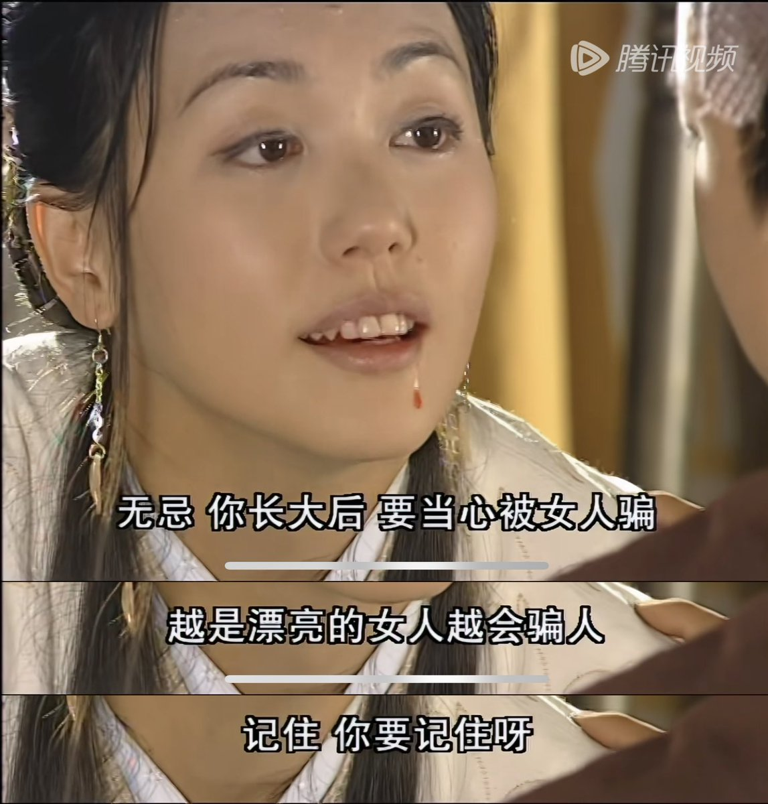

对于那些生了儿子的妈妈们，她们中的绝大部分都注定教不好儿子。根据我的观察，至少有2个原因导致了这个结果：

1.     妈妈们终究不是男性，不能设身处地知晓男性在一生中要面对的挑战与陷阱，非亲历而不可知细节，因此对于儿子的成长其实没有太多真知灼见。

2.     绝大多数妈妈们在儿子的婚恋关系上，往往都会头脑犯浑，摆不正自身的立场，从而犯下大错，既害儿子，也害自己。

第1个原因，当然也是重要原因，但是这个原因由于非常浅显易懂，大多数人一看估计都能明白，因此本文不赘述（绝对不是因为不重要，其实很重要，但太简单的道理就没必要废话了）。

本文重点阐述第2个原因。

正常情况下，当一个家庭中的儿子处于少年期时，妈妈基本都还处于青壮年期，尚未进入中老年期。在教育儿子的婚恋观时，绝大多数妈妈往往都会先自我代入为“妻子”的立场，从而把自己内心里的“妻子对丈夫的期待”，投射到现实，用来教育儿子的婚恋观。这一点大错特错。

**妈妈在教育自己儿子婚恋观时，自身的立场有且只能有一个，那就是“婆婆”的立场，而非“妻子”。**然而，这些妈妈们由于自身尚未进入中老年期，因此没有准备好做婆婆的心态和知识，自身还停留在“妻子”的阶段，因此极其容易摆不正自己应有的立场，用错误的立场，错误的观点教育儿子的婚恋观，这将为儿子的未来埋下大雷。

任何一个妈妈，在面对自己的丈夫时，可以自我带入为“妻子”，这是正常的。当她站在“妻子”的立场，对丈夫提出的期待，无论人们是否支持认同，但至少这个“妻子”的立场是正确的。我们理解不同的人注定会有五花八门的、不同的立场，每个人站在自己的立场看待问题，就算某些结论得不到大众的支持认同，但这种“为自己的立场”考虑问题的思维方式本身是可理解的，符合人性的。

但是，当这个妈妈在面对自己的儿子的时候，就绝不能再站在“妻子”的立场考虑问题，因为对象（儿子）不适用。在你儿子面前，你首先是一个“潜在的婆婆”的身份。在儿子和未来的儿媳之间，只要不涉及大是大非的原则问题，婆婆都应该坚定地和自己儿子站在一边。因为：

1.     你儿子是亲生的，他始终是你儿子。儿子和妈妈之间才是牢牢绑定的利益共同体，一荣俱荣，一损俱损。

2.     儿媳可不一定一直都是你的儿媳，因为她可能会离婚，离了婚就跟婆婆没有任何关系。你再想想现在肉眼可见越来越高的离婚率。

3.     更何况，任何一个男孩的妈妈，潜在的婆婆，对于“婆媳关系”是一种什么关系，难道自己心里没数吗？你知道那些年轻一代的女人们是怎么看待婆婆的吗？如果真不清楚，可以上某音和某书，一搜就有一大堆她们的内心真实想法。

任何一个家庭中，妈妈都是儿子认识的第一个女人，也是儿子成长阶段中最重要的女人，妈妈的教育直接奠定了儿子对女人的态度的基础。

当一个妈妈自我代入为“妻子”的立场时，就会不自觉地教育儿子要对未来的妻子好。然而，这样很容易就会给儿子洗脑，忽视了儿子自己的人生目标。

**对儿子来说，“对妻子好”只是一种手段，而绝不是目标本身。用不用这个手段，用到什么程度，必需因人而异，不能一概而论。**然而如果妈妈们一味地洗脑儿子“要对妻子好”，那就是在坑儿子，一旦儿子成年后遇人不淑，那就很容易踩坑。

妈妈应该教育儿子，要确定自己的人生目标。儿子是否要对自己的妻子好，那也要看这么做是否有利于达成自己的人生目标。而这个人生目标，绝对不包括“成为她人的垫脚石”。这才是一个“婆婆”应有的立场。

然而事实却是，太多的妈妈们头脑犯浑，没有意识到自己其实应该站在“婆婆”的立场，反而站到了“妻子”的立场上去，在儿子很小的时候就给他灌输了片面的观点，这种教育方式就是亲手给儿子埋雷。这个雷以后爆不爆，完全看儿子的运气，看遇到的是什么女人。

这里提供一个正面的例子。虽然这个例子是虚构的，但道理是相通的，并且这个例子传播度很广，很多人都听说过，因此很适合拿来举例。那就是金庸小说《倚天屠龙记》里的殷素素。

殷素素就是一个非常聪明，非常摆得正自己立场的妈妈。殷素素临死前，给自己儿子留下的教育就是“儿子你要小心女人，尤其是越漂亮的女人越会骗人。”

殷素素作为一个女人，而且也是爱骗人的女人，但是在面对自己亲儿子的时候，她的头脑就很清醒，对儿子要教真本事，绝对不讲“儿子你以后要对妻子好”之类的蠢话，反而教儿子以后要小心女人，尤其是美女。这就是一个妈妈对儿子的正确的、有效的、聪明的教育。她就摆得正自己的立场，认识到自己首先是一个男孩的妈妈，一个潜在的婆婆，才会这么教自己儿子。

有些人估计要抬杠，妈妈们这么教儿子防备女人，这种防备心是否过激了？

是否过激，要看大环境，看时代背景。

1.     如果处在天下太平，人人温良恭俭让的和谐社会，那么过度防备当然不理想。但问题是，这种近乎乌托邦式的理想世界往往不存在。你觉得现在的世界是这种和谐社会吗？

2.     如果是处在社会剧变阶段，人与人之间充满了算计和斗争，那么拥有防备心就是利大于弊。

我们要清楚地知道自己是谁，处于什么立场，谁是我们的盟友，谁是我们的敌人，这些才是考虑很多问题的最重要的前提。

妈妈们如果不把自己的立场想清楚，不在自己还年轻，儿子还小的时候就意识到自己其实应该处于“婆婆”的立场，那么就注定无法教育好儿子。
