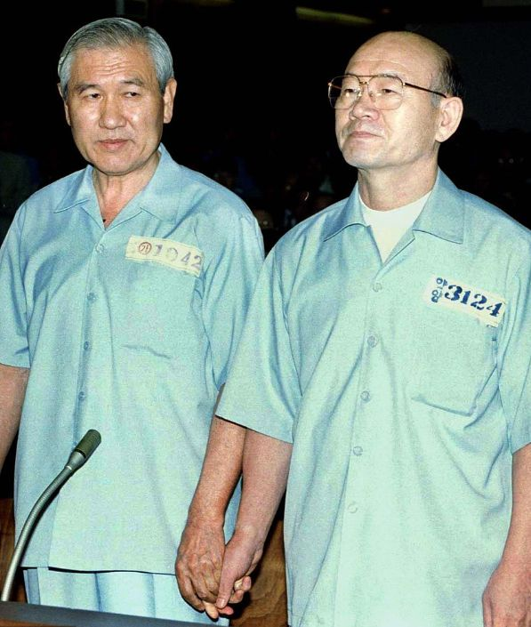

> 원문: [大韩民国第五共和国（10）兄弟一生一起走](https://lucius.caelumfamily.com/blog/sk510/) · 2025-02-04 · 글: 神通LC

전두환과 노태우는 동향으로, 사관학교 때부터 알던 사이였고 그때 두 사람은 같은 방을 쓰는 룸메이트였다. 그때부터 두 사람은 좋은 형제였다. 졸업 후 전두환은 처세에 능해 일찍 박정희 대통령의 신임을 얻었고, 그 덕에 같은 기수 동기들보다 승진이 빨라 줄곧 하나회에서 두목 자리에 있었다. 노태우는 전두환 뒤를 따라 2인자 역할을 했다. 대개 전두환이 승진하면 노태우를 자기 자리에 추천했다. 그래서 두 사람이 알게 된 지난 수십 년 동안 관계가 각별했고, 늘 전두환의 지위가 노태우보다 높았다. 1987년 대선에서 노태우가 한국 제13대 대통령이 되고 전두환이 권력을 넘겨 전직 대통령이 되면서 두 사람의 지위가 바뀌었고, 이 변화에 두 사람 모두 잘 적응하지 못했다.

전두환의 입장에서 보면, 노태우와는 수십 년지기 좋은 형제이고, 이번 대선에서 그를 위해 정말 전력을 다했으며, 심지어 노태우가 자기 부패 행위를 청산하겠다는 말까지 공개적으로 약속하게 내버려 두었다. 전두환은 자기가 노태우에게 의리는 하늘에 닿을 만큼 다했으니, 정으로나 이치로나 노태우가 이 형제의 정을 갚아야 하고, 두 형제는 계속 한국의 최고 권력을 나눠 가져야 한다고 여겼다. 그래서 전두환은 퇴임 전에 '국가원로자문회의'를 만들어, 퇴임 후 이 원로회를 통해 정국에 영향력을 행사하려 했다.

그러나 노태우에게는 자기 생각이 있었다.

노태우는 자기 선거 과정에서 전두환이 힘을 많이 보탠 것은 사실이지만, 자기는 어쨌든 전 국민 선거로 뽑힌 대통령이고 권력의 원천은 전 국민의 투표 지지이지 전두환이 아니며, 권력은 오직 권력의 원천에만 책임진다고 여겼다. 대통령 권력을 전두환이 준 것이 아닌 이상, 자기가 전두환에게 책임질 이유도 없다는 것이다.

더구나 인간의 본성은 복잡해 권력을 나누려는 사람은 없다. 노태우와 전두환이 수십 년지기 좋은 형제라지만, 친형제도 재산을 나눌 때는 적지 않게 원수가 되는데, 하물며 대통령이라는 최고 권력이겠는가. 아무도 이런 권력을 남과 나누려 하지 않는다. 수십 년지기 좋은 형제라도 이런 인간 본성의 시험을 견디지는 못한다. 그래서 전두환이 정국에 간섭하겠다는 뜻을 내비치자 노태우는 본능적으로 위협과 반감을 느꼈다.

다만 전두환은 당시 형세를 분명히 잘못 짚었다. 노태우가 대통령이 되었어도 민간의 전두환 성토가 잠잠해질 리 없었고, 전두환이 무사히 퇴임하는 것만 해도 다행인데 권력을 계속 쥐겠다는 것은 사치였다.

이에 노태우는 민심을 이용해 흐름을 탔다. 먼저 언론과 손잡아 언론이 전두환의 '국가원로자문회의'를 공개 비판하게 하고, 이어 전두환 친척의 부패 행위를 조사해 처벌했다. 이제야 전두환은 현실을 조금 깨달았는지 곧 '국가원로자문회의' 직을 사임하고 현 정권에 간섭하리라는 환상을 버렸다.

이어 1988년 4월 한국은 다시 총선을 치렀고, 결과는 야당 의석이 여당을 넘어섰다. 노태우는 취임하자마자 '여소야대'의 불리한 국면을 맞아 자기 정권에 큰 위협을 받았다. 삼김은 대통령이 되지는 못했지만 삼김의 정당이 국회에서 주요 의석을 차지해 여전히 연합해 노태우에게 큰 압력을 가할 수 있었다. 그래서 삼김은 계속 전두환 집권기의 부패 행위 청산과 광주 사태 조사를 요구했다.

이때 노태우는 진퇴양난이었다. 주관적 의향으로는 전두환이 자기 권력에 간섭하지 않기를 바랄 뿐, 수십 년지기 형제를 청산할 동력은 없었다. 더구나 전두환과의 관계상 전두환의 문제를 정말 낱낱이 캐내면 자기 자신도 비린내를 피할 수 없었다. 그러나 삼김이 국회 다수 의석을 장악하고 거대한 민심의 지지까지 받았으니, 노태우가 삼김에 타협하지 않으면 대통령 자리도 지키기 어려웠다.

전두환 청산 문제에서 노태우는 청산하지 않으면 안 되고, 철저히 청산해도 안 되었다. 그래서 남은 선택은 하나뿐이었다. 전두환의 부차적인 문제 몇 가지를 적당히 조사해 처벌 수위를 가볍게 하고, 그것으로 야당과 민간에 명분을 내보이는 것, 곧 '명벌실보(明罰實保)', 비교적 가벼운 처벌로 철저한 청산을 피해 전두환을 지키는 전략이었다.

그리하여 전두환과 노태우 양측의 일련의 실랑이와 협상 끝에 전두환도 점차 현실을 받아들여 합의에 이르렀다.

1. 전두환은 공개적으로 사죄 성명을 발표한다.
2. 전두환은 개인 재산 '전부'와 남은 정치 자금 139억 원을 내놓는다. (실은 이 돈은 전두환의 전 재산이 결코 아니었다. 그의 재산은 적어도 2,000억 원 이상이었다. 게다가 이 139억 원 가운데 50억은 노태우 정부가 대준 돈이었다.)
3. 전두환은 서울을 떠나 강원도 백담사에 은거한다.

이렇게 해서 1988년 11월 23일 전두환은 서울 자택에서 사죄 성명을 발표한 뒤 아내와 함께 백담사로 갔다. 신체의 자유를 다소 잃기는 했지만 백담사는 명승고적이자 관광지여서, 백담사에 은거하는 것이 감옥살이보다는 나았다. 전두환은 백담사에서 2년 남짓 지내다 1990년 12월에야 서울로 돌아왔다.

그 대가로 노태우도 야당의 압력을 견디며 일을 거기서 끝냈고, 자기 재임 중에는 더 이상 전두환의 문제를 추궁하지 않았다.

그러나 노태우가 한때는 막을 수 있어도 끝까지 막을 수는 없었다. 노태우가 한 임기를 마치고 1993년 삼김 가운데 김영삼이 대통령 자리를 이어받으면서, 하나회 사람들의 좋은 시절도 끝났다.

김영삼 재임 중 전두환과 노태우의 죄를 추궁하는 수사가 시작되었다. 1996년 8월 26일 서울지방법원은 군사반란과 내란에 주도적으로 가담한 죄, 상관 살해 미수, 수뢰 등의 죄목으로 전두환에게 사형과 2,205억 원의 추징금을 선고했고, 같은 죄목으로 노태우에게 징역 22년 6개월과 2,628억 원의 추징금을 선고했다. 한국이 이렇게 전직 대통령 두 명을 동시에 재판한 것(게다가 전두환은 사형이었다)은 국제적으로도 보기 드문 일이어서 큰 파문을 일으켰다.

 

*피고석의 노태우와 전두환. 두 사람은 손을 맞잡고 재판을 받았다.*

1996년 12월 서울고등법원은 전두환의 사형을 무기징역으로 바꾸고 노태우의 형량을 17년으로 낮췄다. 고등법원 판사는 전두환이 대통령 재임 중 경제 발전에 큰 공이 있고, 당시 다음 사람에게 평화적으로 권력을 넘기며 저항하지 않았다며, '항복한 장수는 죽이지 않는다'는 옛말을 인용해 전두환을 죽여서는 안 된다고 보아 무기징역으로 감형했다. 다만 솔직히 말해, 전두환이 군대에 뿌리 깊은 세력을 두고 보수파 기본 지지층도 여전히 큰 영향력을 가졌기에, 김영삼 대통령이든 판사든 정말로 전두환을 죽일 엄두는 내지 못했을 것이다.

전두환과 노태우도 오래 수감되지는 않았다. 1997년 12월, 당시는 김영삼 대통령 임기 말기였고 김대중이 차기 대통령 자리를 이어받을 것이 확정된 상태였다. 이때 김대중은 김영삼에게 전두환과 노태우 두 전직 대통령을 사면하라고 건의했다.

김대중이 이 두 오랜 상대를 사면하려 한 데에는 첫째, 당시 아시아 금융위기 시기여서 전두환·노태우 두 사람을 사면해 그들 뒤의 보수 세력을 결집하고 모두 힘을 합쳐 금융위기의 난관을 함께 넘어서려 했기 때문이다.

둘째, 김대중이 매우 착하고 너그러운 사람이었기 때문이다. 그는 삼김 가운데 사덕(私德)이 가장 고매했다. 사실 삼김 가운데 김대중이 정치적 박해를 가장 많이 받았고 전두환(그리고 박정희)에게 복수할 자격이 가장 있었다. 김대중은 박정희와 전두환 두 군사정권 대통령과 반생을 싸우며 여러 번 죽을 고비를 넘겼다. 미국과 일본이 한국 정부를 견제하지 않았다면 김대중은 전두환 재임 때까지 살아남지도 못했고, 박정희 시대에만 해도 몇 번은 죽을 수 있었다. 그러나 김대중은 평생 '경천애인(敬天愛人)'을 삶의 이념으로 삼아 사람을 너그럽게 대했다. 1980년 전두환 재임 때 김대중에게 사형이 선고되었는데, 당시 김대중은 피고석에서 엄숙히 말했다. "나는 이 자리에서 여러분에게 유언을 남깁니다. 훗날 민주 정부가 수립되거든 절대로 정치적 보복을 해서는 안 됩니다. 이 나라의 독재자는 거듭 정적에게 잔혹한 정치적 보복을 남발했습니다. 우리는 우리의 힘으로 이런 보복의 역사를 끝내야 합니다. 정치적 보복은 나로 끝내겠습니다!"

김대중은 그해 '정치적 보복은 나로 끝내겠다'고 말했고, 자기가 대통령이 되자 정말로 그 약속을 지켜 정치적 보복을 하지 않고, 자기에게 사형을 선고했던 전두환(그리고 노태우)을 사면했다. 이렇게 덕으로 원한을 갚는 흉금과 기량, 그리고 정치적 지혜에 전두환조차 감복했다. 김대중이 말년에 병이 깊어지자 전두환은 병원까지 문병을 갔다.

전두환과 노태우는 사면된 뒤 집으로 돌아가 말년을 보냈다. 말년의 노태우는 건강이 좋지 않아 오래 집에서 요양했고, 광주 사태에 대해 뉘우침을 표했으며, 법원이 선고한 추징금을 성실히 납부했다.

반면 전두환은 말년에 건강이 괜찮아 정기적으로 옛 형제들과 모임을 갖고, 이따금 하늘과 땅과 광주를 향해 윽박질렀다. 한편으로는 추징금을 낼 돈이 없다고 하면서(실은 꽤 많은 돈이 있었다) 다른 한편으로는 골프를 치고 회고록을 썼으니, 말년의 삶의 질은 괜찮았다. 전두환은 이런 성격이라 속으로 자책하며 스스로를 갉아먹지 않았다. 이런 성격은 평가가 좋지 않지만 건강하게 오래 사는 데에는 유리하다.

2021년 노태우와 전두환이 잇달아 세상을 떠나면서, 제5공화국의 모든 것이 마침내 끝났다. 이 두 형제는 지위가 대략 평등하거나 전두환이 노태우보다 조금 높았던 시기에는 관계가 원만했다. 다만 노태우가 대통령이던 시기에 노태우가 전두환보다 높은 관계에 두 사람 모두 적응하지 못해 관계가 한때 매우 긴장했다. 그러나 나중에 두 사람은 함께 감옥에 갇히고 함께 사면되면서, 이전의 비교적 평등했던 형제 관계로 돌아간 듯했다. 전체적으로 보면, 전두환과 노태우는 한평생의 형제라 할 만하다.

나라는 모두 사람으로 이루어진다. 대한민국 제5공화국을 떠올리면 사람들은 무엇을 생각할까?

나라 발전만을 위해 애썼지만 수단이 잔혹하고 강경했으며 끝내 뜻을 이루지 못한 박정희일까?

큰 뜻은 없이 권력과 이권만 탐했지만 어쩌다 보니 정작 성과는 꽤 괜찮았던 전두환일까?

전두환 뒤에서 인내하며 낮은 자세로 따르다 마침내 대통령 자리를 얻은 노태우일까?

아니면 민주를 위해 백절불굴로 항쟁했지만 서로 적이자 동지였던 삼김일까?

혹은 나라와 백성을 위해 애쓴, 재주가 뛰어났지만 하늘이 시기한 김재익 수석일까?

그리고 3허 1이, 장세동과 노신영, 하나회 사람들 등 5공 시기의 다른 인물들일까? 이 인물들은 절대적인 흑이나 백이 아니라 회색이다(김 수석만은 흠이 전혀 없는 백이라고 할 만하다). 바로 이 성격이 제각각인 갖가지 인물들이 함께 파란만장한 대한민국 제5공화국을 이루었다. 회색의, 현실적인 어른들의 정치 우화다.

*(대한민국 제5공화국 시리즈 완결)*
