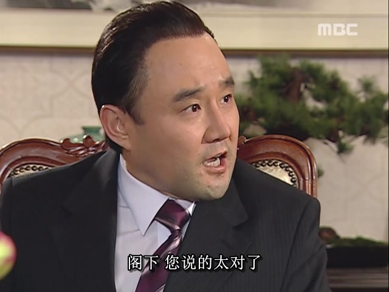
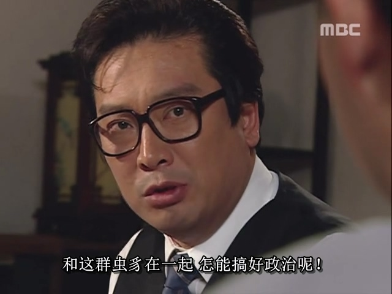

> 원문: [大韩民国第五共和国（1）正熙遇刺半岛惊](https://lucius.caelumfamily.com/blog/sk51/) · 2025-02-04 · 글: 神通LC

한국 현대정치는 동아시아 정치의 특징을 이해하는 더없이 좋은 출발점이다. 한편으로 동아시아 3국은 문화의 뿌리가 같아(일본과 한국의 문화는 중국의 영향을 깊이 받았다) 국민들의 사고방식과 행동양식에 공통점이 많고, 서로를 거의 막힘없이 이해한다. 다른 한편으로 가장 중요한 점은, 한국은 특수한 국정 때문에 각 세력의 투쟁이 치열하고 후임이 전임을 청산하는 일이 끊이지 않았다는 것이다. 청산이 거듭될수록 전임 정권의 사건들이 극히 상세하게 폭로되었고, 고위 정치의 디테일을 이렇게 적극적으로 드러내는 특징은 전 세계적으로도 보기 드문 일이다. 덕분에 대중은 한국 현대정치의 자잘한 부분까지 알 수 있게 되었으니, 이는 참으로 귀한 일이다.

한국 정치사를 이해하려면 역대 대통령의 행적을 보면 된다. 한국의 대통령들을 보면, 존재감이 상대적으로 옅은 몇몇 권한대행(윤보선 대행, 최규하 대행)을 빼고는 모두 개성이 강하고 화제성도 넘친다. 가장 못하다고 공인된 윤석열조차 못하는 수준도 범상치 않아, 못함의 새 경지를 열었다.

개성이 넘치는 한국 대통령들 가운데 내 개인적으로 가장 이야기할 만한 인물은 대한민국 제5공화국의 전두환일 것이다.

다만 제5공화국을 말하자면 제4공화국의 결말, 곧 박정희의 죽음에서 시작하지 않을 수 없다.

박정희(1917년 11월 14일~~1979년 10월 26일)는 호가 중수(中樹)이며 대한민국 제5~~9대 대통령이다. 한국 헌정사에서 집권 기간이 가장 긴 국가원수였고, 한국 제18대 대통령 박근혜의 아버지이기도 하다.

이 연재는 주로 '5공'의 이야기를 다루므로, '4공'에 관한 전사(前史)는 되도록 짧게 줄이겠다.

박정희는 말년에 쿠데타를 일으켜 종신 대통령제, 곧 독재를 실시했는데, 그 독재 통치에는 두 개의 기둥이 있었다.

1. **고속 경제성장.** 박정희 집권기 동안 한국은 찢어지게 가난한 농업국에서 초기 공업국으로 도약했고, 1인당 국민총생산은 1961년 82달러에서 1979년 1644달러로 늘었다. 박정희는 이 때문에 '한강의 기적을 만든 사람'으로 불린다.
2. **정보 통치.** 정보기관을 통해 정국을 장악하고 반대 세력을 제거하여 박정희의 지위를 지키는 것이다.

1979년이라는 시점에서 박정희가 정보 통치를 위해 의지한 인물은 다음 세 사람이었다.

1. 중앙정보부(한국판 CIA로, 주로 국내외 전략정보를 수집했다)의 **김재규**.
2. 경호실(본래 임무는 대통령의 신변 보호였지만, 박정희 말년의 독재로 더 많은 기능이 덧붙여졌다)의 **차지철**.
3. 보안사령부(주로 군 내부의 정보기관)의 **전두환**.

독재자로서 박정희는 이 세 부하를 부려 서로 견제하게 하며 자신의 절대적 지도자 지위를 지켰다. 세 사람 가운데 차지철과 전두환은 박정희에게 절대적으로 충성했고, 동향인 김재규도 한때는 충성했을 것이다. 그러나 뒤에 차지철과 총애를 다투다 밀리면서(차지철은 지도자의 1호 아부꾼이라 아부의 정도가 남달랐고, 김재규는 그 아부 경쟁에서 그를 이길 수 없었다) 김재규의 충성은 끝내 절대적이지 않게 되었다.

1979년, 한 시위 운동이 박정희와 김재규의 갈등을 크게 격화시켰다.

간단히 말해, 당시 제1야당 총재 김영삼(이 이름은 동그라미 쳐 두자. 한국의 유명한 '삼김' 가운데 한 사람이며 수십 년간 한국 정계에서 활약한 얼굴이다)이 박정희의 독재에 반대해 개헌을 요구한 데다 'YH무역' 노동자 투쟁까지 지지하자, 박정희는 김영삼의 국회의원 자격을 박탈하도록 지시했다.

김영삼이 국회에서 제명되자 한국 정계는 발칵 뒤집혔다. 김영삼의 정치적 근거지인 부산·마산·창원 등지에서는 대규모 시위가 벌어졌으니, 이른바 '부마항쟁'이다. 김영삼의 표밭인 부산·마산 등지의 한국인들이 앞다투어 거리로 나섰다.

부마항쟁을 어떻게 진압할 것인가를 두고 중앙정보부장 김재규는 분명히 겁을 먹었다. 상대편의 민심이 들끓고 인파가 어마어마한 것을 확인한 그는 두려움에 사로잡혀 강경 진압에 나서지 못했다.

반면 쿠데타로 집권한 전직 군인인 박정희 대통령은, 우선 성격의 바탕 자체가 강경했다. 다른 한편 독재자는 말년이 되면 점점 냉혹해지고 점점 '외로운 군주'가 되기 마련이니, 옛날 황제와 비슷하다. 오랜 독재 통치는 필연적으로 박정희에게 수많은 적을 만들었고, 그는 이런 강경한 태도와 실력을 끝까지 유지해야만 곳곳의 반대 세력을 눌러 둘 수 있었다. 조금이라도 타협하거나 약해진 기색을 보이면 적지 않은 반대 세력이 꿈틀거릴 것이 뻔했다. 그러니 독재자 박정희가 계속 강경 노선을 택한 데에는 성격 탓도 있었겠지만, 자기 보신을 위한 현실적 필요도 있었을 것이다.

1호 아부꾼 차지철은 어떠했을까? 당연히 "각하의 판단이 옳습니다"라고 했다. 지도자가 하겠다고 하면 차지철은 전력으로 실행하겠다고 했다.

 

*차지철.*

게다가 김재규와 차지철은 평소에도 자주 부딪혔다. 차지철은 박정희의 총애를 얻은 것을 믿고 김재규를 온갖 방식으로 무시했다. 게다가 김재규는 선배, 차지철은 후배였다. 한국 문화에서는 상하 서열을 유난히 따져서, 후배가 선배에게 존댓말을 쓰지 않는 것만으로도 큰일인데, 후배 차지철의 온갖 무례에 김재규가 격노한 것은 당연했다.

김재규는 박정희의 신임을 잃고 해임되어 이 권력투쟁의 패자가 될지도 모른다는 생각을 점점 굳혔다. 그는 앉아서 죽을 수 없다고 여겼고, 먼저 나서기로 마음먹었다. 박정희를 암살하고, 그 1호 아부꾼도 없애 버리는 것이다(이쪽이 오히려 더 큰 이유였을지 모른다). 생각이 여기에 미치자 그는 급하게 행동에 옮겼다. 날짜는 바로 그날, 1979년 10월 26일 저녁, 박정희가 '성대하게' 베푸는 술자리에서 암살을 감행하기로 했다.

이른바 '성대하게'란, 중앙정보부가 정기적으로 박정희의 술자리를 마련하고, 박정희와 몇몇 측근 고위 관료, 그리고 술을 따르고 노래를 부르는 미녀 몇 명이 참석하는 것을 말한다.

1979년 10월 26일 밤의 '성대한 자리'에는 박정희와 그림자처럼 붙어 다니는 1호 아부꾼 외에 김재규도 참석했다. 자리에서 박정희가 부마항쟁의 진전을 물으며 김재규의 무능을 또 꾸짖었고, 1호 아부꾼도 예상대로 불을 붙이며 김재규를 공격하는 데 가세했다. 결국 김재규가 폭발했으니, 그 유명한 대사가 여기서 나왔다.

 

*김재규의 이른바 '명대사' 장면.*

그리고 김재규는 권총을 꺼내 최고 지도자 박정희와 1호 아부꾼 동료를 그 자리에서 쏘아 죽였다. 많은 직장인들이 꿈꾸지만 감히 하지 못하는 일을 해치운 것이다. 아부꾼이라는 생물은 어디를 가든 미움을 산다는 생각이 든다.

한국의 드라마와 영화는 김재규를 독재에 반대하고 민주화를 이끈 '거대한 인물'로 그리기를 좋아한다. 이는 입장이 머리를 결정하는 셈이니, 실은 객관적이지 않고 역사에 어긋난다. 오늘날 한국에서 민주를 지지하고 군사정권에 반대하는 것은 절대적 정치적 올바름이며, 게다가 드라마·영화 뒤의 자본인 재벌은 군사정권을 미워하면서도 두려워한다(군사정권의 몇몇 대통령이 재임 중 재벌들에게 PTSD를 안겨 주었다). 그래서 이 소재를 다룬 모든 작품은 군사정권, 특히 전두환을 철저히 깔아뭉갠다. 이런 '반군사정권' 기조 아래 박정희를 암살한 김재규는 제작자의 입장을 드러내는 도구가 되었고, 마음대로 미화할 수 있는 '민주 상징'이 되었다. 그러나 역사 속 실제 김재규를 두고 '민주를 위해'라고 하기는 어렵다. 여러 요인이 한데 겹쳐 순간적으로 치솟은 감정에 머리가 뜨거워진 채, 깊이 생각하지 않고 급하게 손을 댄 쪽에 가깝다.

객관적으로 말해 김재규의 이번 암살은 한국의 역사적 경로를 바꾸었고, 여러 세력에 막대한 이익을 안겼다.

1. **가장 먼저 이득을 본 것은 전두환이다.** 박정희와 경호실장 차지철이 죽고, 중앙정보부장 김재규도 곧 체포되어 진상이 밝혀진 뒤 얼마 지나지 않아 처형되면서 한국의 고위 권력 기구는 순식간에 큰 혼란에 빠졌다. 대통령, 경호실, 중앙정보부 세 자리가 모두 기능을 잃었고, 세 정보 통치 기구 가운데 보안사령부만 남아 전두환 일파는 아무 손실 없이 오히려 이번 암살 사건 수사의 최전선에 밀려 올라갔다. 김재규의 암살은 전두환이 최고 권력의 자리로 가는 길을 치워 주었으니, 신의 한 수였다(물론 김재규의 본심은 결코 아니었다).
2. **민주 인사들도 이득을 보았다.** 박정희는 18년 동안 대통령 자리를 잡고 있었고 그 독재는 당시로서는 흔들기 어려워 민주파는 도저히 막을 수 없었다. 그런데 김재규가 폭력으로 박정희의 통치를 끝장냈고, 박정희가 죽은 뒤 민주 인사들은 희망을 보고 민주화 운동의 절정을 일으켰다. 그 시기를 '서울의 봄'이라 부르며, 민주파는 한때 승리에 가까이 갔지만 전두환이 나서면서 패했다.
3. **가장 기묘하고, 또 가장 어처구니없는 것은 피살된 박정희 본인도 이득을 보았다는 점이다.** 당시 박정희는 이미 부마항쟁에 강경 진압을 가하기로 결정해, 백성이 무수히 죽고 다쳐도 개의치 않을 작정이었다(말년의 박정희는 갈수록 독단적이고 잔혹해졌다). 그 일이 실제로 벌어졌다면 박정희의 역사적 평가는 전두환보다도 낮아졌을 가능성이 크다. 그런데 김재규가 박정희로 하여금 어쩔 수 없이 '벼랑 끝에서 고삐를 당기게' 만들었고, 그래서 그 일은 일어나지 않았으니, 결과적으로 박정희의 역사적 평가를 구해 준 셈이다. 지금 한국인들이 공인하는 최고의 대통령은 여전히 박정희, 중국 누리꾼이 '박카카'라 부르는 그 사람이다. 이 점에서 보면 박정희 본인도 이 사건 덕을 본 쪽에 속한다.

이상이 대한민국 제5공화국의 전사다. 김재규는 개인적 원한과 정치적 견해 차이 때문에 박정희를 암살했고, 뜻하지 않게 전두환에게 시집갈 옷을 지어 주어 그를 역사의 무대 위로 밀어 올렸다. 그뿐 아니라 김재규는 무심코 '사람을 돕는다면 끝까지 돕는' 셈까지 해 주었다. 암살 당일 밤의 '성대한 자리'에 또 다른 고위 관료, 한국 육군참모총장(육군의 일인자) 정승화, 곧 정 총장을 귀신에 홀린 듯 초대한 것이다. 바로 이 초대가 전두환에게 다시 큰 도움을 주었다. 여기서 제5공화국의 첫 번째 하이라이트, 전두환과 그의 형제들이 인생에서 가장 빛났던 순간인 12·12 사태가 이어진다.
