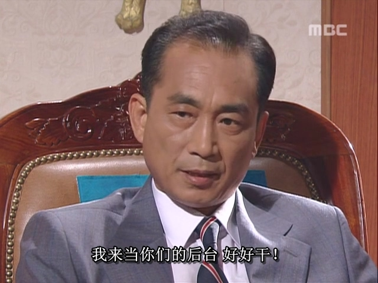
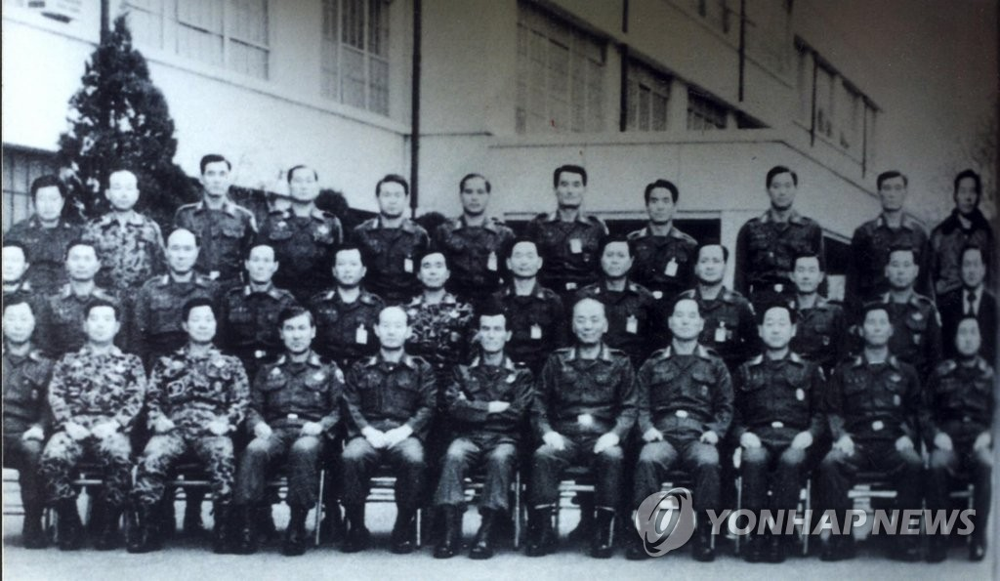

> 원문: [大韩民国第五共和国（2）兄弟一心共进退](https://lucius.caelumfamily.com/blog/sk52/) · 2025-02-04 · 글: 神通LC

김재규의 박정희 암살은 치밀한 계획이 없었고 오히려 곳곳에 허점을 드러냈기에 곧바로 탄로 났고, 그날 밤 체포되었다. 이어 남은 한국 고위 관료들의 급한 일은 계엄을 선포하고, 보안사령관 전두환에게 박정희 피살 사건의 진상을 밝히고 김재규의 공범을 추적하는 일을 전권으로 맡기는 것이었다.

이렇게 해서 한국 제일의 좋은 형님, 5공의 제1주인공 전두환은 역사의 물결에 휩쓸려 무대 앞으로 나오게 되었다.

박정희의 갑작스러운 죽음은 한국의 최고 권력을 진공 상태에 빠뜨렸고, 권력은 진공을 싫어한다. 여러 세력이 때를 같이해 최고 권력의 자리를 노렸다. 권력의 게임에서 참가자 모두에게 주어진 결말은 '앞으로 나아가 승리하기'와 '투쟁에 패해 권력을 잃기' 둘뿐이며, 현상 유지를 바라는 것은 불가능하다. 12·12 사태는 바로 이런 배경에서 필연적으로 일어난 사건이었다.

12·12 사태가 일어난 이유를 한마디로 설명하면, 중국인이라면 누구나 아는 그 말이다. "천자가 바뀌면 신하도 바뀐다."

전두환은 오래전 군 안에 비밀 조직 하나회를 만들었다. 전두환을 핵심으로 하는 소장파 장교들의 작은 모임으로, 하나회 구성원들은 박정희에게 충성했기에 군 안에서 박정희의 측근으로 여겨졌다.

박정희가 살아 있을 때 그는 하나회의 배경이었기에 군의 다른 거물들도 하나회 구성원을 건드리기 어려웠다. 그러나 이제 '천자' 박정희가 죽었으니 천자가 바뀌면 신하도 바뀌어야 했다. 육군의 일인자인 참모총장 정승화는 자신의 통제를 받지 않는 '전왕조의 신하' 집단인 하나회를 제거하기 시작했고, 그 선두에 선 것이 하나회의 두목 전두환이었다.

당시 상황은 이러했다. 정 총장 쪽은 권력의 우위를 점했다. 그가 육군의 일인자로서 군 인사에 큰 영향력을 행사했기 때문에, 정 총장은 정규 절차를 밟아 하나회 구성원을 차례로 한직으로 옮겨 실권을 빼앗고 하나씩 격파할 작정이었다.

반면 전두환 쪽은 무력의 우위를 점했다. 하나회 구성원 다수가 군에서 중·고급 장교로 복무하며 군대를 움직일 권한을 가진 실권 무관이었다. 하나회가 여러 해에 걸쳐 세력을 키운 덕에 수도권 인근 군대의 대부분을 하나회 구성원들이 장악하고 있었다.

권력의 밑바탕(가운데 하나)은 바로 무력이지, 허명뿐인 직책이 아니다.

전두환 쪽도 곧 소문을 접하고 정 총장과의 갈등이 피할 수 없게 되었음을 알았다. 보안사령부의 부하 '2허 1이'(허화평, 허삼수, 이학봉, 이들도 하나회 구성원이다)의 건의에 따라 전두환은 선수를 치기로 했다. '내란 방조죄' 명목으로 정 총장을 비밀리에 체포하고, 그를 박정희 피살 사건에 끌어들여 상대를 무너뜨리는 것이다.

여기서 김재규가 전두환에게 큰 도움을 주었다는 점을 되짚어야 한다. 박정희를 암살한 그날 밤, 김재규는 귀신에 홀린 듯 정 총장을 연회에 초대했다. 당시 정 총장은 박정희와 같은 방에 있지는 않았지만 같은 건물 안에 있었으므로, 아슬아슬하게 '현장에 있던' 사람이 되었고, 이것이 전두환이 트집을 잡을 여지를 주었다. 김재규가 박정희를 암살한 것은 내란죄에 해당하고, 정 총장은 김재규의 초대로 그 현장에 함께 갔으니, 전두환은 정 총장에게 '내란 방조죄'를 씌울 수 있었다. 어떻게 방조했는지는 기술적 문제일 뿐, 부하들에게 심문을 맡기면 어떤 진술과 증거든 어렵지 않게 만들 수 있었다. 무력으로 승리해 정 총장만 붙잡으면 이런 기술적 문제는 모두 사소한 일이었다. 결국 역사는 승자가 쓰는 법이다.

정 총장은 자신이 규칙 안에서 전두환 일당을 죽일 수 있다고 생각했지만, 전두환이 그와 규칙을 두고 놀아 줄 필요 없이 곧바로 무력으로 판을 깰 수 있다는 것은 몰랐다. 무력이 충분히 강하면 규칙이란 깨라고 있는 것이다.

전두환은 1979년 12월 12일 하나회의 핵심 형제들을 불러 서울 경복궁 안에 모이게 한 뒤 함께 한국 근대사에서 가장 성공한 쿠데타, 12·12 사태를 일으켰다. 먼저 기습적으로 정 총장을 체포하고, 다음으로 쿠데타 반대파 군인들을 꺾고, 승패가 갈린 뒤에는 대통령 권한대행(최규하 대행)에게 정 총장 체포 영장에 서명하도록 압박해 합법적 절차를 마무리했다. 하룻밤 사이에 군대의 판이 뒤집힌 것이다.

한국에서는 2023년 영화 《서울의 봄》이 개봉했는데, 이야기의 원형이 바로 이 12·12 사태다. 그러나 영화 전체에서 사실인 것은 시작과 결말뿐이고 과정은 모두 지어낸 것이다. 실제 12·12 사태는 영화처럼 파란만장하고 반전이 거듭되지 않았고, 오히려 전두환이 거의 일방적으로 우위를 점했다. 전두환이 이길 수 있었던 데에는 주로 다음과 같은 이유가 있다.

1. **하나회 구성원들의 단결력이 대단했다.** 일시적인 좌절에도 물러서지 않고 오히려 전두환 주위에 굳게 뭉쳐, 형제는 한마음으로 함께 살고 함께 죽었다.
2. **군에는 중립파가 많았다.** 그들은 전두환의 권력 장악에 반대하지 않았고, 쿠데타 당일 밤에는 "나와 무관하다"며 팔짱을 끼고 누가 이기면 누구를 도왔다. 실제로 전두환은 승리한 뒤 이 중립파 장군들에게 꽤 잘해 주었다.
3. **미국의 핵심 이익은 한반도의 안정이었다.** 한국 쪽에서 누가 권력을 잡든 미국에 큰 문제는 아니었지만, 한국군이 내분으로 서로를 죽이고 북한이 남침하도록 유인한다면 미국은 절대 받아들일 수 없었다. 그래서 이 쿠데타에서 미국은 전두환 일파를 진압하는 쪽을 지지하지 않았다.
4. **정 총장 쪽 인원은 많지 않았다.** 수도경비사령부의 장태완과 특전사령부의 정병주만이 끝까지 전두환에 반대했는데, 이 두 장군은 운도 없어서 부하 장교 대부분이 전두환의 부하였다. 쿠데타 당일 밤 그 부하들이 모두 전두환을 지지하러 달려가자 장태완과 정병주는 쓸 병력이 없었다. 심지어 더 황당한 것은 두 사람이 마지막에 부하들의 배신으로 체포되었다는 점이다. 상명하복이 절대적인 군대에서 이는 참으로 진기한 광경이었다. 이를 보면 전두환이 군에서 얼마나 인망이 두터웠는지 알 수 있다. 부하들이 전 형님을 위해 자기 직속 상관을 배신했으니 말이다.

《서울의 봄》은 전두환을 깎아내리고 군사정권을 깎아내리기 위해 여러 장면을 지어냈다. 예컨대 영화 속 전두환은 1공수여단의 여단장인 부하에게 자기 부대를 서울로 끌고 오라고 시키고, 부하가 마다하자 총으로 협박해 "나를 죽이든가, 돌아가서 병력을 끌고 오든가" 둘 중 하나를 고르라고 한다. 영화가 그려 낸 하나회는 이익으로만 뭉친 오합지졸이라 어려움만 생기면 발을 빼는 집단인데, 실제는 그렇지 않았다.

실제로는 이랬다. 전두환이 1공수여단의 부하에게 돌아가 병력을 이끌고 서울로 오라고 하자, 부하는 두말없이 곧바로 갔고 목숨을 걸고 전두환과 함께 나아갔다. 전두환이 3공수여단의 부하에게 자기 직속 상관을 체포하라고 하자, 부하는 잠깐 망설였을 뿐 곧 결심하고 실행했다. 전두환의 동기이자 '평생의 동지'인 노태우는 전두환이 입을 열기도 전에 자신이 지휘하는 전방 부대, 한국군의 간판 '백마부대'를 불러들였다. 미군의 동의 없이 전방 부대를 움직이는 것은 노골적인 군기 위반이었다(한국군 전방 부대는 북쪽의 북한을 경계해야 했다). 노태우 역시 목숨을 걸고 전두환과 함께했다. 요컨대 쿠데타 당일 밤, 하나회 핵심 구성원들은 마음을 합쳐 전두환과 함께 나아가고 함께 물러났다.

하나회 내부가 이렇게 단결한 데에는 주로 몇 가지 이유가 있다.

1. 하나회 구성원들의 이해가 일치했다. 서로가 순망치한(脣亡齒寒)의 관계였다. 그들이 뭉치지 않으면 정 총장에게 하나씩 격파되어 점점 변두리로 밀려날 뿐이었다.
2. 구성원들 사이에, 특히 후배들과 전두환 사이에 진짜 형제애가 있었을 것이다.

여기서 전두환이라는 인물을 말하지 않을 수 없다. 그는 꽤 복잡한 사람이다. 외부의 적에게는 정말 가차 없어서 냉혹하고 교활하다고 할 만하지만, 자기 사람에게는 누구나 인정하는 좋은 형님이었다. 전두환은 박정희의 두터운 신임 덕에 군에서 빠르게 승진했고, 승진한 뒤에도 하나회 형제들을 잊지 않고 앞장서 인맥을 뚫어 형제들을 좋은 자리에 앉혀 주며 함께 날았다. 게다가 전두환은 돈을 쓸 줄 알아서, 돈을 마련하면 대개 인맥을 다지는 데 썼다. 좋은 것을 함께 누리고, 평소 정기적으로 모임을 열어 하나회 구성원들 사이의 정을 돈독하게 했다. 또 하나회의 직계 형제들에게 잘하면서 다른 계파의 중립파에게도 소홀하지 않아, 이따금 다른 세력의 거물들에게 선물을 보냈다. 전두환이 이렇게 '눈치가 빠르고' 배경도 단단했기에(박정희가 뒷배였다) 군에서 인망이 두터웠고, 따라서 세력을 크게 떨치며 추종자가 많았다.

요컨대 하나회가 마음을 합친 덕에 전두환은 쿠데타에 성공해 정 총장을 꺾었고, 하나회는 군의 세력을 장악했다. 쿠데타 성공 후 전두환 일파는 이 유명한 단체 사진을 남겼다(아래 사진은 영화 스틸이 아니라 실제 역사 사진이다).

 

*12·12 사태 이후 전두환 일파의 실제 단체 사진.*

전두환이 최고 권력의 자리로 가는 길에 적은 둘이었다. 하나는 정 총장 같은 군 안의 반대자였는데, 이제 그를 꺾었다. 남은 적은 민간의 정치인, 민주파 '삼김' 곧 김영삼, 김대중, 김종필이다. '삼김' 역시 한국 정계의 전설적인 인물로, 특히 김영삼과 김대중은 군사정권과 반평생 굴하지 않고 싸워 마침내 차례로 한국 대통령이 되었다.

전두환이 '삼김'을 어떻게 꺾을까 고민하던 때, 한 사람이 먼저 전두환에게 다가왔다.
