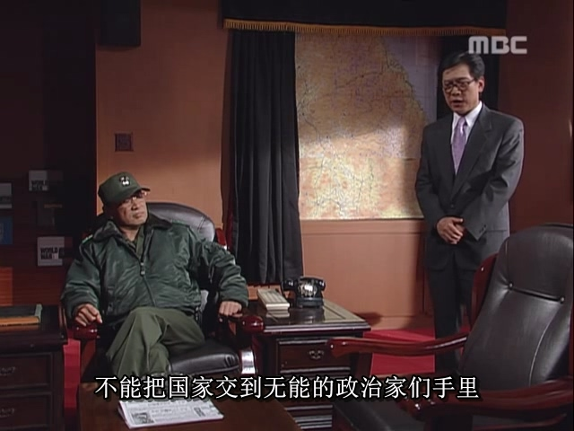
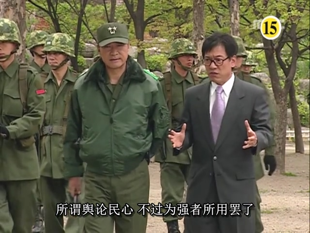
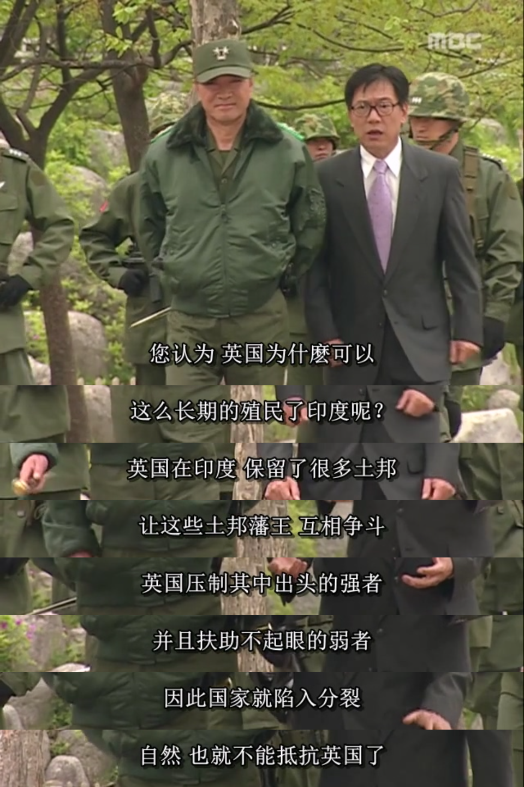

> 원문: [大韩民国第五共和国（3）首尔之春分三金](https://lucius.caelumfamily.com/blog/sk53/) · 2025-02-04 · 글: 神通LC

박정희가 죽자 당시 한국의 많은 사람은 민주화 운동이 반드시 돌파구를 마련할 것이라고, 전 국민 선거만 실시하면 민주파 '삼김' 가운데 한 사람이 대통령 자리를 차지할 것이라고 믿었다. 서울의 봄은 그렇게 막을 올렸고, 1980년 5월 17일 갑자기 막을 내렸다.

그러나 일본 언론이 먼저 정답을 찾아냈다. 군인 전두환이 최종 승자가 될 가능성이 가장 크다는 것이었다.

일본과 한국은 문화의 뿌리가 같고, 일본은 한때 한반도를 식민 통치했다(1910~1945년). 그 기간 일본은 한반도에서 친일파 조선인들을 키워 조선을 대신 통치하게 했고, 이 친일파 가운데 상당수는 훗날 한국의 군·정·재계 고위층이 되었다. 박정희도 일본 육군사관학교에서 공부했고 다카키 마사오(高木正雄)라는 일본 이름이 있었다. 일본은 패전해 한반도에서 물러난 뒤에도 한국 고위층과 끊을 수 없는 인연을 이어 갔기에 한국을 극히 잘 안다. 게다가 일본인들은 '하극상(下剋上)', '군부 독주' 같은 이야기에 익숙해, 한국에서 곧 벌어질 일을 불 보듯 훤히 알았다.

일본 언론의 분석과 보도를 접하면서 주일 한국대사관의 공보관 허문도도 이를 간파했고, 곧바로 귀국해 전두환에게 접근하기로 마음먹었다.

허문도(1940년 2월 26일~2016년 3월 5일)는 한국의 기자이자 정치인이다. 조선일보 기자, 청와대 공보비서관, 국토통일원 장관 등을 지냈다. 재임 중 문화·선전을 총괄하며 '언론 통폐합'으로 불린 언론사 통합 정책을 주도해 '전두환 정권의 괴벨스'로 불렸다.

허문도라는 인물이 전두환에게 접근한 것은 주로 출세와 재물 때문은 아니었을 것이다(그것은 부차적 목적이었을 터). 그는 나름의 정치적 이상을 가진 사람이었을 것이다. 전직 기자였지만 언론 통제에 관해서는 보통 기자와 다른 지향을 가진 강경 보수파였다. 그는 국가 권력을 무능한 정치인에게 맡길 수 없고, 실권을 쥔 강경파가 정국을 주도하며 국민을 이끌어야 한다고 생각했다. 전두환을 보좌해 자신의 정치적 목표를 이루려 한 것이다.

 

*허문도.*

허문도는 귀국 후 고등학교 동창이자 '2허 1이' 가운데 한 사람인 허삼수의 소개로 전두환과 연락이 닿았고, 기회를 얻어 전두환에게 계책을 바쳤다.

허문도는 전두환에게 여론과 민심은 모두 조작할 수 있는 것이며, 전두환이 대통령 자리에 오르려면 전국 언론의 검열권을 자기 손에 쥐어야 한다고 건의했다.

'삼김'에 관해서는 세 사람이 한 덩어리가 아니니, 전두환이 삼김 사이의 이해 충돌을 이용해 이간질하고 하나씩 격파하면 된다고 했다. 허문도는 영국이 인도를 식민 통치한 예까지 들었다.

 

*허문도가 든 영국의 인도 통치 사례.*

이것이 대영제국의 '약자를 도와 강자를 다스리는 기술'이다. 나는 이에 관해 《제국의 부약치강술(扶弱治强術)》이라는 글을 따로 쓴 적이 있다.

전두환은 듣고 나서 몹시 기뻐하며 유능한 관료를 하나 더 얻었다. 이때부터 허문도는 전두환의 신임을 얻어 핵심 참모진에 들어갔고, '2허 1이'와 함께 '3허 1이'로 불리게 되었다.

당시 전두환에게는 두 가지 목표가 있었다.

1. **계엄 범위의 확대.** 박정희가 죽은 뒤 한국은 비상계엄을 실시해 국회를 제외한 정치 활동을 금지했지만, 국회 기능은 여전히 정상 작동했다. 전두환은 계엄을 확대해 국회의 정치 활동까지 금지시킴으로써 군대가 실질적 정치 권력을 얻기를 바랐다.
2. **'삼김'을 이간질해 꺾는 것.**

이때 노태우가 전두환에게 건의했다. 계엄을 확대하려면 북한이 남침하려 한다고 주장해 사회적 공포를 조성하면 계엄 확대가 당연해진다는 것이었다. (한마디 덧붙이자면, '북한 남침'을 처음 이유로 든 사람은 천재(天才)일지 모르나, 같은 수법을 다시 쓰면 동시효빈(東施效顰)이다. 윤석열이 2024년에 또 이런 이유를 댄 것은 참으로 우스꽝스럽다.) 전두환은 이 건의를 받아들였고, 한국인들이 깊이 믿게 만들기 위해 일본 쪽 인맥을 통해 '북한 남침'이라는 가짜 소식을 먼저 일본에 흘린 뒤 일본에서 한국으로 되돌아오게 하고, 언론 통제와 맞물려 한국인들이 '북한 남침'이라는 가상을 믿도록 했다.

'삼김' 가운데 김종필은 김대중, 김영삼과 확연히 달랐다. 뒤의 두 사람은 야당 인사로 최고 권력의 원 안에 들어온 적이 없었지만, 김종필은 청와대의 '전왕조 신하'였다. 전두환은 먼저 김종필에게 눈독을 들였다.

김종필은 한국 전 대통령 박정희의 형 박상희의 사위로, 1961년 박정희가 이끈 5·16 군사정변에 참여했고, 1971-1975년과 1998-2000년 두 차례 국무총리를 지냈다.

전두환이라는 사람은 성적은 별로였지만, 이상하게도 일인자 지도자에게 꼭 필요한 재능, 곧 사람을 알아보고 잘 쓰는 능력이 있었다. 그는 무언가를 이루려면 어떤 사람을 찾아야 하는지 아는 직감 같은 것을 가지고 있었다.

김종필을 꺾기 위해 전두환은 곧 또 다른 '전왕조 신하', 전 중앙정보부장 이호락을 떠올렸다. 이호락은 청와대를 떠난 뒤 민주공화당에 입당해 김종필과 같은 당이 되었다. 당시 이호락은 횡령·부패 혐의를 받고 이미 미국으로 도피한 상태였다.

전두환은 곧 미국에 있는 이호락과 연락이 닿았고, 두 사람은 곧 거래를 성사시켰다. 이호락이 한국에 돌아가 김종필에 대한 부정적 발언을 하면, 전두환이 그의 부패 문제를 추궁하지 않겠다는 것이었다.

이호락은 곧 귀국해 기자회견을 열고 김종필에게 불리한 발언을 쏟아냈다.

1. 김종필은 정당한 절차를 거치지 않고 민주공화당 총재가 되었다.
2. 김종필은 전왕조의 신하다. 박정희 전 대통령에게 잘못이 있다면, 김종필도 박정희에게 무조건 복종한 책임을 져야 한다.
3. 같은 당의 당원으로서 김종필을 신뢰하지 않는다.

이렇게 해서 이호락은 김종필이 당내를 장악하지 못하고 당이 분열된 조짐을 외부에 드러냈고, 김종필의 민심을 깎아내렸다. 이는 훗날 전두환이 김종필을 체포할 때의 저항도 없애 주었다.

김대중과 김영삼에 관해서는 '2허 1이' 가운데 이학봉이 전두환에게 건의했다. 계엄을 확대한 뒤 '학생 운동 선동'을 이유로 김대중을 체포하고, 김영삼에게는 너그럽게 대해서 한 명은 잡고 한 명은 놓아두어, 이 두 김 뒤의 세력이 뭉쳐 서로 온기를 나누지 못하게 하자는 것이었다. 전두환 쪽은 이미 예상하고 있었다. 김대중을 체포하면 그의 고향 광주 사람들이 자극을 받아 시위 규모를 반드시 키울 것이며, 군은 광주 진압 준비를 마쳐 두었다. 이때 김영삼까지 함께 체포하면 김영삼의 표밭인 부산 사람들도 함께 시위할 터이니, 양쪽을 모두 진압해야 한다면 군에 불리했다. 전두환은 '하나 잡고 하나 놓기' 방안을 받아들여, 그때는 광주 한 곳에만 힘을 집중해 진압하기로 했다.

1980년 5월 17일, '북한 남침'이라는 가짜 소식과 군의 재촉에 밀려 최규하 대통령 권한대행은 계엄 확대를 선언하고 전국의 모든 정치 활동을 금지했으며, 국회까지 금지했다. 서울의 봄은 끝났다. 군은 계엄 확대 기간에 더 큰 권력의 공간을 얻었고, 전두환 일파는 곧 사람을 보내 김대중을 자택에서 체포해 서빙고로 압송했다. 김종필을 부당 축재 혐의로 체포했다. 김영삼에 대해서는 처음에 그를 풀어줄 생각이었으나 곧 자택 연금으로 바꾸었고, 그래도 정식으로 체포하지는 않았다.

이렇게 해서 삼김은 순식간에 전두환의 손아귀에 들어가 정치 활동 능력을 잃었다.

그러나 이것이 물론 결말은 아니었다. 전두환은 이미 준비가 되어 있었다. 삼김을 장악한 것은 시작일 뿐이었다. 김대중을 체포하기만 하면 광주는 반드시 어지러워질 것이고, 광주를 진압해야만 그는 마음 놓고 대통령 자리에 앉을 수 있었다.

이렇게 해서 한국 근대사의 가장 큰 비극인 광주 사태가 막을 올리려 하고 있었다. 그리고 광주 진압은 전두환 일생의 가장 큰 죄명이 되었다.
