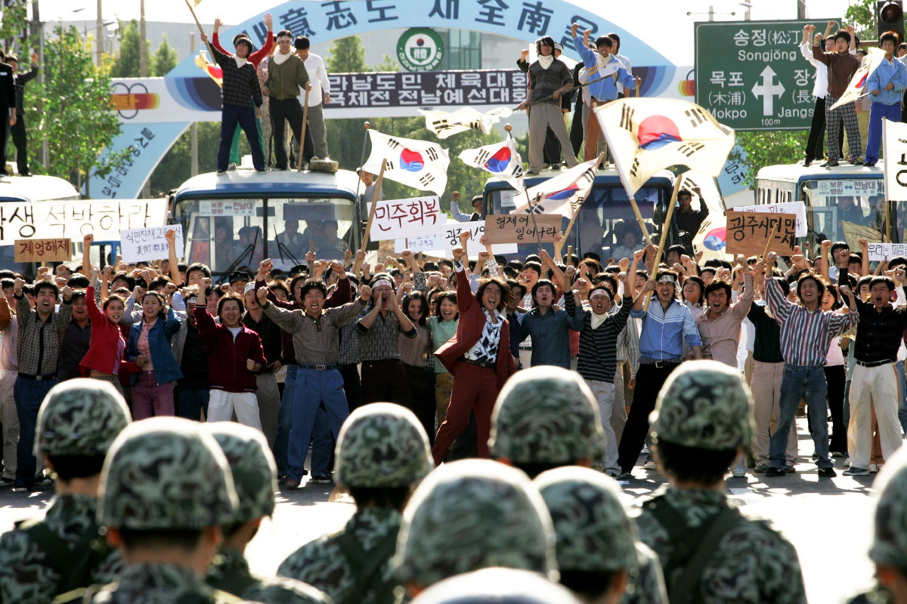
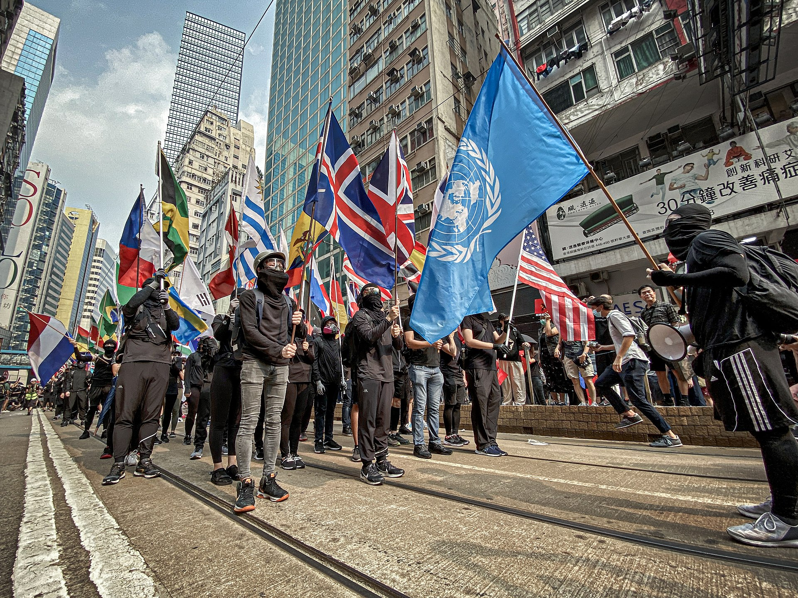

> 원문: [大韩民国第五共和国（4）光州悲剧何所思](https://lucius.caelumfamily.com/blog/sk54/) · 2025-02-04 · 글: 神通LC

전두환은 계엄 확대 이후 한국 국민이 반발하리라는 것을 이미 예상했고, 광주는 특히 중점 경계 지역이었다. 광주 출신 정치인 김대중을 체포한 탓도 있었지만, 무엇보다 광주가 좌파의 본거지여서 군사정권 독재와 물과 불처럼 맞서는 곳이었기 때문이다.

1980년 5월 17일 밤, 한국 정부가 계엄 확대를 선언하자마자 전두환은 7공수여단을 밤새 광주에 투입했다. 5월 18일 공수부대 병사들이 시위에 참가한 광주 대학생들을 때려 다치게 하면서 광주 시민의 분노에 불이 붙기 시작했고, 군과 민간의 원한은 갈수록 깊어졌다. 전두환 쪽이 미리 준비해 광주로 통하는 도로와 통신을 끊어 버린 탓에 한국의 다른 지역 사람들은 광주에서 무슨 일이 벌어지는지 몰랐고, 광주 시민은 한국군과 홀로 맞서야 했다.

공수부대가 광주 시민을 진압하는 동안 서울에 있던 전두환 일파는 사태의 진전을 처음부터 끝까지 지켜보고 있었다. 그런데 전두환의 참모 '3허 1이' 가운데 이학봉이 김대중을 심문하던 중 흥미로운 단서 하나를 발견했다.

여기서 이학봉이라는 인물을 짚어야 한다. 그는 전두환 휘하의 대공처장(對共處長)으로, 중국인에게 익숙한 그 '공', 곧 공산주의의 공이다. 물론 한국인인 그가 주로 상대한 것은 북한의 공산주의자였고, 북한과 관련된 모든 정보를 다뤘다.

이학봉은 허문도의 제안을 받아들여 김대중을 '북한과 내통하고 학생 운동을 선동했다'는 쪽으로 매장하려 했다. 김대중 자택의 방문객 기록을 뒤지던 그는 흥미로운 이름 하나를 발견했다. 광주 전남대학교 재수생 협회장 정동년이었다. 광주에서 온 학생이 김대중의 집을 찾았다는 사실에 이학봉은 곧바로 정신을 번쩍 차렸다. 그는 다시 광주에서 군이 체포한 시위 학생 명단을 확인했고, 거기서도 마침 정동년의 이름을 발견했다. 이에 이학봉은 자신의 전문성을 발휘해 김대중과 광주 사태를 연결하는 가짜 시나리오를 지어냈다.

엄중히 밝혀 두자면, 다음은 모두 이학봉이 지어낸 시나리오이며 사실이 아니다.

1. 김대중은 북한과 내통하는 간첩으로, 북한의 지시를 받아 한국에서 학생 운동을 선동해 정부에 반대했다.
2. 광주 학생 정동년은 1980년 4월 13일 김대중의 집을 찾았고, 김대중은 부하에게 활동 자금을 주어 정동년에게 건네게 하고, 그를 광주로 돌려보내 폭동을 선동하게 했다.
3. 정동년은 고향 광주로 돌아가 행동에 나섰고, 1980년 5월 18일 광주 시위가 통제를 벗어나기 시작했다.

위 시나리오는 모두 지어낸 것이다. 그러나 전두환은 이 시나리오에 몹시 만족했다. 광주 진압의 명분을 마련하는 동시에 정적 김대중에게 반역죄라는 사형감을 뒤집어씌울 수 있었으니, 일석이조였다. 전두환은 자신감에 차서 광주 시민을 강경 진압하겠다는 결심을 더욱 굳혔고, 광주에 군대를 더 보냈다.

5월 18일부터 군이 광주 시민을 때릴 때마다 분노한 광주 시민이 더 많이 거리로 나와 맞섰고, 늘어나는 광주 시민에 맞서기 위해 군도 계속 광주에 병력을 증파했다. 양쪽의 원한은 나선형으로 치솟았고, 5월 21일에는 일부 급진적인 시민이 지역 무기고로 몰려가 총과 탄약을 빼앗아 군과 총격전을 벌였다. 바로 이날 전두환은 군이 실탄으로 광주 시민을 사격하는 것을 공식 허가했다.

광주 시민이 총기를 빼앗은 일은 일선의 말단 병사만 위협할 뿐, 서울에 있는 전두환 같은 고위 장교에게는 전혀 위협이 되지 않았다. 오히려 광주 사람들이 총기를 빼앗았기 때문에 전두환은 그것을 구실로 군의 무력 수위를 당당하게 끌어올리고 실탄 진압을 떳떳하게 할 수 있었다. 이 순간부터 광주 사태는 좋게 끝날 수 없게 되어 있었다.

5월 27일 군대가 탱크를 몰고 광주에 들어왔고, 광주 시민이 자발적으로 조직한 '항쟁 지도부'는 마지막 순간까지 싸우다 힘이 다해 무너졌다. 광주 사태는 그렇게 끝났다.

이 소식을 듣고 전두환은 크게 기뻐했다. 마지막 장애물도 해결되었으니 이제 한국에서 그가 대통령이 되는 것을 막을 사람은 없었다. 이어 그는 실권 없는 최규하 대행에게 회유와 압박을 함께 가해 1980년 8월 16일 대통령직에서 물러나게 했다.

1980년 8월 27일, 전두환이 조종한 통일주체국민회의는 전두환을 한국 제11대 대통령으로 선출했고, 그는 이렇게 8년 가까운 독재 통치를 시작했다. 이것이 이른바 '제5공화국'이다.

1980년 9월 11일 군사재판부는 김대중에게 광주 사태를 조종한 '내란 음모죄'와, 1972년 '10월 유신' 쿠데타 이후 해외에서 '한민통'을 조직한 '반국가 단체의 주모자' 두 가지 죄목으로 사형을 선고했다(다만 뒤에 미국의 압력으로 무기징역으로 감형되었고, 1982년 특사로 풀려나 미국으로 갔다).

광주 시민은 참혹한 대가를 치렀는데도 전두환의 집권을 막지 못했다. 그들은 대체 무엇을 위해서였을까? 그들이 한 모든 일은 과연 의미가 있었을까?

광주 시민의 희생은 전두환을 막지는 못했지만 결코 무의미하지 않았다. 광주 사람들은 목숨으로 전두환 정권에 지울 수 없는 오점을 남겼고, 그 오점은 제5공화국 기간 내내 곪아 터져 제5공화국이 겨우 한 임기를 채운 뒤 막을 내리게 만들었다. 역사책 속 전두환이 후대의 평가를 마주할 때 광주 사태는 그가 영원히 피할 수 없는 한 페이지다. 또한 광주 시민의 희생은 한국 민주파의 정신적 지주가 되어 수많은 민주 인사들이 앞서거니 뒤서거니 싸우게 했다.

광주 시민은 결코 자기 조국에 반대한 것이 아니라 전두환 군사정권에 반대했을 뿐이다. 현장 사진을 보면 알 수 있다(아래 사진은 영화 스틸이지만 실제 상황도 반영한다).

 

*시위 현장의 광주 시민.*

광주 시민이 시위 현장에서 흔든 것은 한국 국기였다.

반대 사례를 하나 들자면 다음과 같다.

 

*2019년 홍콩 폭동 사태 당시의 모습.*

위 사진은 2019년 홍콩 폭동 사태 당시 '황사(黃絲)'라 불린 친민주 시위대가 갖가지 외국 국기를 들고도 정작 자기 나라 국기는 들지 않은 장면을 담고 있다. 그 뜻이 무엇인지 아직도 분명하지 않은가? 그러므로 홍콩 폭동 사태와 광주 사태는 본질적으로 다르다.

광주 시민은 자기 한국인 정체성에 반대한 것이 아니라 정치적 견해가 달랐을 뿐이다. 그들은 전두환에 반대하고 민주파 정치인, 특히 자기 고향의 김대중을 지지했을 뿐이니, 이는 내부 갈등이지 반역이 아니다. 물론 그 과정에서 일부 광주 시민이 총기를 빼앗은 것은 확실히 과격한 행동이었다. 원한은 일단 시작되면 한쪽이 다른 쪽을 완전히 꺾을 때까지 나선형으로 치솟기 마련이다. 이는 아마 양쪽 모두가 처음부터 바라지 않았던 비극이었을 것이다.

전두환이 광주를 유혈 진압한 것은 확실히 그의 죄다. 그러나 전두환 쪽에 죄가 있다고 해서 광주 시민 쪽의 정치적 견해가 자연히 옳다고 단정할 수는 없다. 1980년 그 격동의 시대에 한국이 처한 현실을 되짚어 볼 필요가 있다.

1980년은 제2차 석유파동이 한창이던 때였다. 당시 이란 이슬람 혁명과 이란-이라크 전쟁이 터지면서 원유 가격은 1979년 배럴당 15달러 안팎에서 1981년 2월 최고 39달러까지 올랐으니, 20세기 후반 3대 에너지 위기 가운데 하나였다. 석유파동은 경제 질서를 어지럽혀 자본주의 국가 전반에 꽤 심각한 경기 침체를 불러왔다. 물가가 크게 오르고 경제 성장률이 떨어지는 이런 조합을 '스태그플레이션'이라 부른다. 자본주의 진영의 작은 나라인 한국이 예외일 수 없었다. 한국 경제는 1980년 1956년 이래 처음으로 마이너스 성장을 기록했고, 인플레이션율은 28.7%라는 터무니없는 수준까지 치솟았다. 게다가 박정희 시대 '한강의 기적'의 부작용이 드러나 낮은 수준의 발전은 더 이상 이어갈 수 없게 되어, 한국 경제는 위태롭기 그지없었다.

게다가 당시 미국 대통령은 지미 카터였다. 1978년부터 1980년 사이 카터는 한국에서 미군 6,000명을 차례로 철수시켰고, 1982년 말까지 미 지상군을 전부 철수시킬 계획이었다. 이는 북한의 남침을 유인하는 것과 같아, 한국이 맞닥뜨릴 북방의 압력이 순식간에 커졌다. 물론 뒤에 보면 그런 일은 일어나지 않았다. 1981년 카터는 철수 정책을 재검토하겠다고 발표했고, 재선에 실패한 뒤 후임 레이건이 곧 그 정책을 취소했다. 그러나 1980년이라는 시점에 서서 미래를 예측할 수 있는 사람은 아무도 없었고, 한국이 맞닥뜨린 외부 압력은 실제로 커지고 있었다. 게다가 당시는 아직 냉전 시대여서 소련이 건재했고, 한국은 냉전의 최전선에 있었으며, 전 대통령 박정희가 갑자기 죽어 정계 고위층이 흔들리고 민심이 술렁였다.

나는 외국인으로서 제3자의 중립적 입장에서 되도록 객관적으로 말하려 한다. 당시 한국의 상황은 안팎으로 근심이 겹친 '내우외환'이라, 정말로 실력 있는 강권 인물이라야 이 엉망진창인 판을 받아낼 수 있었을지 모른다.

삼김은 민간 정치인으로 명망은 있었지만 그것이 곧 나라를 잘 다스린다는 뜻은 아니다. 특히 김영삼과 김대중은 그전까지 야당에 있었고 최고 권력의 원 안에 들어온 적이 없었다. 평생 민주주의 관념을 선전하고 군사정권에 맞선 것은 정신적으로 가상하나, 그들이 잘하는 이런 일과 경제를 발전시키고 외교를 처리하며 군대를 지휘하는 통치 능력은 결코 같은 것이 아니다. 전 국민 선거 방식의 민주주의는 결국 수단일 뿐 목적 자체가 아니다. 일반 백성에게는 경제를 발전시켜 민생에 혜택을 주고 보통 사람도 편안히 살아갈 수 있게 하는 것이 가장 큰 선이다.

어쨌든 전두환은 하나회 형제들과 수많은 참모의 보좌를 받아 10개월에 걸친 문공무투(文攻武鬪) 끝에 모든 정적을 꺾고 마침내 한국 대통령 자리에 올랐다. 그에게 속한 제5공화국이 정식으로 시작되었다.
