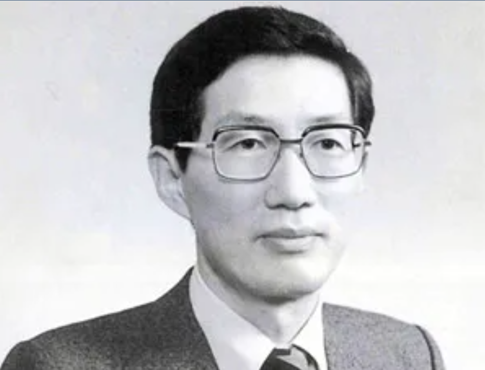
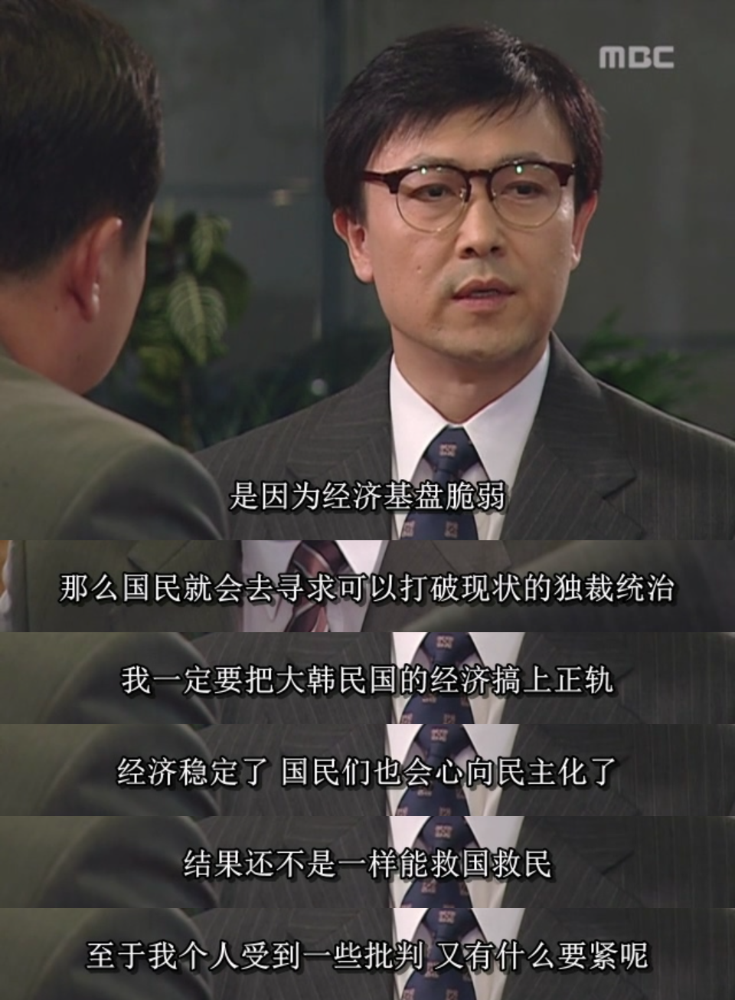
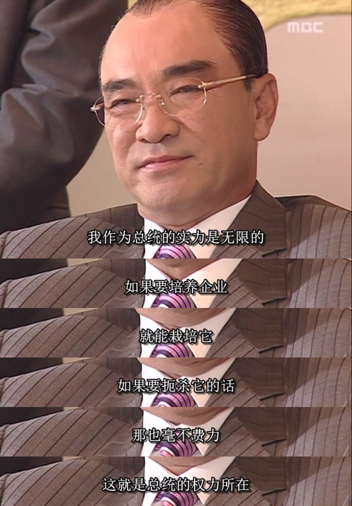

> 원문: [大韩民国第五共和国（6）仰光事变失首席](https://lucius.caelumfamily.com/blog/sk56/) · 2025-02-04 · 글: 神通LC

1980년대에 들어 한국의 국제적 영향력은 나날이 커져 외교 면에서 북한에 큰 압박을 주었다. 남북은 모두 자기가 한반도의 정통이라고 주장했지만, 한국의 국제적 동맹이 늘고 영향력이 커지면서 한국의 기세가 북한을 확실히 압도했다. 특히 한국이 1981년에 1988년 올림픽 개최권을 따낸 것은 세계 많은 나라의 인정과 지지를 얻은 것을 뜻했고, 북한의 목에 가시가 걸린 격이었다.

1983년, 국제 경제·무역 협력 관계를 강화하기 위해 전두환 대통령은 10월 8일부터 아시아와 오세아니아의 다섯 나라를 방문할 계획을 세웠고, 첫 방문지는 아시아의 버마(미얀마)였다. 버마는 1975년 남과 북 양쪽과 동시에 수교해, 남북이 모두 버마를 끌어들이고 상대를 배제하려 했고, 이것이 1983년 아웅산 폭발 사건의 화근을 묻었다.

전두환은 버마에 도착한 뒤 계획대로 버마의 국부 아웅산 묘소를 참배할 예정이었다. 한국 측 인원은 차량 두 대로 나눠 아웅산 묘소로 향했고, 전두환은 늦게 도착하는 바람에 2번 차에 탔다. 그런데 한국 측 인원이 가득 탄 1번 차가 먼저 묘소에 도착하자 묘소 지붕에서 격렬한 폭발이 일어나 한국 측 인원 16명과 버마 인사 4명이 그 자리에서 숨지고 47명이 부상했으며, 전두환은 2분 늦게 도착한 덕에 화를 면했다(이 사람은 정말 주인공의 광채를 타고난 것 같다). 그는 곧 모든 일정을 취소하고 한국으로 돌아갔다.

버마 정부는 곧 북한 공작원 3명을 붙잡아 진상을 밝혀냈는데, 북한 정부가 전두환의 일정을 알고 공작원을 보내 미리 아웅산 묘소에 원격 조종 폭탄을 설치해 둔 것이었다. 북한 공작원은 한국의 1번 차가 도착하는 것을 보고 전두환이 왔다고 여겨 폭탄을 터뜨렸지만, 전두환이 2번 차에 탔으리라고는 생각하지 못해 암살은 실패했다. 진상이 드러나자 버마 정부는 곧 북한과 단교했다.

전두환은 목숨을 건졌지만 이번 아웅산 폭발로 그의 집권 팀은 절반 이상이 죽거나 다쳤고, 외교·경제 분야의 기술 관료 여러 명이 세상을 떠난 것은 이루 헤아릴 수 없는 손실이었다. 그중 전두환이 가장 애석해한 사람은 그의 수석 경제 고문이자 청와대 경제수석비서관인 김재익, 곧 김 수석이었다.

 

*김재익.*

김재익(1938년 11월 26일~1983년 10월 9일)은 스탠퍼드대학교 경제학 박사 출신의 한국 경제학자이자 정치인이다. 김재익은 전두환 정부 시절 청와대 경제수석비서관이었고 금융실명제의 설계자이기도 하다. 대통령 비서로 재임하며 물가 안정, 무역 자유화, 정보화 정책을 적극적으로 수립해 한국이 경제협력개발기구(OECD)에 순조롭게 가입할 수 있게 했다. 그는 1983년 10월 9일 미얀마 양곤 폭발 사건으로 향년 44세에 세상을 떠났고, '대한민국 훈장'을 추서받았다.

김 수석은 당당한 스탠퍼드대 경제학 박사로, 오늘날에도 자존심 높은 박사들 사이에서 한 수 위로 평가받는 존재인데, 하물며 1980년대에는 아시아 전체를 통틀어도 이 급의 인재가 흔치 않았다.

전두환이 막 대통령 자리에 올랐을 때, 그의 명성이 너무 나빠 많은 지식인이 그를 위해 일하기를 꺼렸다. 김 수석도 한때 망설였지만, 한국 경제만 잘 이끌면 백성이 부유해진 뒤 자연히 민주를 추구하게 될 것이라고 생각했다. 그래서 김 수석은 개인의 명예를 돌보지 않고 전두환을 보좌하기로 결심하고 청와대에 들어가 경제 업무를 맡았다.

여기서 다시 전두환의 큰 장점 하나를 말해야 한다. 자신에 대해 객관적으로 아는 능력인데, 일인자 지도자 가운데 이는 매우 드문 것이다. 사람은 높은 자리에 오르면 우쭐해져 자기가 하늘이 선택한 사람이라고 여기기 마련이고, 밑에는 아부하는 무리가 늘 따라붙기에 오래되면 자기가 못 하는 게 없다고 착각하게 된다. 세상의 문외한이 전문가를 가르치는 일은 대개 이렇게 생긴다. 그러나 군대의 무식한 사나이였고 사관학교 성적도 별로였던 전두환은 자기가 경제를 전혀 모른다는 것을 똑똑히 알았고, 김 수석을 수석 경제 고문으로 발탁한 뒤에는 사람을 의심하지 않고 곧장 이렇게 말했다. "군말 없어. 경제에서는 자네가 대통령이야!"

전두환은 자기 자신을 아는 데 그치지 않고 사람을 알아보고 잘 썼으니, 이 두 가지는 모두 중요하고 모두 어려운 일인데 그가 다 해냈다. 김 수석도 기대에 저버리지 않고 나라와 백성을 위해 부지런히 일했다. 김 수석이 내놓은 정책 제안은 전두환이 대부분 받아들였다. 게다가 김 수석의 정책에 반대한 관료는 하나같이 좋은 끝을 보지 못했는데, 전두환 초기의 측근이자 '2허 1이'인 허화평과 허삼수도 마찬가지였다. 이 두 허는 한때 권력을 다투려 김 수석을 밀어냈지만 전두환은 끝까지 김 수석을 지지했고, 결국 두 허는 청와대를 떠났다(물론 두 허의 퇴장이 김 수석 반대라는 한 가지 이유만은 아니었다).

김 수석이 막 취임했을 때 한국의 인플레이션율은 제2차 석유파동 때문에 좀처럼 내려가지 않았는데, 김 수석의 정책 콤보에 힘입어 1980년 28.7%에서 1982년 7.2%, 1983년 3.4%까지 낮아져 경제 질서와 민심이 크게 안정되었다. 한국의 경제성장률도 1980년 -1.6%에서 1981년 7.2%, 1983년 13.4%로 올라갔고, 이후 평균 성장률은 10% 안팎을 유지했다.

김 수석은 경제학자일 뿐 아니라 수학과 공학에도 능했고, 이런 이공계 배경 덕에 산업을 앞을 내다보며 배치하는 안목을 갖추었다. 김 수석은 청와대에 들어간 뒤 여러 반대를 무릅쓰고 TDX 전자식 교환기 국산화 사업을 전폭적으로 지원했다. 또 교환기 기술이 발전하면서 한국은 반도체와 컴퓨터도 전략 산업으로 지정해 적극 육성했다. 김 수석이 이끈 청와대 경제수석비서실은 이들 업종의 발전 계획을 기초했고, 결정적인 시점에 한국의 산업 고도화를 밀어붙였다. 바로 이 세 업종의 돌파가 훗날 한국이 선진국이 되는 데 결정적이었다.

김 수석은 순수한 기술 관료로서 전두환의 나쁜 평판에 휘말리지 않았고, 한국의 여러 인사가 그를 극히 높이 평가했다. 다만 하늘이 영재를 시기했는지, 그는 결국 남북 대립의 희생양이 되었다. 그러나 남북 대립은 직접적 원인일 뿐이고 근본 원인은 미·소의 패권 다툼이었다. 미·소는 각자의 패권 이익을 위해 온전한 나라 하나를 인위적으로 둘로 갈라놓았고, 한반도 사람들이 80여 년간 겪은 비극은 모두 여기서 비롯되었다. 김 수석의 죽음은 그 작은 축소판에 불과하다.

아웅산 폭발 사건이 터진 뒤, 한국의 대재벌이자 현대그룹 창업주인 정주영이 전두환의 환심을 사려고 '일해재단'('일해'는 전두환의 호다)을 세워 폭발 사건에서 순국한 관료들의 유족에게 위로금을 주고, 재단의 재원은 한국 최고의 재벌들이 기부하게 하자는 제안을 내놓았다. 전두환은 듣자마자 좋은 생각이라며 곧바로 동의했다. 전두환은 막 정예 부하들을 잃은 터라 애석한 마음이 있었지만, 곧 냉정해져 이번 사건을 구실로 일해재단을 세우면 앞으로 자기 금고로 쓸 수 있으니 그걸로 수확이 있다고 여겼다.

그리하여 전두환은 재임 기간 내내 일해재단이라는 돈벌이 도구를 통해 정기적으로 각 대재벌에게 돈을 걷었고, 명목상으로는 재벌들의 '자발적 기부'였으나 물론 모두 '자발적으로 기부하게 된' 것이었다. 그래서 한국은 일부 마케팅 계정이 묘사하는 '재벌의 나라'가 아니다. 실제로 박정희와 전두환 재임 중 한국 재벌들은 이런 강권 대통령들의 갖가지 흑색·백색 수단에 거의 PTSD가 생길 지경이었다.

