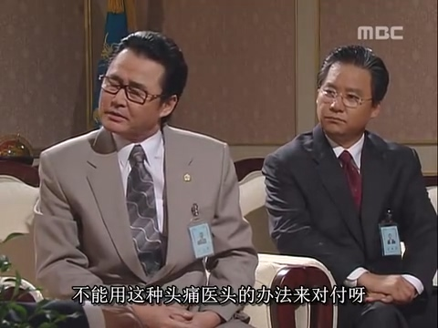
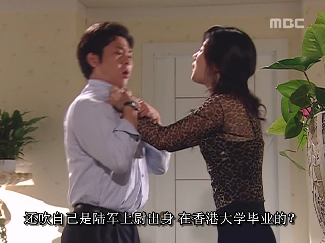
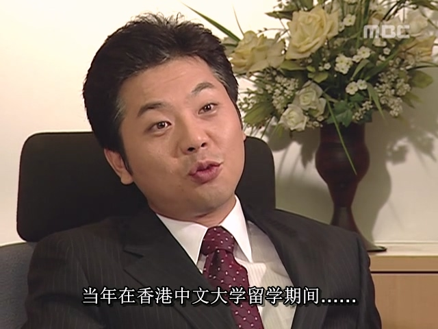

> 원문: [大韩民国第五共和国（7）各出奇谋抗改宪](https://lucius.caelumfamily.com/blog/sk57/) · 2025-02-04 · 글: 神通LC

전두환이 집권한 그 몇 해 동안 한국 경제는 고속 성장했지만 정치 환경은 좀처럼 평온하지 않았다. 민간의 전두환 군사정권에 대한 불만은 경제 발전으로 가라앉지 않고 오히려 끊임없는 항의로 이어졌다.

1985년 한국 국회의원 선거 때가 되자 두 주요 야당(신한민주당, 민한당)의 지지율 합계가 이미 전두환의 여당(민정당)을 넘어섰고, 이는 전두환에게 큰 골칫거리가 되었다. 게다가 그해 총선 전에 김대중이 야당의 선거전을 지원하려고 굳이 미국에서 한국으로 돌아와 자기 표밭을 북돋우자, 김영삼과 김대중 두 김이 합류해 함께 전두환에 반대하게 되어 두 김의 기세가 크게 올랐다. 한국 민주 인사들과 학생 운동은 연합해 항의했고, 두 가지 주요 요구를 내걸었다. 헌법 개정, 그리고 광주 사태의 책임 규명이었다.

여기서 한국 제4·5공화국의 헌법적 연원을 간단히 소개해야겠다.

제4공화국 헌법 체제에서 대통령 선거는 1인 1표제가 아니라 '통일주체국민회의'를 통한 간선제였고, 이 국민회의 구성원 명단은 대통령이 정했다. 게다가 대통령에게는 연임 제한이 없어, 이 국민회의의 투표 지지만 얻으면 계속 연임할 수 있었다. 이 두 장치 아래에서 박정희는 대통령이 된 뒤 자기 측근을 '통일주체국민회의' 구성원 명단에 넣을 수 있었으므로 무한 연임을 보장받을 수 있었으니, 이것이 실질적인 종신 대통령제였다.

전두환의 제5공화국은 박정희의 제4공화국에서 태어났는데, 5공 헌법이 4공 헌법에 비해 이룬 가장 중요한 개혁은 대통령 임기 제한을 둔 것이다. 대통령은 한 임기만 할 수 있고 임기는 7년이며, 임기가 끝나면 연임할 수 없게 해 종신 대통령제를 피했다. 박정희가 그때 종신 대통령제를 실시한 뒤 맞닥뜨린 각 세력의 반대가 너무 컸다. 민간이 그의 독재에 반대했을 뿐 아니라 고위층의 각 세력도 박정희의 권력 독점에 불만이었다. 제4공화국 정권은 말기에 이르러 이미 흔들렸고, 박정희는 수많은 적을 만들어 결국 내부 갈등이 폭발해 암살당했다. 이 모든 것을 박정희의 측근인 전두환은 처음부터 끝까지 지켜보았다. 박정희의 죽음은 전두환에게 종신 대통령제를 이어 가면 자기도 반드시 수많은 적을 만들고, 조금만 실수하면 박정희의 전철을 밟게 된다는 것을 깨닫게 했다. 전두환은 목숨을 부지하고 편안히 복을 누리는 것이 더 중요하다고 여겼기에, 제5공화국을 세울 때 종신 대통령제를 폐지했다.

그러나 전두환도 그렇게 순순히 권력을 넘길 사람은 아니었다. 5공이 더 이상 종신 대통령제를 쓰지 않게 되었어도, '통일주체국민회의' 간선제는 그대로 남았다. 이 간선제만 있으면 전두환은 회의 구성원 명단을 조작해 자기 측근을 차기 대통령으로 지정할 수 있었다. 그렇게 되면 전두환은 여전히 '상왕'으로서 정권에 영향력을 행사할 수 있었다.

한국 민주파가 겨냥한 것이 바로 이 간선제였다. 이들은 헌법을 고쳐 1인 1표의 전 국민 선거로 대통령을 뽑고, 전두환이 차기 대통령을 지정하는 것을 막으라고 요구했다.

전두환은 당연히 이 요구를 받아들일 수 없었다. 후계자 지정은 대통령으로서 그의 핵심 권한이었으니 쉽게 내줄 리 없었다. 양측은 개헌 문제를 두고 주고받으며 한 걸음도 물러서지 않았다.

허문도가 먼저 전두환에게 계책을 바쳤다. 학생 운동에 관해서는 '학원안정법'을 만들어 과격하게 시위를 주도하는 학생들을 가려내 격리하고, 다수 학생이 이 주도 학생들과 접촉하지 못하게 하면 학생 운동은 적극분자의 주도가 사라져 자연히 점차 가라앉을 것이라고 했다. 전두환은 좋다고 여겨 곧 핵심 팀과 '학원안정법'의 실현 가능성을 의논했다. 그러나 당시 국무총리였던 노신영은 이 안정법을 곧바로 내놓지 말 것을 건의했다. 헌법과 충돌할 뿐 아니라, 학생들도 법의 위협 때문에 항의를 포기하지는 않을 테니, 두통이 나면 머리만 치료하는 식으로 학생 운동에 대응해서는 안 된다는 것이었다.

노신영은 오히려 '없는 카드를 만들어 쓰는' 방법을 건의했다. 먼저 사람을 시켜 '학원안정법'을 추진한다는 풍문을 흘리고, 국민이 '학원안정법'을 걱정할 때 전두환이 그 법을 추진하지 않겠다고 선언해 자신의 현명한 결단을 보여 주라는 것이었다. 또한 전두환은 이 카드로 야당과 거래해, '학원안정법' 포기를 조건으로 야당이 개헌을 포기하게 할 수도 있었다. 전두환은 노신영의 건의에 몹시 만족하며 그 일을 노신영에게 맡겼다.

그러나 한국 국민의 개헌 요구는 약해지지 않고 오히려 거세져, 1986년에는 개헌이 이미 주류 여론이 되어 기세가 대단했고, 전두환 정부는 점점 궁지에 몰렸다.

바로 그해 북한 정부가 자기 영내 한강 상류에 금강산댐을 세우겠다고 발표했다. 장세동(이때 이미 안전기획부장이 되어 있었다. 안전기획부는 옛 중앙정보부다)과 이학봉은 기회를 날카롭게 포착하고, 북한의 금강산댐을 이용해 뭔가 해 볼 수 있다고 여겼다.

장세동과 이학봉은 전두환에게 언론을 조작해, 북한이 한국이 곧 개최할 올림픽을 망치려고 금강산댐을 세우는 것이라고 선전하자고 건의했다. 때가 되면 수문만 열어 엄청난 물을 방류하면 한강을 따라 서울로 흘러들어 서울을 물에 잠기게 해 막대한 피해를 줄 수 있다는 것이다. 민주는 결국 상층의 욕구이고, 안전은 그보다 더 중요한 기본 욕구다. 한국 국민은 이런 선전을 들으면 반드시 관심을 국가 안보로 돌릴 테니 자연히 개헌을 신경 쓸 겨를이 없어질 것이라고 했다. 전두환은 이 '관심 돌리기' 전략을 듣고 크게 기뻐했다. 북한 위협을 부풀리는 것은 그가 가장 즐겨 쓰는 수단이었다. 국민의 북한에 대한 공포를 일단 자극하면 국민의 강권 정부에 대한 의존이 커지고, 필요하면 계엄을 선포해 권력을 조일 수도 있었다. 내부에 문제가 생기면 북한을 끌어내 협박하는 이런 방식은 한국의 많은 정치인의 경로 의존이 되어, 2024년에도 윤석열이라는 이 익살꾼이 아직 쓰고 있다.

전두환 정부가 금강산댐 위협론을 부풀리기 시작하자 한국 국민은 과연 넘어갔고, 관심은 실제로 모두 옮겨 갔다. 모든 것이 장세동과 이학봉의 예상대로였다. 게다가 전두환 정부는 이 기회에 '평화의 댐' 계획을 내놓았다. 한국 영내, 금강산댐 하류에 '평화의 댐'을 세워 금강산댐이 방류하는 물을 막겠다는 것이다. '평화의 댐을 짓는다'는 구실이 생기자 전두환은 국고 자금을 쓰고 민간 기부를 일으켜 이 공사를 완수할 명분을 얻었고, 물론 전두환 팀은 이 대공사에서 손을 이리저리 대며 갖가지 이득을 챙겼다. 이렇게 금강산댐 위협론은 국민이 잠시 개헌에 관심을 두지 않게 할 뿐 아니라 전두환이 덤으로 한몫 챙기게도 해 주었으니, 일거양득이었다. 전두환은 이렇게 돈 냄새를 맡는 감각이 매우 민첩했다.

몇 달 뒤 이학봉이 전두환에게 보고했다. 윤태식이라는 한국 상인이 주싱가포르 한국대사관에 도움을 청했는데, 홍콩에서 알게 된 한국인 아내가 실은 북한 간첩이라 그를 먼저 싱가포르로 꾀어낸 뒤 북한으로 납치하려 했고, 그는 기회를 봐서 빠져나와 대사관에 도움을 청했다고 주장한다는 것이었다.

다만 윤태식의 말은 모두 거짓말이었다. 그는 유명인도 아니어서 주싱가포르 한국 관리들은 북한이 그를 납치할 이유가 전혀 없다고 여겼다. 게다가 그가 한국 관리들에게 늘어놓은 이야기는 허점투성이여서 곧 꼬리가 드러났다. 이 사건이 바로 제5공화국 말기에 한때 세상을 시끄럽게 했던 '미녀 간첩 수지 김' 사건이다.

사건의 온전한 진상은 이러했다. 윤태식의 아내 본명은 김옥분, 영어 이름 수지로, 한국 충청북도 충주시 사람이었다(원문은 '진저우[金州]'로 적었으나 실제 출신지는 충주다). 젊은 시절 홍콩 상인을 만나 홍콩으로 시집왔지만, 홍콩에 와서야 그 상인에게 이미 아내가 있다는 것을 알고 분노해 그를 떠났다. 다만 수지도 곧바로 한국으로 돌아가지 않고 홍콩에서 술집 접대 일을 시작했다. 1986년 수지는 사업 기회를 찾아 홍콩에 온 윤태식을 만났다. 본래 일본에 갈 계획이라 자기가 세 든 집을 윤태식에게 전세로 넘길 생각이었는데, 나중에 계획이 바뀌어 일본에 가지 못하고 윤태식과 함께 살게 되었다.

한마디 덧붙이자면, 나는 홍콩의 주거 사정을 아주 잘 안다. 틀림없이 그 집의 면적이 너무 좁았을 것이고, 남녀가 좁은 공간에 함께 살면 불똥이 튀기 쉬워 두 사람은 곧 정이 들어 1개월도 안 되어 번개처럼 결혼했다.

그러나 애정은 결국 생활의 자잘한 일과 물질적 궁핍에 희석되기 마련이고, 게다가 수지는 나중에 윤태식이 자기 신분을 허풍 떨며 거짓말한 것을 알게 되어, 얼마 지나지 않아 두 사람은 끊임없이 다투었다.

 

*홍콩대학이 애꿎게 총을 맞았다.*

1987년 1월 2일 두 사람은 또 돈 문제로 격렬히 다투었고, 윤태식이 실수로 수지를 죽였다. 윤태식은 당황한 나머지 수지의 시신을 두고 문을 잠근 뒤 곧바로 항공권을 사서 홍콩을 빠져나가 싱가포르로 날아갔다.

싱가포르에 도착한 윤태식은 먼저 주싱가포르 북한대사관을 찾아가 북한으로 망명하고 싶다고 했지만, 북한 관리들은 심사한 뒤 이 인간에게 이용 가치가 전혀 없다고 여겨 거절했다. 이어 윤태식은 주싱가포르 미국대사관에도 가서 운을 시험했으나, 예상대로 거절당했다. 이에 궁지에 몰린 윤태식은 마침내 머리를 좀 써서 유일한 목숨 부지 수단을 찾아냈다. 수지에게 북한 간첩 누명을 씌우면 한국으로 돌아가도 정부의 추궁을 피할 수 있다는 것이었다.

말하지 않을 수 없는데, 적어도 일부 한국인은 '일이 생기면 북한을 끌어내 누명을 씌우는' 것을 본능으로 삼았다. 대통령 전두환이 그랬고, 평민 윤태식도 그랬다.

안전기획부장 장세동은 진상을 알고 나서, 금강산댐 위협론처럼 수지 사건으로 같은 장사를 할 수 있다고 여겼다. 인간이라는 생물은 선천적으로 기이한 이야기와 가십을 좋아하는 심리가 있다. '북한 미녀 간첩이 한국인을 납치하려 했다'는 이런 화제성 가득한 기이한 가십은 민중의 관심을 크게 돌릴 수 있고, 또 한국인의 북한에 대한 증오를 부추길 수 있어 한국 정부에 이로울 뿐 해로울 것이 없었다. 그래서 장세동은 윤태식이 거짓말하는 줄 알면서도 이 거짓말을 끝까지 연출하기로 했다. 장세동은 사람을 보내 윤태식을 한국으로 데려와 통제했고, 목숨을 부지해야 했던 윤태식은 안전기획부의 지시에 순순히 따랐다. 그는 한국 국민 앞에서 미녀 간첩 아내가 그를 납치하려 했지만 차라리 죽을지언정 따르지 않고 한국으로 도망쳐 왔다는 하늘을 찌르는 거짓말을 늘어놓았다.

사건이 보도되자 곧 전국적인 관심을 불러일으켰고, 한국 민중은 잇달아 북한을 규탄하며 윤태식을 동정했다. 윤태식은 국민의 뜨거운 환영을 받았고 그 덕에 민족 영웅이 되었다.

그러나 1987년 1월 26일 홍콩 경찰이 수지의 이웃 주민 신고를 받고 수지의 시신을 발견했고, 곧 윤태식을 제1 용의자로 지목해 한국 정부에 범죄인 인도 요청서를 보내 윤태식을 홍콩으로 인도해 조사받게 해 달라고 요구했다. 그러나 전두환 정부는 알면서도 저지른 입장이라 윤태식을 홍콩 경찰에 넘길 수 없었다. 홍콩 경찰이 한국에 가서 사람을 잡을 수도 없었으므로 조사를 종결할 수밖에 없었다. 당시에는 아직 인터넷도 스마트폰도 없어 한국 민중이 정보를 얻는 통로는 자국 언론뿐이었고, 홍콩의 소식을 볼 수 없었기에 계속 어둠 속에 있었다.

한국 언론의 대대적인 취재 보도로 이 일은 거대한 파문을 일으켰고, 곧 수지의 한국 가족을 절망에 몰아넣었다. 그 가족은 안전기획부의 혹독한 고문을 당하고 무지한 군중에게 '간첩의 집안'이라는 모욕을 받으며 참혹한 처지에 놓였다.

반면 윤태식은 민족 영웅으로 추앙받으며 이후 한국에서 장사를 해 크게 성공했고, 심지어 청와대를 드나들 만한 성공한 상인이 되었다.

 

*홍콩중문대학이 애꿎게 총을 맞았다(엄중히 밝히자면 윤태식은 홍콩 톱2 대학과 아무 관계가 없고, 그의 실제 학력은 고등학교 중퇴다).*

그러나 윤태식은 끝내 제재를 피하지 못했다. 2001년 제6공화국 김대중 대통령 재임 때, 수지에게는 누나의 억울함을 풀어 주려는 것을 포기하지 않은 남동생이 있었는데, 그 동생이 한 기자의 도움으로 수지가 살해된 증거를 한국 검찰에 제출했다. 이에 김대중 정부가 이 사건을 다시 수사했고, 한국 경찰이 홍콩 경찰과 적극 협력해 당시 사건의 증거를 다수 확보한 뒤 윤태식을 체포했다. 여러 해 만에 수지와 그 가족의 억울함이 풀린 것이다. 다만 이 뒤늦은 정의는 수지 가족의 상처를 끝내 아물게 하지 못했다.

이렇게 해서 장세동은 금강산댐 위협론과 미녀 간첩 수지 김 사건으로 한동안 한국 국민의 관심을 성공적으로 돌려 개헌에 대한 민중의 관심을 크게 낮추어 전두환의 부담을 크게 덜어 주었다. 장세동은 이렇게 하나회 형님 전두환을 위해서라면 수단과 방법을 가리지 않고 목숨도 아끼지 않는, 전두환의 가장 충직한 심복 부하였다. 동시에 한국인의 눈에는 앞잡이이자 혹리였다.

그러나 장기간의 고압 통치는 언젠가 잘못되어 통제를 벗어나기 마련이었다. 머지않아 장세동은 그의 인생 방향을 바꾼 큰일을 맞게 되니, 바로 '박종철은 죽고, 장세동은 떠나다'였다.
