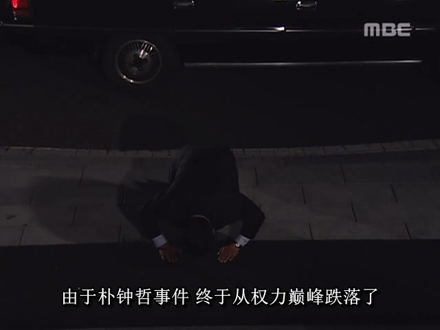

> 원문: [大韩民国第五共和国（8）死钟哲走生世东](https://lucius.caelumfamily.com/blog/sk58/) · 2025-02-04 · 글: 神通LC

제5공화국 기간에 학생 운동은 끊임없이 일어났고, 대학생이 시위에 참가했다가 경찰에 체포되는 일은 이미 밥 먹듯 했다. 그중 서울대학교의 박종철이라는 대학생이 어느 집회에서 체포되었다. 1987년 1월 14일, 한국 치안본부 대공처(역시 그 '공', 공산주의의 공이다)의 경찰 몇 명이 박종철을 심문하며 물고문을 했고, 지나치게 세게 한 탓에 박종철이 그 자리에서 죽고 말아 일이 크게 번졌다.

제5공화국 기간에 전두환 정부가 다른 의견을 가진 반대 인사들을 대규모로 체포하는 일은 이제 새롭지도 않았지만, 유죄 판결도 없이 사람 목숨을 앗아 간 것은 일의 성질을 바꾸어 놓았다. 그래서 치안본부는 처음부터 박종철의 죽음을 덮어 대충 넘어가려 했다.

그러나 이 일은 곧 한국 검찰청에까지 들어갔다. 검찰청과 치안본부는 서로 다른 계통이어서, 검사들은 이 사건에 개입하기로 했다. 치안본부를 칠 수도 있고 검찰청의 영향력을 높일 수도 있었기 때문이다. 그래서 검사는 박종철의 죽음을 기자에게 흘려 보도하게 했다.

여기서 되짚어야 할 것이 있다. 전두환 정부는 집권 초기에 언론을 단단히 장악했지만 받는 반대 압력이 갈수록 커졌다. 1986년 여름에 이르러 전두환 정부는 더 이상 압력을 견디지 못하고 언론 통제를 느슨하게 할 수밖에 없었다. 박종철 사건은 1987년에 터졌으므로 이때 전두환 정부의 언론 장악력은 이미 크게 떨어져 있었고, 따라서 이 사건 보도를 누를 수 없었다.

박종철의 죽음이 보도되자 곧 한국에 큰 파문이 일었다. 서울대는 한국의 칭화대·베이징대에 해당하는 곳으로, 서울대생 박종철은 하늘의 총애를 받는 인재라 할 만했다. 공부를 숭상하는 동아시아 땅에서 성적 좋은 우등생은 자연히 더 많은 관심을 끈다. 게다가 한국 민주파는 전두환 정부에 쌓인 원한이 오래되었는데, 앞서 장세동이 '금강산댐 위협론'과 '미녀 간첩 수지 김' 사건으로 민중의 관심을 돌려 어찌할 바를 몰랐다가, 이제 '박종철의 죽음'이라는 전두환을 공격할 카드를 만났으니 기회를 놓칠 리 없었다. 각지의 민주 인사들은 이 일을 전력으로 선전하며 이를 계기로 사람들을 결집해 전두환 정부에 공동으로 맞섰다.

종이로 불을 쌀 수 없다는 것을 깨달은 치안본부는 먼저 중대한 점을 피해 가볍게 넘기려 했다. 기자회견에서 심문하던 경찰이 탁자만 한 번 쳤는데 박종철이 쓰러져 죽었다고 주장하자, 현장의 기자들은 웃음을 참지 못하며 치안본부가 세 살짜리 아이를 속이냐고 여겼다.

안전기획부장 장세동은 치안본부의 기자회견 태도를 알고 곧바로 전화해 치안본부 사람들을 한바탕 욕했다. 장세동은 그들이 나쁜 것을 나무란 것이 아니라 너무 못한 것을 나무란 것이다. 일 처리가 너무 어리석어 이 이유로는 사람을 전혀 속일 수 없고, 오히려 민간의 분노와 정부에 대한 불신을 자극할 뿐이었다.

이에 치안본부는 졸을 버려 차를 보호하는 전략을 써서, 박종철이 물고문을 당해 죽었다는 것을 마지못해 인정하고 심문에 참여한 경찰 2명을 내놓아 죄를 뒤집어쓰게 했다. 장세동은 또 안전기획부 자금에서 1억 원을 꺼내 치안본부 고위층이 그 2명을 협박하고 회유하게 했다. 죄를 전부 뒤집어쓰고 다른 사람을 물지 않으면 각 집에 5,000만 원을 주고 그 가족을 돌보겠지만, 따르지 않으면 치안본부에는 그 가족을 다스릴 방법이 얼마든지 있다는 것이었다. 그래서 두 말단 경찰은 어쩔 수 없이 승낙했다.

그러나 1987년 5월 18일, 광주 사태 7주년이 되는 날, 한국 민중은 광주 사태와 박종철의 죽음 두 가지를 합쳐 새 원한과 옛 원한을 함께 셈하며 전국적인 대규모 추모 시위를 일으켰다. 검사와 기자의 집요한 추적 끝에 언론도 박종철 사건의 더 많은 세부를 대대적으로 보도하기 시작했다. 한국 민중은 말단 경찰 두 명이 모든 누명을 뒤집어쓰기에는 부족하다고 여겼고, 민간의 분노는 전두환 정부를 정면으로 향했다.

이때 전두환 정권 내부의 문제도 터지기 시작했다. 여기서 장세동, 노태우, 노신영의 후계자 다툼이라는 배경을 소개해야 한다.

제5공화국 헌법이 대통령은 한 임기만 하고 연임할 수 없다고 규정했기에, 전두환 집권 말기에는 누구를 후계자로 골라 차기 대통령으로 만들지 고민하지 않을 수 없었다. 당시 민간에서는 후계자가 장세동(하나회 구성원, 당시 안전기획부장), 노태우(하나회 구성원, 당시 국회의원), 노신영(문관, 당시 국무총리) 세 사람 가운데 나올 것이라고 저마다 추측했다.

당시 정치 상황으로 보면 먼저 배제된 것은 노신영이었다. 노신영은 결국 문관이라 군대에 기반이 전혀 없었고, 전두환이 노신영을 고르면 반드시 군 조직의 반대에 부딪힐 터인데, 전두환이 군이라는 기본 지지 기반을 먼저 거스르기는 어려웠다. 게다가 전두환의 가장 큰 두 흠, 12·12 사태와 광주 사태에 노신영은 참여한 적이 없어 자기 사람이라고 할 수 없었다. 노신영이 차기 대통령이 된다면 훗날 민주 인사들이 전두환의 이 두 흠을 청산하려 할 때 노신영이 그를 끝까지 감싸 줄지 알 수 없었다. 그래서 전두환은 하나회의 자기 사람을 고를 수밖에 없었다. 그 시절의 일은 모두 함께 저지른 것이니, 자기 사람이라야 민주파의 청산 압력을 견뎌 전두환을 지키는 동시에 자기 자신도 지킬 수 있었다.

장세동은 전두환에게 충성스럽기는 했지만 당시 경력으로는 아직 혼자 한쪽을 맡기에 부족해 대통령직을 감당할 수 없었고, 이 점은 장세동 자신도 알고 있었다. 게다가 장세동은 경호실장과 안전기획부장이라는 두 강력한 자리를 연달아 맡으며 내내 전두환을 위해 더러운 일을 많이 했기에 평판이 전두환 못지않게 나빠, 그를 후계자로 고르기는 민심을 얻기 어려웠다. 전두환이 장세동을 높은 자리에 올린 것은 주로 다른 사람을 견제하는 데 그가 필요했기 때문이다.

노태우가 가장 적합한 인물이었다. 경력이 충분하고 전두환과 동기이며 하나회의 2인자였고, 전두환의 흠에도 모두 참여했다. 게다가 두 사람은 사관학교 시절부터 알던 사이(룸메이트이기도 했다)였고, 졸업 후 군에 몸담은 뒤에도 관계가 각별해 대개 전두환이 승진하면 노태우를 자기 자리에 추천했다. 두 사람은 함께 학교를 다니고, 함께 군에 들어가고, 함께 승진하고, 함께 쿠데타를 일으키고, 함께 광주를 진압하고, 함께 청와대에 들어갔으며, 심지어 제6공화국 시기에는 함께 재판을 받고 함께 감옥에 갔다가 함께 특사로 풀려났다. 친형제라도 두 사람처럼 운명이 이렇게 단단히 묶이지는 못할 것이다. 전두환은 노태우를 평생의 동지로 여겼다. 또 노태우는 정계에 나온 뒤 장세동처럼 더러운 일에 많이 얽히지 않아 상대적으로 바탕이 깨끗했으므로, 대통령을 이어받는 데 따르는 저항이 훨씬 적을 터였다.

그래서 전두환은 사실 원래부터 노태우를 차기 대통령으로 염두에 두고 있었지만, 노태우만으로는 완전히 안심할 수 없어 장세동을 키워 노태우를 견제하게 했다.

다만 노태우의 입장에서 보면, 전두환이 아직 공식적으로 자기를 차기 후계자로 선언하지 않은 이상 일이 확정된 것이 아니어서 장세동은 여전히 그의 정적이었다. 게다가 하나회 내부에서 전두환은 절대적 핵심이자 두목이라 모두가 전두환의 체면을 봐 주었지만, 전두환 외의 다른 사람들은 저마다 파벌이 있고 내부 갈등도 있었다. 장세동은 하나회의 후배로서 오직 전두환 한 사람에게만 충성해, 전두환이 명령만 내리면 물불을 가리지 않았다. 그러나 장세동은 하나회의 다른 선배들(노태우 등)에게는 그저 그랬기에 노태우의 불만을 샀다. 그래서 노태우도 '박종철의 죽음' 사건을 빌려 장세동을 제거할 작정이었다.

박종철의 죽음이 기자에 의해 보도된 뒤, 노태우는 적극적으로 움직여 정호용(하나회 3인자, 노태우의 철벽 동맹)을 내각에 들여보내 새 내무부장관으로 앉히고, 정호용의 손으로 장세동을 무너뜨릴 준비를 했다.

민간의 전두환 정부에 대한 하늘을 찌르는 분노 앞에서, 국무총리 노신영은 경찰 몇 명을 처리하는 것만으로는 분명 부족하니, 자기가 총리로서 내각 전원을 이끌고 사퇴해 민중의 분노를 가라앉히는 방안을 고려하겠다고 건의했다. 장세동은 그래도 버텨 보려고 먼저 상황을 지켜볼 생각이었고, 당장은 내각(자기 자신 포함)이 사퇴하기를 바라지 않았다. 그런데 이때 정호용이 나서 불을 지피며, 박종철 일은 모두 장세동 계파 사람들이 저지른 실수이니 한 사람이 저지른 일은 한 사람이 책임져야 한다고, 장세동에게 아직 책임질 배짱이 있다면 사퇴해야 한다고 비꼬았다. 그렇지 않으면 내각이 책임지지 않는 만큼 전두환이 나서서 책임져야 한다는 것이었다.

결국 형님을 지키기 위해 장세동은 전두환에게 사의를 표하기로 했다. 그러나 전두환은 처음에 완강히 그의 사퇴를 반대했다. 전두환이 가장 신임하는 사람이 바로 장세동이었기에, 한 가닥 희망이라도 있으면 이 부하를 지켜 주려 했다.

그러나 정호용은 곧 장세동이 안전기획부 자금을 동원해 죄를 뒤집어쓴 두 경찰을 협박·회유한 검은 자료까지 캐냈고, 이번에는 정부 내부에서까지 전두환에게 장세동의 책임을 물으라고 건의했다. 안팎의 거센 압력 앞에 전두환도 장세동을 지켜 줄 수 없어, 눈물을 머금고 장세동이 안전기획부장직을 사퇴하고 청와대를 떠나게 할 수밖에 없었다. 그리하여 당시 한국 사회에 '죽은 종철이 산 세동을 쫓아냈다'는 말이 돌았다. 이는 죽은 제갈량이 산 사마의를 물리쳤다(死諸葛走生仲達)는 《삼국지연의》의 고사를 따른 표현이니, 한국인들도 중국의 《삼국지연의》를 읽은 모양이다.

 

*청와대를 떠나며 그쪽을 향해 절하는 장세동.*

청와대를 떠난 뒤 충직한 장세동은 청와대 안 전두환이 있는 방향을 향해 무릎을 꿇고 절했다. 장세동은 이 생에서 많은 사람에게 미안했지만, 유일하게 전두환에게는 부끄럽지 않았다. 전 형님을 위해 죽을 때까지 따랐고 한순간도 망설인 적이 없었다. 전두환도 장세동을 굳게 믿고 완전히 자기 형제처럼 대했다.

박종철은 본래 이름도 없는 대학생이었지만, 그의 죽음은 각 세력의 투쟁에 쓰이는 카드가 되었다. 진실로 정의를 펴려는 사람도 있었겠지만, 대다수는 이 카드로 자기 정치적 상대를 무너뜨리려 했을 것이다. 검찰청은 치안본부와 싸우려 했고, 민주파는 전두환을 공격하려 했고, 노태우와 정호용은 장세동을 몰아내려 했다. 모두가 이 판에서 치열하게 겨루었다. 정치 투쟁이란 이런 것이다. 표면적으로는 갖가지 대의명분을 내세우지만, 실제로는 대개 자기 이익을 위한 것일 뿐이다. 육조(六朝)의 역사도 결국 문벌의 사사로운 셈속이었을 뿐이다.

노신영과 장세동이 모두 박종철의 죽음 때문에 사퇴하자 세 후계자 후보 가운데 노태우만 남았다. 이에 전두환은 더 미루지 않고 노태우를 본격적으로 키우기 시작해, 집권당 안에서 노태우를 자기 후계자로 공개 선언했다.

의기양양한 노태우는 차기 대통령 자리가 이미 자기에게 손짓하는 것처럼 느꼈다. 그러나 민주파 세력이 그를 목표의 저편에 쉽게 닿도록 내버려 두지 않을 터였다.
