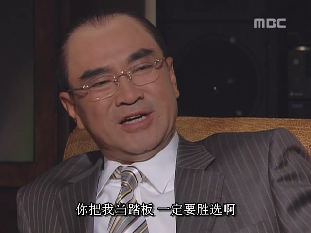

> 원문: [大韩民国第五共和国（9）泰愚大选压三金](https://lucius.caelumfamily.com/blog/sk59/) · 2025-02-04 · 글: 神通LC

장세동은 이미 '박종철의 죽음' 때문에 책임을 지고 사퇴했지만, 민주파는 그냥 물러서지 않았다. 그들의 근본 목적이 원래 개헌, 곧 1인 1표로 대통령을 뽑는 것이었으니, 그 목적을 이루지 못한 이상 항의를 멈출 리 없었다.

1987년 6월 9일, 연세대학교(또 하나의 명문으로, 역시 한국의 칭화대·베이징대에 해당한다)의 대학생 이한열이 자기 대학 안에서 시위하다가 경찰이 쏜 최루탄이 머리 급소를 맞아 그 자리에서 중상을 입고 죽어 가는 지경에 이르렀다(병원의 응급 치료를 받았지만 그해 7월 세상을 떠났다). 전두환도 재수가 없었던 것이, 경찰에게 최루탄 같은 비살상 무기를 쏘게 한 것은 시위 인파를 잠깐 흩어 버리면 그만이었지 사람 목숨을 앗아 갈 생각은 아니었다. 그런데 초보 경찰을 만난 탓에 최루탄이 조금도 어긋나지 않고 이한열의 급소를 맞혔으니, 또 한 명의 초보가 큰일을 저지른 셈이었다.

이미 박종철이 죽었는데 이제 이한열까지 생기자 한국 민중은 더욱 분노했고, 민주파 정치인은 카드가 하나 더 늘었다며 더욱 기뻐했다.

1987년 6월 10일부터 한국 전역에서 대규모 시위가 잇달아 터졌고, 경찰만으로는 이렇게 큰 시위 인파를 진압할 수 없어 전두환 정부는 이미 흔들리고 있었다.

이에 전두환은 그때처럼 군대를 동원해 진압할 준비를 했다. 그러나 곧 세 가지 무거운 현실과 맞닥뜨렸다.

**1. 군 내부의 반대**

장세동(이때 그는 권력만 잃었을 뿐 여전히 개인 자격으로 전두환을 보좌하고 있었다)이 전두환에게, 군 안에 전두환의 강경 진압을 지지하지 않는 사람이 있으며 그것도 지극히 중요한 부대인 특전사(공수부대의 직속 상급 부대)라고 알렸다. 그 시절 전두환이 12·12 사태를 일으키고 광주를 진압할 때 주로 의지한 것이 특전사의 병력이었다. 특전사가 전두환에게 충성하지 못하면 전두환의 무력은 절반 이상 폐기된 셈이었다.

이런 상황이 생긴 원인은 바로 전두환이 측근 형제들에게 잘해 준 데 있었다. 쿠데타를 일으키거나 시위를 진압할 때 가장 중요한 것은 고위 장교를 끌어들이는 것이 아니라 현장에서 실제로 지휘할 수 있는 중급 장교를 끌어들이는 것이다. 전두환이 그때 쿠데타를 일으켰을 때 그의 가장 측근인 부하들은 모두 중급 장교였다(예컨대 특전사의 여러 공수여단장, 수도경비사령부의 경비단장). 전두환이 명령만 내리면 부하들이 직접 병력을 이끌고 지휘해 시키는 대로 싸워 전두환을 승리의 자리에 올려놓았다.

그런데 전두환은 대통령이 된 뒤 이 형제들에게도 가진 것을 다 쏟아 부으며 좋은 것을 함께 누렸다. 군에 남은 형제들은 하나같이 승진해 중장·대장의 높은 자리까지 올랐고, 참모총장 같은 육군의 일인자 자리는 형제들이 번갈아 앉았다. 전두환은 또 다른 형제들은 군에서 나오게 해 자기와 함께 청와대로 들어가 정계에 진출하게 했고, 그들도 승승장구했다. 요컨대 전두환은 그 시절 가장 측근이던 형제들에게 정말 의리 있게 했지만, 그 덕에 이 형제들이 모두 승진해 더 이상 중급 장교가 아니게 되었다.

1987년의 중급 장교들도 다수가 하나회 구성원이었지만, 이 소장파 장교들과 전두환의 관계는 그 시절 가장 측근이던 형제들과의 관계보다는 확실히 더 멀었다. 이른바 하나회는 우선 사관학교 동문회이고, 구성원 사이의 관계는 우선 선후배 관계다. 선후배 사이에서는 나이 차가 적고 입학 연도가 가까운 사이가 더 친밀하고, 나이 차가 큰 사이는 더 멀어지기 마련이다. 그래서 이때의 젊은 세대 중급 장교들이 중요한 일에서 반드시 전두환과 한마음이 되지는 않았다.

**2. 국제올림픽위원회의 반대**

1988년 서울올림픽은 온 나라가 주목하는 큰일이었고, 모든 한국인은 올림픽을 잘 치러 나라의 발전 성과를 보여 주고 민족의 자신감을 세우기를 바랐다. 그런데 1987년 한국에 이렇게 큰 소요가 터지자 국제올림픽위원회(IOC)는 한국 정부에 최후통첩을 보냈다. "소요가 계속 커져 수습할 수 없게 되면 한국의 1988년 올림픽 개최권을 취소하겠다."

전두환이 정말 군대를 동원해 유혈 사태를 일으키면 일이 수습될 수 없고, 서울올림픽도 사실상 물 건너가며, 전두환도 이 역사적 죄책을 감당할 수 없었다.

**3. 미국 대통령의 반대**

당시 미국 대통령 레이건은 특사를 한국에 보내 전두환 정부에 군대를 동원하지 말고 평화적인 방식으로 소요를 해결하라고 경고했고, 그렇지 않으면 미·한 관계가 크게 훼손될 것이라고 했다.

그래서 당시 전두환은 안팎으로 근심이 겹친 궁지에 몰려 있었다. 외부의 중압은 거스를 수 없었고 내부도 마음이 하나로 모이지 않았다. 예전에 박정희도 내부 의견이 하나로 모이지 않은 채 부마항쟁을 강행 진압하려다 자기 사람에게 암살당했던 것이다. 박정희의 죽음은 전두환에게 깊은 교훈을 남겨, 그는 늘 자기도 박정희의 전철을 밟지 않을까 걱정했다. 더구나 박정희는 이상과 추구가 있는 정치가로, 수단은 강경했어도 나라와 백성을 위하는 초심이 극히 확고해 '천만인이 나를 막아도 나는 간다'는 결연함까지 있었다. 반면 전두환은 사실 큰 추구가 없는 두목형 인물이라 권력이나 좀 챙기고 돈이나 좀 벌어 형제들과 맛있는 것 먹고 잘 살면 그만이라고 여겼고, 형세를 따라 갈아타는 심보였다. 곤경이나 적을 만나면 이길 만하면 싸우고, 이길 수 없으면 도망가는 데에도 거리낌이 없었다.

그래서 현실 앞에서 전두환은 눈치 있게 군대를 동원해 진압하려던 생각을 접고, 노태우를 설득해 민주파의 요구를 받아들이고 1인 1표로 차기 대통령을 뽑는 데 동의할 준비를 했다.

노태우는 본래 민주파에 타협하기를 원하지 않았다. 1인 1표가 되면 누구도 자기가 대선에서 이긴다고 장담할 수 없었기 때문이다. 그러나 노태우는 주변 사람(정호용, 박철언)의 설득 끝에 타협이 불가피하다는 것을 깨닫고 전두환의 제안을 받아들여 민주파의 요구에 동의했다.

다만 두 사람에게는 카드가 하나 더 있었고, 바로 이 카드 덕에 노태우의 최종 승리에 자신을 가질 수 있어 비교적 쉽게 타협을 결정할 수 있었다. 그 카드가 바로 전두환이 여러 번 써서 효과를 본 '삼김 이간질'이었다. 전두환이 김대중을 사면해(당시 그는 자택 연금 상태였다) 그를 대선에 끌어들여 삼김의 표를 갈라놓는다는 것이다.

전두환과 노태우는 목표를 세우면 망설임 없이 나아가는 사람들이었다. 이 순간부터 두 사람은 역할을 나눴다. 전두환은 가진 자원을 모두 쏟아 노태우가 대통령 선거에 나서도록 지원하고, 노태우는 전두환과 거리를 두기로 했다. 전두환의 평판은 이미 구제할 수 없을 만큼 나빠졌으니, 지금은 노태우를 지켜 그가 좋은 사람 노릇을 하며 국민 앞에서 호감을 쌓는 것이 중요했다.

1987년 6월 29일 노태우는 6·29 선언을 발표하고 전두환에게 1인 1표 직선제 대통령 선거 동의, 김대중 사면, 언론 자유 보장 등의 8개 항을 건의했다. 게다가 노태우는 건의가 받아들여지지 않으면 모든 공직에서 물러나겠다고 밝혔다. 이어 전두환은 노태우의 모든 건의를 받아들여 민주파에 타협했다. 6·29 선언을 통해 노태우는 '거센 물결을 되돌리는' 민주화 추진자의 이미지를 보여 주며 국민 앞에서 큰 호감을 얻었다.

민주파 정치인들은 노태우의 이번 조작에 몹시 거북한 처지가 되었다. 전두환과 노태우가 연극을 하는 줄 알면서도 자기 목적은 달성했으니 더는 항의하지 않았고, 이제 급한 일은 곧 다가올 차기 대선을 준비하는 것이었다.

전두환이 타협한 뒤 삼김 사이의 적이면서 동지인 복잡한 관계가 드러나기 시작했다. 전두환 군사정권의 독재에 맞설 때 삼김은 군사정권에 공동으로 반대하는 동료로 공통의 이익을 가졌다. 그러나 이제 1인 1표 직선제가 되자 삼김 모두 대통령에 출마할 자격을 갖추어 서로 죽고 죽이는 경쟁자가 되었다. 특히 김영삼과 김대중이라는 오랜 동료이자 오랜 경쟁자는 정치적 '생태적 지위'가 거의 겹쳤다. 둘 다 민주화 운동가이고, 둘 다 군사정권의 탄압을 받았고, 둘 다 각자의 표밭(김영삼은 부산, 김대중은 광주)을 가졌다. 반생을 서로 견제하며 암투를 벌여 온 두 사람의 관계는 이 순간 더욱 민감해졌다. 전두환이 일부러 김대중을 사면한 것은 그를 선거에 끌어들여 나머지 두 김의 표를 갈라놓으려는 것이니, 이는 양모(陽謀)였다. 삼김도 이를 뻔히 알면서 서로 양보하지 않았다. 최고 권력 앞에서 자기 몫을 포기할 정치인은 없다. 그리하여 1987년 하반기, 삼김과 노태우가 뒤엉켜 함께 차기 대통령 자리를 겨루었다.

그동안 전두환은 삼김 진영에 계속 불을 지폈다. 예컨대 김대중의 유세장에 사람을 보내 '김영삼 지지'를 외치게 하고, 김영삼의 텃밭에서는 '김대중 만세'를 외치게 하는 등 자잘한 소동을 끊임없이 벌였다.

그런데 김영삼이 문득 한 사람을 떠올렸다. 그 사람이라면 노태우의 민심을 깎는 데 도움이 될지도 몰랐다. 12·12 사태에서 전두환과 노태우에게 박해받은 전 육군참모총장 정승화였다.

정승화는 예전에 전두환 일파의 쿠데타에 체포된 뒤 대장 계급을 박탈당하고 이등병 신분으로 강제 예편되었으며, 몇 해 감옥살이를 한 뒤에야 풀려나 1987년에는 이미 은퇴해 세상일을 묻지 않는 처지였다. 김영삼은 곧 정승화를 찾아가 자기 정당에 입당해 자기 대선을 지지해 달라고 간곡히 청했다.

이 수가 나오자 과연 효과가 있었다. 정승화가 대대적으로 복귀하자 한국 국민은 그 시절 12·12 사태를 떠올렸다. 민중은 모두 전두환이 쿠데타로 집권했고 그 과정에 온갖 흑막이 있었으며, 노태우와 전두환은 단단히 묶인 철벽 동맹이어서 그 시절 일에 노태우도 가담했다는 것을 깨달았다. 이에 노태우의 지지율이 떨어지고 김영삼의 지지율이 뚜렷이 오르기 시작했다.

노태우의 선거 상황이 불리해지자 전두환은 곧 노태우의 집으로 가 대책을 의논했다. 전두환은 1,500억 원을 꺼내 노태우에게 주며 마음대로 쓰라고 했다. 노태우가 이기게 하기 위해 전두환은 정말 밑천까지 쏟아부었다. 노태우는 고맙게 그 자금을 받고 조심스럽게 전두환의 속내를 떠보았다. 당시 민중의 노태우에 대한 인상은 아직 '전두환의 후계자'였고 두 사람은 너무 깊이 묶여 있었으며, 전두환의 평판이 너무 나빠 노태우에게 큰 짐이 되었다. 그래서 노태우는 대선에서 이기려면 민중 앞에서 입장을 밝혀 전두환과 더 큰 거리를 두어야 하고, 심지어 집권하면 전두환 재임 중의 부패 사건을 조사하겠다고 약속해야 할지도 모른다고 건의했다. 노태우는 이 말을 조심스럽게 마친 뒤 전두환의 눈치를 살폈다.

뜻밖에도 전두환은 선뜻 승낙했다. 그도 자기 평판이 어떤지 알고 있었고, 지금 유일한 목표는 노태우를 대통령에 올려 자기가 안전하게 착륙하는 것이었다. 이기기만 하면 어떤 수단이든 쓸 수 있었다. 어차피 정치인의 약속은 100% 지켜지지 않으며, 민주 체제의 1인 1표 선거란 허풍을 치고 떡을 그려 보이는 과정이니까. 전두환과 노태우는 수십 년의 교분이 있었고, 이 순간 전두환은 아무 방비 없이 자기 뒤를 노태우에게 맡겼다.

이에 노태우는 언론에 전두환 정권의 부패 행위를 추궁하겠다는 공약을 내걸어 전두환과 더 확실히 결별했다. 이 조작에 삼김은 모두 얼이 빠졌다. 노태우가 이렇게 독할 줄은 몰랐으니, 이기기 위해서라면 자기 좋은 형제까지 등 뒤에서 칠 수 있다는 것이다. 삼김은 아직 전두환을 청산하겠다는 말도 꺼내지 않았는데, 오히려 노태우가 앞서 나가 그런 입장을 밝혔다. 삼김은 전두환과 노태우 두 사람의 승리에 대한 집착과 서로에 대한 신뢰가 자기들의 예상을 뛰어넘는다는 것을 몰랐다.

이때부터 노태우의 지지율은 계속 올라갔다. 그리고 투표일이 다가올 무렵, 북한이 또 노태우에게 유리한 일을 벌였다.

북한은 한국의 올림픽 개최를 방해하려고(북한은 한국의 올림픽 개최에 정말 뼈에 사무치는 원한이 있다) 공작원 2명을 보내 1987년 11월 29일 대한항공 여객기 폭파 사고를 일으켰다. 이 2명의 공작원은 바레인에서 인터폴에 붙잡혔는데 한 명은 그 자리에서 자살했고 남은 한 명은 생포되었으니, 이 사람이 바로 유명한 미녀 간첩 김현희다(이번은 진짜 북한 미녀 간첩이지, 누명을 쓴 수지 김과는 다르다).

전두환 정부는 일부러 대선 전날에 북한 공작원 김현희를 한국으로 인도해 민중의 관심을 끌었고, 부동층 유권자들에게 북한이라는 외부 위협이 여전히 존재하니 군인 출신 정치인 노태우를 대통령으로 뽑는 편이 국민을 더 잘 보호할 것 같은 느낌을 주었다.

이렇게 전두환과 노태우의 갖가지 계략 아래, 대선 당일 노태우는 처음부터 우위를 점해 아무 이변 없이 대선에서 이기고 대한민국 제13대 대통령에 당선되었다. 최종 득표 결과는 다음과 같다.

1. 노태우 — 36.6%
2. 김영삼 — 28.0%
3. 김대중 — 27.0%
4. 김종필 — 8.0%

사실 김영삼과 김대중이 합류해 표를 한 사람에게 모았더라면 노태우를 이기기에 충분했을 것이다. 그러나 이 두 김에게는 결국 사심이 있었고, 반생을 싸워 마침내 1인 1표제를 얻은 마당에 최고 권력의 자리 앞에서 기회를 상대에게 양보할 사람은 없었다. 이번 대선은 분명 민주파의 승리였지만 삼김 개인에게는 실패였다. 노태우는 한국 최초로 전 국민 대선을 통해 뽑힌 대통령이 되어 반드시 한국 역사에 이름을 남길 것이다.

그리하여 전두환은 정식으로 대통령 자리를 좋은 형제 노태우에게 넘겼고, 제5공화국은 정식으로 막을 내렸으며 한국은 제6공화국을 열었다.

그러나 전두환의 이야기는 아직 끝나지 않았고, 그와 수십 년지기 좋은 형제 노태우의 관계에 전례 없는 균열이 곧 생기려 하고 있었다.
