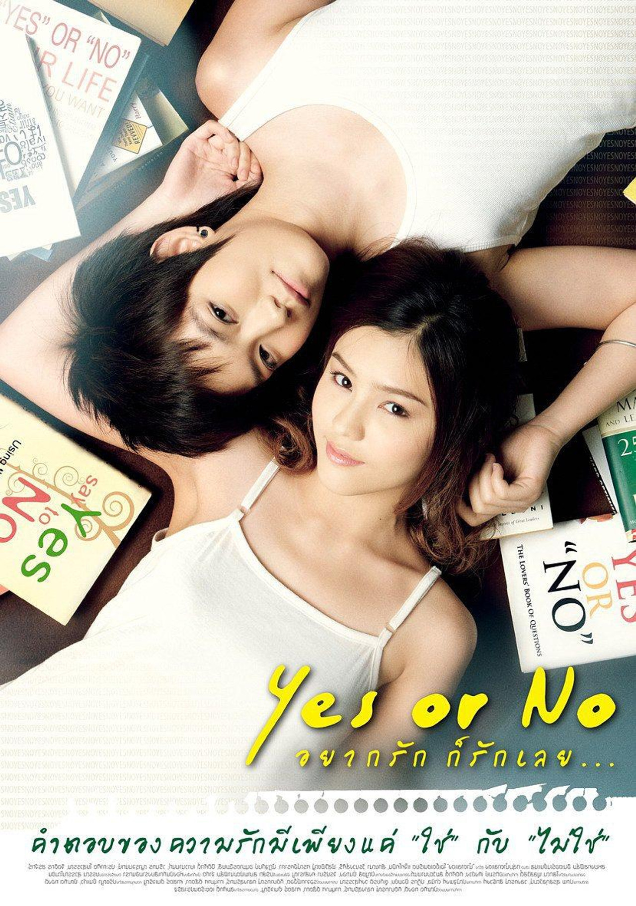
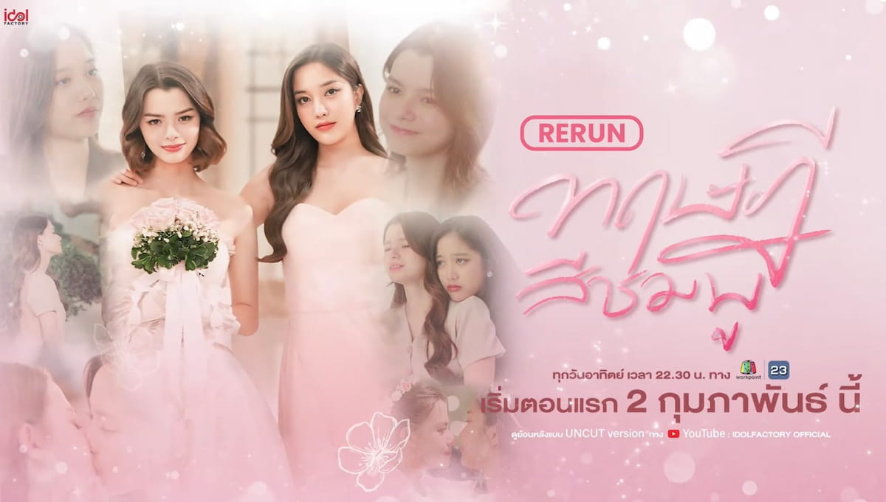
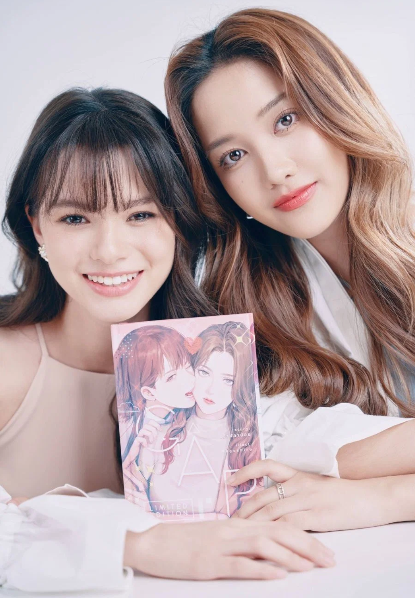
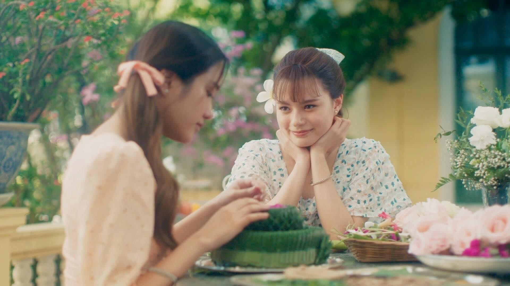
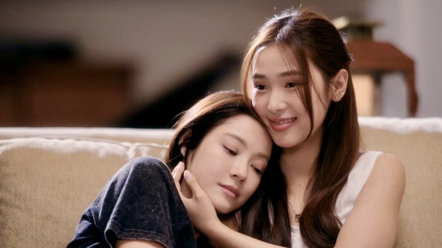
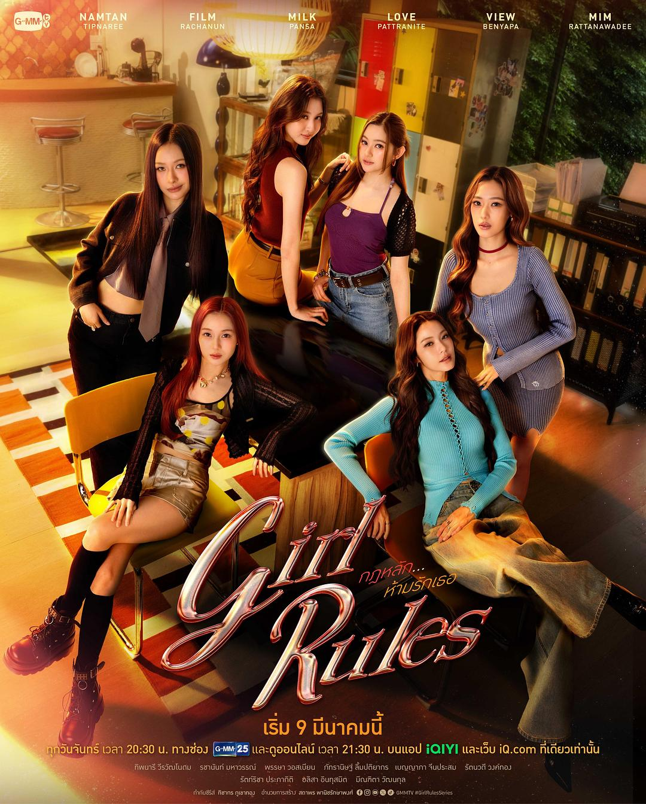

今年年初，我阴差阳错地发现了一个很小众的影视领域：泰国百合剧（下文简称“泰百”）。观察了一阵，觉得这个小众领域还挺有意思，便决定写一部泰国百合剧编年史。

百合，即 Girls’ Love（GL），指以女性之间的爱情为核心的故事类型。泰国百合剧，则是过去几年亚洲影视工业中生长最快的类型之一。

作为产业的泰国百合剧，历史其实很短。眼下通行的产业叙述，大多把 2022 年 11 月首播的《粉红理论》（GAP The Series）视作现代泰国百合剧产业的起点。在这之前，泰国早已有百合电影、百合小说与女性 CP（CP 即 couple，搭档），却始终没有长成今天这样一条稳定的产业链：“剧集—固定 CP—经纪运营—品牌代言—线下见面会—下一部剧”。

要理解这段历史，得从 2010 年说起。

**2010：起源——《Yes or No》与 tomboy 叙事**

泰国百合影视的来路，至少可以上溯到 2010 年的电影《想爱就爱》（Yes or No）。

《Yes or No》讲的是大学女生 Pie 与室友 Kim 从冲突、靠近到相爱的故事。Kim 是泰国传统语境里典型的 Tom：衣着、发型与举止都偏男性化，这更接近泰国早期百合影视与现实社群中常见的一种性别气质结构；而今天 FreenBecky、LingOrm、MilkLove、NamtanFilm 这些商业组合，基本走的是两位女性气质主演的“双女主”配置。

《Yes or No》的历史意义在于：它最早以商业电影的方式证明，两个女人之间的爱情可以独自撑起一部面向大众的爱情片。影片 2010 年 12 月 16 日在泰国上映，此后又推出《Yes or No 2》（2012）与《Yes or No 2.5》（2015）。可它终究只是一部电影，还撑不起一个可以持续生产、运营 CP 的剧集工业。

所以，若谈论泰国百合影视史，《Yes or No》是绕不开的起点；若谈论现代泰国百合偶像工业史，真正的起点还要再等十二年——2022 年，FreenBecky 与《粉红理论》才把“百合”做成一门可以持续运营的生意。

**2022：现代泰百的开山之作《粉红理论》**

现代泰国百合剧真正的分水岭，是《粉红理论》（GAP The Series）。

主演是 Freen Sarocha（Sarocha Chankimha）与 Becky Armstrong（Rebecca Patricia Armstrong），这对搭档合称 FreenBecky。

故事本身并不复杂：Mon 从小把 Sam 当作榜样，毕业后进了 Sam 的公司，才发现这位强势、冷淡的上司出身显赫（原作设定为皇室后裔）。两人之间隔着八岁的年龄差、阶层、职场权力与家庭压力，最后仍然走到了一起。

但《粉红理论》的意义从来不只在剧情。它是第一部真正完整验证了这样一个命题的作品：两个女性主演可以独自撑起一部长篇商业爱情剧，女女 CP 也能聚起规模惊人的国际粉丝群体。

泰国文化机构 Thailand Foundation 在 2025 年的一篇文章里，明确把《粉红理论》称为“泰国第一部主流百合剧”；此后的产业报道与研究，也大多把 2022 年视作泰国现代百合产业兴起的起点。

《粉红理论》2022 年 11 月 19 日首播、2023 年 2 月 11 日完结，共 12 集，在 Channel 3 与 IdolFactory 的 YouTube 频道同步播出。海外观众迅速涌来，Freen 与 Becky 也从电视剧演员，变成一对可以脱离角色独自运营的明星组合。这一步极其关键：泰国公司由此意识到，电视剧并不是唯一的商品，CP 也可以是商品，甚至是比剧集热度更持久、吸金能力更强的商品。

如果一定要选一组最具历史意义的泰国百合 CP，最大的公约数大概就是 FreenBecky——也就是下面这两位：

FreenBecky 常被称作“现代泰百祖师奶”，她们最重要的贡献，是第一次把泰国女女 CP 做成可以持续经营的明星产品。

《粉红理论》之后，两人并没有“演完就散”，而是继续一同出现在品牌活动、红毯、粉丝见面会、海外巡演、杂志拍摄、演唱会，以及下一部作品里。CP 的重心由此从剧中的角色组合，一点点挪到现实中的 FreenBecky 本身。

最能说明这种迁移能力的，是 2024 年的《簪定此生》（The Loyal Pin）。这部剧把 FreenBecky 从现代的办公室爱情，带进 1950 年代的贵族家庭：Freen 饰演贵族小姐 Pin，Becky 饰演公主 Anin。观众愿意跟着这对搭档去看完全不同的人物、年代与故事，说明至少对相当一部分观众来说，吸引力已经不只来自角色，而来自“这两个人一起演戏”本身。角色 IP 由此转化为演员组合 IP——这是泰百 CP 工业从“剧集副产品”走向“可复用资产”的关键一步。

**2023：偶然，还是一个蓝海新市场？**

若把泰国百合剧的发展比作一家公司创业，那么，2022 年是产品第一次做出来；2023 年是证明这个产品具备可持续的吸金能力；2024 年才是资本大规模扩产。

因此，2023 年最准确的历史定位不是“大爆发”，而是“市场验证年”与“产业准备年”。这一年真正发生的事，不只是多播了几部剧，而是泰国娱乐业第一次系统地追问四个问题：

（1）《粉红理论》的成功能不能复制？

（2）除 FreenBecky 之外，能不能再造出新的百合 CP？

（3）百合剧能不能借电视、YouTube、会员付费与国际流媒体，走出不同的商业模式？

（4）如果上面几问的答案都是“可以”，大型娱乐公司是否值得在 2024 年以后大规模投资？

到 2023 年底，前三个问题基本得到了肯定的答案；第四个问题，则要交给 2024 年的投资来回答。

《粉红理论》成功后，行业面临一个很现实的疑问：也许观众只是喜欢 FreenBecky，并不真的需要更多百合剧、更多百合 CP。如果接下来的其他百合 CP 全部失败，《粉红理论》就只能被看成一次偶然。

2023 年真正承担“验证”任务的作品之一，是《只想说爱你》（Show Me Love）。这部剧的 CP 是 EngLot（Engfa Waraha × Charlotte Austin）。

《只想说爱你》的历史意义，不在于剧情有多创新。它真正改变行业的地方是：它和《粉红理论》的造星顺序完全相反。《粉红理论》是先有电视剧，再捧红 FreenBecky 这对 CP；《只想说爱你》则是先有 EngLot 这对 CP，再为这对 CP 拍一部电视剧。

EngLot 为什么特殊？

Engfa Waraha 是 2022 年 Miss Grand Thailand 冠军，Charlotte Austin 也参加过同一届 Miss Grand Thailand 比赛。两人在选美比赛及相关活动中已经积累了大量 CP 粉丝；也就是说，在《只想说爱你》开拍之前，市场上先有了 EngLot 这个“真人 CP”。

制作方于是做了一件很有商业意义的事：把已经存在的真人 CP 热度，转换成电视剧 IP。剧里 Meena 与 Cherine 的故事被放进选美竞赛、娱乐行业与梦想竞争的环境，既借了演员的现实背景，也让“选美”成为当时百合剧里少见的题材。

由此，泰国百合剧形成了两条不同的造星路径：

《粉红理论》模式：电视剧→ CP

《只想说爱你》模式：CP→ 电视剧

这两条路径后来长期并存：有的项目先有剧、再捧 CP，有的项目先有 CP、再为 CP 定制剧。

《只想说爱你》还验证了另一件事：百合 CP 可以来自别的娱乐产业。FreenBecky 基本出自电视剧演员体系，EngLot 则出自选美产业。这件事看似简单，影响却很深远：它意味着泰国制造百合明星时，不一定只能去传统演员学校里找新人，还可以从选美、偶像、模特、网红、音乐艺人等不同体系中，找到两个有化学反应的女性，再做 CP 化运营。从产业史看，《只想说爱你》把“选美经济”与“百合经济”接上了，这条路至今仍在。

**2024：第一个真正意义上的大爆发**

经过 2022—2023 年的市场试探，到 2024 年，行业开始相信百合剧能赚钱。GMMTV、Channel 3 等传统电视工业中的重要玩家正式入场，泰国百合剧迎来第一个真正意义上的爆发，大量作品在 2024 年走到观众面前。

不过严格说来，GMMTV 并非从零开始。2021 年《Bad Buddy》里的 InkPa 支线，已经让公司看见女女 CP 的潜力；2024 年的《地球倾斜23.5度》，才是它第一部完整的 百合剧。

（1）《地球倾斜23.5度》：GMMTV 正式进入百合剧领域

《地球倾斜23.5度》（23.5）由 MilkLove（Milk Pansa × Love Pattranite，业界称“奶爱”）主演。故事是非常典型的青春校园恋爱：害羞的 Ongsa 暗恋 Sun，却用“Earth”的网名在社交网络上接近她；Sun 一度以为 Earth 是男生。现实身份、线上关系与青春期暗恋，就此交织。

《地球倾斜23.5度》的产业意义大于剧情意义：它是 GMMTV 第一部完整的百合剧（此前只有《Bad Buddy》等剧中的百合支线）。GMMTV 拥有泰国最成熟的 Y-series 演员与制作体系之一，因此它入场不只是“多拍了一部百合剧”，而是意味着一个已经掌握 BL 工业化方法的公司，开始建立自己的百合产品线。

（2）《我们的秘密》：传统电视工业正式进场

另一部历史意义极高的作品是《我们的秘密》（The Secret of Us），主演是 LingOrm（Lingling Kwong 邝玲玲 × Orm Kornnaphat）。邝玲玲是港泰混血，1995 年生于香港，17 岁移居泰国，会说粤语、普通话、泰语与英语；她是泰国三台（Channel 3）旗下艺人，2022 年前后也曾为香港 TVB 的 J2 台主持《冲游泰国》等旅游节目。

Channel 3 在泰国传统电视产业中的地位，决定了这部作品的象征意义。《我们的秘密》讲的已不是高中少女的爱情，而是成年职业女性、医生、前任、分手创伤与重逢。邝玲玲饰演皮肤科医生 Fahlada，Orm 饰演她的前女友 Earn；两人曾经相爱，Earn 却突然离开，真正的原因与 Fahlada 母亲的反对有关。多年之后，她们再次走进彼此的生活。

Channel 3 的官方页面明确把《我们的秘密》作为其百合剧项目推广；它也是 Channel 3 第一部自制的百合剧。如果说《粉红理论》证明创业型公司可以造出百合剧爆款，那么《我们的秘密》证明的是：传统电视巨头认为百合剧已经值得成为主流产品。

随后 LingOrm 又主演了《Only You》以及 2026 年的《绘梦婚礼》。Channel 3 实际上已开始围绕 LingOrm，经营一个长期的百合剧 CP 明星品牌。

LingOrm 这条线尤其值得研究，因为它展示了百合叙事的快速成熟。早期的百合剧，大量篇幅用于回答“两个女人能不能在一起”，家庭、社会与自我认同是主要阻力；到了 2026 年，LingOrm 的《绘梦婚礼》已经可以直接进入结婚、夫妻关系、家庭、离婚与复合。叙事前提悄然改变：过去的核心问题是两个女人能不能在一起，如今越来越多作品的核心问题，变成两个已经相爱的女人究竟该怎么经营这段关系。这其实是类型成熟的重要标志——故事不再需要把“百合”本身当作最大的戏剧冲突。

（3）《簪定此生》：百合剧不再只是一种“题材”

《簪定此生》的重要程度经常被低估。它真正完成的突破是“百合 + 年代剧”：FreenBecky 换上完全不同的服装、身份与时代背景，爱情被放进 1950 年代泰国的贵族社会、家庭责任、传统婚姻制度与时代规范之中。该剧被称为泰国第一部百合年代剧。

前文已经讨论过它对 CP 品牌的意义；从类型史看，它更重要的转变在于：最开始是“我要拍一部百合剧，所以找两个女人谈恋爱”，后来渐渐变成“我要拍一部年代剧，而两个主人公恰好都是女人，并且相爱”。两者差别极大：前者说明百合是题材，后者说明百合已经开始成为一种可以被接纳的人物关系结构。

（4）《冥王星之恋》：剧情开始比“发糖”更重要

GMMTV 随后形成的另一个核心 CP 是 NamtanFilm（Namtan Tipnaree × Film Rachanun，业界称“糖影”）。

《冥王星之恋》引入了双胞胎、身份替代、秘密、事故、失明与悬疑结构：双胞胎里的 Oaboom 在婚礼当天出事之前，托另一个 Ai-oon 代自己去和 May 分手；Ai-oon 见到 May，却发现她是盲人，于是将错就错地冒充下去。于是它不再只靠“两个女人有没有化学反应”推着观众看下一集，观众还会追问：“真相到底是什么？”这代表百合剧开始进入情节驱动的阶段。

《冥王星之恋》常被观众视作泰百剧情的第一梯队。双胞胎身份替代的设定，放在 2024 年的泰百里仍算有新意，并在中段制造了一次关键反转；虽然泰剧常被诟病逻辑不够严密，这部剧也并非无懈可击，但整体仍属上乘。

**2025：从“百合热潮”走向“百合常态化”**

如果说 2022 年《粉红理论》打开了市场，2024 年泰国百合剧完成了第一次大爆发，那么 2025 年，泰国百合剧真正走向了“量产”。

2025 年最重要的，并不是出现了某一部像《粉红理论》那样的开山之作，而是一整年几乎不断档地有泰国百合剧播出。据 MyDramaList 的 2025 年泰百片单，全年共 26 部（含 3—4 集短剧）；若只计 8 集以上的常规剧集，约 21 部。这意味着百合剧已经开始成为泰国电视剧工业里的常规品类。

（1）《Only You》：LingOrm 从爆款 CP 变成 Channel 3 的长期资产

2025 年最重要的项目之一，无疑是《Only You》。2024 年《我们的秘密》成功后，Channel 3 没有更换主演，而是迅速让 LingOrm 二搭《Only You》，而且类型完全改变：邝玲玲饰演女保镖 Tawan，Orm 饰演超级明星 Ayla。这说明 Channel 3 已经认识到，LingOrm 的商业价值并不绑定 Fahlada 与 Earn 两个角色，电视台真正拥有的，是 LingOrm 这个 CP 品牌。2025 年，Channel 3 还为两人举办了 HER & HERS LINGORM 1st FANCON。

所以，如果说《我们的秘密》代表传统电视台第一次认真做百合剧，那么《Only You》代表的，是传统电视台第一次认真经营一个长期的百合超级 CP。这两者的产业意义并不一样。

（2）2025 年还有一个很重要的变化：百合剧开始“全年不断档”

把几部主要作品按首播时间排一下，会非常明显：

| **首播** | **代表作品**                  | **产业意义**                     |
| ------ | ------------------------- | ---------------------------- |
| 1月     | **Us**                    | EmiBonnie 成型，GMMTV 扩大百合 CP 池 |
| 2月     | **Reverse  With Me**   | 奇幻、时间穿越、百合 IP 世界观            |
| 5月     | **Denied  Love**       | 流媒体发行 + 契约婚姻模式               |
| 6月     | **Whale  Store xoxo**  | MilkLove 二搭，CP 长期化           |
| 7月     | **Only  You**          | LingOrm 二搭，Channel 3 加码      |
| 7月     | **Harmony  Secret**    | LMSY 二搭（《Affair》之后）          |
| 8月     | **Somewhere  Somehow** | IdolFactory 培养 FayMay        |
| 10月    | **Love  Design**       | 主流女演员进入百合                    |
| 10月    | **Unlimited  Love**    | EngLot + Miss Grand 生态       |
| 11月    | **ClaireBell**            | 监狱 / 犯罪环境题材进入百合              |

此外还有《I’m Your Moon》《Queendom》《Roller Coaster》《My Safe Zone》《Poisonous Love》《Player》《Dangerous Queen》等一批作品。按 MyDramaList 的 2025 年泰百片单，全年共 26 部（含 3—4 集短剧）；若只计 8 集以上的常规剧集，约 21 部。无论用哪种口径，都和 2022 年只有少数试验型项目不是一个量级。所以 2025 年第一次给人一种感觉：泰百不再有“百合季”，一年十二个月，都可能看到新项目。

（3）2025 年真正发生了什么？

如果把它总结成几个关键词，我认为是：

第一，数量规模化。

泰国百合剧从 2024 年的突然爆发，变成 2025 年的持续生产。

第二，CP 二搭成为常态。

MilkLove、LingOrm、LMSY、EngLot 等都继续合作。

第三，新 CP 成批产生。

EmiBonnie、FayMay、EnjoyJune、KaoJane、LenaMiu 等不断进入市场。

第四，大公司不再只押一对 CP。

GMMTV、Channel 3、IdolFactory 等开始形成自己的百合演员阵容。

第五，类型迅速扩张。

从校园、办公室扩张到奇幻、医疗、动作、商业竞争、契约婚姻、监狱与犯罪。

第六，发行体系成熟。

GMM25、Channel 3、One31、Channel 7、Workpoint 与 YouTube、Netflix、iQIYI、WeTV 等平台同时存在，泰百越来越天然地按照“泰国播出 + 国际流媒体”的逻辑生产。

如果用一句话概括 2025 年：2024 年让泰国娱乐公司发现“百合到处都能拍”；2025 年则让整个行业学会了“百合可以一直拍”。

**2026：超级项目、群像化与 IP 化**

这一年最具代表性的变化，不再只是“又增加了多少部百合剧”，而是产业结构升级了：

《四大元素》把四部百合剧做成一个 32 集的共享宇宙；《女孩法则》第一次把三组GMMTV CP放进同一部群像剧；《月下之影》则把 EmiBonnie 从《Us》的青春浪漫，直接推向 one-night stand、包养关系、旧爱与成人欲望；而 LingOrm 的《绘梦婚礼》，已经开始直接讨论结婚、离婚与婚姻修复。

换句话说，2026 年泰百开始从“批量生产百合”，进入建设百合 IP、百合明星矩阵与类型工业的阶段。

（1）《四大元素》：2026 年最有产业史意义的百合项目

如果只能选一个项目代表 2026 年泰百的产业升级，我会选《四大元素》（4 Elements）。

它不是一部单剧，而是由四部百合剧组成的连续项目：

《土：大地情缘》（The Earth）：童年好友重逢，契约婚姻假戏成真。

《水：水之魅影》（The Water）：商业竞争 + 家族恩怨 + 卧底。

《风：风之恋歌》（The Air）：王室 + 保镖 + 暗杀 + 身份谜题。

《火：火之爱链》（The Fire）：宿敌恋人 + 欢喜冤家。

每部 8 集，一共 32 集。四部都由 North Star Entertainment 制作，改编自泰国作家 Salmon 的“The Wathinwanits”小说系列。这本身就已经和《粉红理论》时代完全不同了。2022 年的逻辑还是：“我们冒险投一部百合剧，看看会不会成功。”到了 2026 年，制作方敢做的是一次性投资四部、32 集，从年初播到 8 月，并且在 Channel 7 这样的地面电视台首播，再由 iQIYI 跟播。这是工业信心的巨大变化。

《四大元素》的真正创新，是第一次把百合剧做成“共享宇宙”。四部故事围绕同一个 Wathinwanit 家族展开，四位同族姐妹分别对应土、水、风、火。每人有自己的爱情线，但其他姐妹会在彼此的剧中客串。因此四部剧既独立成篇，又共享一个家族世界。这和以前的泰百模式差别非常大。

以前是：一本小说 → 一部剧 → 一对 CP。

《四大元素》则变成：小说系列 → 家族世界观
→ 四部电视剧 → 四组 CP → 角色交叉 → 一个统一品牌。

这已经非常接近传统商业影视里的系列 IP。因此我认为，《四大元素》的历史意义，大于其中任何一部单剧的成败：它证明泰百开始具备“构建世界”的能力。

（2）《女孩法则》：从“一部剧一对 CP”走向“百合群像宇宙”

如果说《四大元素》代表跨公司、跨 CP 的系列化尝试，那么 GMMTV 的《女孩法则》（Girl Rules）代表的，则是公司内部的百合明星矩阵化。

《女孩法则》核心阵容包括：

Namtan × Film（糖影）

Milk × Love（奶爱）

View × Mim（景米）

也就是三组 CP、六个女主角。

在此之前，泰百的基本商业单位，大体上是“一部剧 = 一对 CP”。

而《女孩法则》第一次非常明确地把几个已经建立了自身粉丝群的百合 CP，放进同一个核心故事。故事围绕时尚与影视制作行业，以及六名女性之间不断交叉的事业与私人关系展开。这本质上说明，GMMTV 已经不再需要“一对一对地推百合 CP”，它可以开始推“GMMTV 百合宇宙”。

（3）《月下之影》：2026 年泰百“成人化”的代表作品之一

然后到了 8 月，GMMTV 又推出一部风格明显不同的作品：《月下之影》（Moonshadow）。主演 CP 是 EmiBonnie（Emi Thasorn × Bonnie
Pattraphus），同时还有 Film Rachanun 担任非常重要的第三女主（饰演女主的前任）。

《月下之影》和《Us》相比，几乎是一次“成年礼”。EmiBonnie 在 2025 年的《Us》里，核心还是年轻女性、暗恋、家庭关系、成长。

而到了《月下之影》，开场就是 one-night stand。Emi 饰演的 Chan 是事业成功、掌控力很强的成熟女性；Bonnie 饰演的 Key 与她发生关系后并没有离开，反而提出一个带着挑衅意味的建议：让 Chan“包养”她。两人由此进入一段接近 sugar baby 的灰色关系。

随着 Chan 与 Key 真正生出感情，Film 饰演的 Jay——Chan 的初恋——又重新出现。故事于是变成 Chan × Key × Jay 的成人爱情三角。

《月下之影》还有一个容易被忽略的产业实验：让 Film 介入 EmiBonnie 的三角关系。

Film 本来已经是 NamtanFilm 的一半。按非常僵硬的传统 CP 逻辑，理论上该尽量避免让她成为另一组热门 CP 爱情故事里的强势第三者。但 GMMTV 仍然让 Film 直接进入 EmiBonnie 的核心三角；同一部剧里，Namtan 也以 Elle 的身份出现。这等于把两组 GMMTV 核心 CP 的成员同时放进一部新剧，说明公司开始测试一件很重要的事：百合演员能不能渐渐脱离“只能和固定搭档演爱情戏”的限制？

如果未来的答案是“可以”，泰国百合演员的发展空间会大很多。因为固定 CP 模式虽然非常赚钱，却一直有个长期隐患：演员可能被自己的 CP 困住。

2026 年开始出现越来越多这样的迹象：保持主 CP 品牌，但允许演员跨作品、跨组合去建立角色关系。从产业长期健康程度看，这非常重要。

（4）LingOrm 的《绘梦婚礼》：从恋爱进一步走到婚姻

2026 年另一部必须放进历史脉络的作品是《绘梦婚礼》（In Love Forever）。这是 LingOrm 连续第三部核心作品：

2024：《我们的秘密》

2025：《Only You》

2026：《绘梦婚礼》

而三部剧恰好连成一条非常明显的成熟路线。

故事开始时，两位女主角已经结婚，而且已经准备离婚。邝玲玲饰演成功律师 Ran，Orm 饰演 Z 世代富家继承人 Neen。由于 Ran 母亲的反对与长期矛盾，两人的婚姻走向破裂；但因为商业利益等原因，她们不得不在外人面前继续扮演幸福夫妻。一次几乎夺走 Neen 性命的事件之后，Ran 与母亲决裂，两年后两人重逢，旧日的感情重新浮现。

把它和《粉红理论》放在一起，就能看出这四年的变化有多大。

2022 年《粉红理论》：“两个女人能不能克服家族压力在一起？”

2026 年《绘梦婚礼》：“两个已经结过婚的女人为什么会离婚？这段婚姻还有没有可能修复？”

这是完全不同的叙事阶段。早期百合最大的阻力，经常是“你们都是女人，家长不同意”。到了 2026 年，越来越多百合剧的真正矛盾，变成了“你不信任我”，“你前任回来了”，“我们的婚姻出了问题”，“你欺骗了我”，“你太控制我”，“我们对关系的定义不同”。

也就是说，冲突越来越来自“人”，而不是“百合”。这其实就是类型真正成熟的表现。

把《四大元素》，《女孩法则》，《月下之影》，《绘梦婚礼》放在一起，可以看到 2026 年完成的四次产业升级：

| **作品**     | **表面上的剧情创新**  | **更深层的产业意义**         |
| ---------- | ------------- | -------------------- |
| **《四大元素》** | 四姐妹、四种元素爱情    | **百合系列化 / 共享宇宙出现**   |
| **《女孩法则》** | 六名女性、三组交叉关系   | **多 CP 群像、公司矩阵化**    |
| **《月下之影》** | 一夜情、包养、前任、三角恋 | **百合成人化、固定CP边界开始松动** |
| **《绘梦婚礼》** | 结婚、离婚、婚姻修复    | **百合关系进入成熟家庭/婚姻叙事**  |

不过，2025—2026 年，“泰百供给过剩”的风险第一次真正变得明显。2025 年已有 26 部（含短剧），2026 年又叠加了《四大元素》这样的四部连播项目；作品越来越多，CP 越来越多，观众的时间却没有同步增加。行业里已经开始出现“泰百是不是增长得比观众和产业支撑体系更快”的讨论。

几年前市场只有几组核心 CP，如今已扩展到数十组、多家制作公司与大量不同类型，竞争只会更残酷。仅靠“两个漂亮女孩谈恋爱”已经远远不够；剧本、导演、摄影、制作规模、表演、类型创新、CP 化学反应、海外发行，以及公司长期运营演员的能力，才决定一部剧能不能突出重围。

综上：

2022 年，《粉红理论》证明“百合剧可以成为主流产品”。

2023 年，行业证明“百合 CP 可以复制，也可以反向定制”。

2024 年，资本证明“百合剧可以规模化”。

2025 年，市场证明“百合剧可以全年持续生产”。

2026 年，泰国开始证明：百合剧可以拥有自己的共享宇宙、明星矩阵、大型 IP、类型体系与全球化商业生态。

**泰国百合剧的另一面：一种被精心制造的“精神乌托邦”**

泰国百合剧之所以能吸引大量观众，一个重要的原因在于，它并不以记录现实为首要目标。许多百合剧更接近一种被高度提纯的爱情幻想：两个容貌出众、经济宽裕、事业体面又彼此强烈吸引的女性，在经历有限的误会、家庭阻力或第三者之后，最终确认彼此、重新相爱，得到一个相对圆满的结局。豪宅、海边、咖啡馆、大学校园、时尚公司、医生、明星、企业继承人与漂亮的服装，共同构筑出一处几乎滤掉现实摩擦的审美空间。《粉红理论》的豪门与公司、《地球倾斜23.5度》的校园、《我们的秘密》的医院与家族企业、《簪定此生》的宫廷，都是这处空间的不同变体。观众消费的并不只是“两个女人相爱”，而是一个爱情可以压倒现实、两个人终究会坚定选择彼此的精神乌托邦。

然而现实中的百合伴侣关系，当然远没有这么简单。她们和任何长期伴侣一样，要面对性格不合、沟通方式不同、金钱观念、事业选择、家务分配、亲密需求差异、嫉妒、边界感、原生家庭的介入，以及关系渐渐平淡这些问题。有些关系还要经历出轨、控制欲、情绪依赖、分手复合，甚至长期无法解决的价值观冲突。百合关系并不会因为双方都是女性，就天然拥有更强的共情能力。相反，它有时要面对一种独特的困难：异性恋关系里那些现成的剧本——“男主外女主内”，“你是不是男人”——在这里失效了，伴侣必须自己协商分工、边界与责任，没有可以照抄的模板。这既可能减少某些摩擦，也意味着更多需要自己摸索的部分。

因此，泰国百合剧最值得注意的地方，恰恰是它与现实之间的那段距离。屏幕上的爱情，往往把漫长、琐碎、令人疲惫的现实压缩成几个可以解决的戏剧冲突；现实关系却没有编剧负责让误会在第十一集解除，也没有大结局保证两个人最后拥抱在一起。

这并不是说百合剧的浪漫化没有价值。恰恰相反，这种“不完全真实”本身就是它的重要功能。很多观众走进泰国百合剧的世界，并不是为了听一堂关于现实百合伴侣生活有多难的社会学课程，而是想暂时进入一个更漂亮、更温柔、爱情更容易被回应的世界。

因此，可以把泰国百合剧理解为一种满足观众对亲密关系需求的“情感乌托邦”。但走出屏幕以后，真正维持一段长期关系所需要的，仍然不是“CP 感”，而是沟通、边界、信任、责任、现实利益的协调，以及处理冲突的能力。泰国百合剧描绘的并不等于现实中的百合生活；它更像现实之上的一场梦。也正因为现实中的爱情远比电视剧复杂，这个梦才会如此有吸引力。

**泰国百合剧的流行，本质上并不只是百合文化的流行，它也照见现代人的亲密关系困境。城市化、个人主义与社会原子化，使人拥有更多自由，却未必拥有更多稳定的陪伴。现实爱情需要承担拒绝、磨合、责任、经济压力与失去的风险，而影视作品可以把这些复杂性过滤掉，只留下心动、拥抱、依恋，和“被坚定选择”的感觉。因此，对一部分观众来说，百合剧其实是一种情感的代偿机制：他们通过看虚构的人物相爱，短暂地满足现实生活里未必能得到的那点亲密、陪伴与归属感。百合剧构建的不是现实关系的真实复制品，而是一座可以暂时居住的精神乌托邦——正因为现实世界没有编剧保证幸福结局，人们才如此需要一个虚构世界，让爱情至少在那里能按自己希望的方式发生。**

**这，是不是对现代原子人的一种讽刺呢？**
