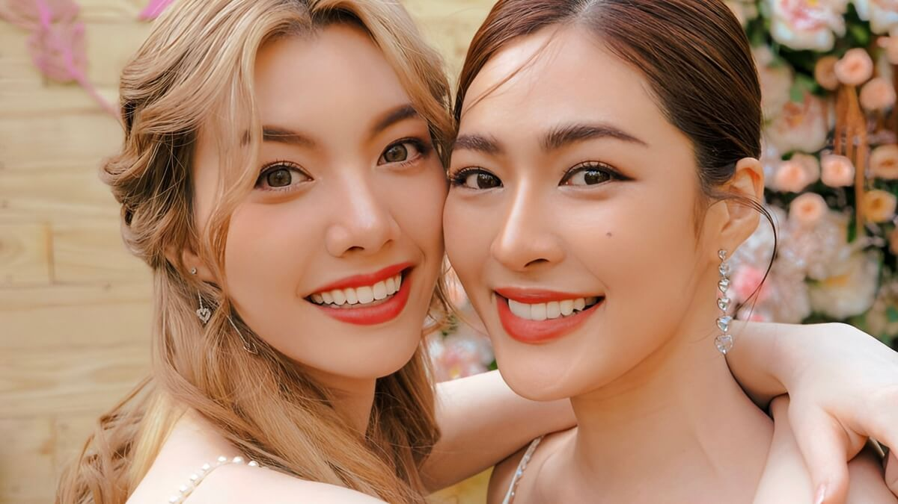
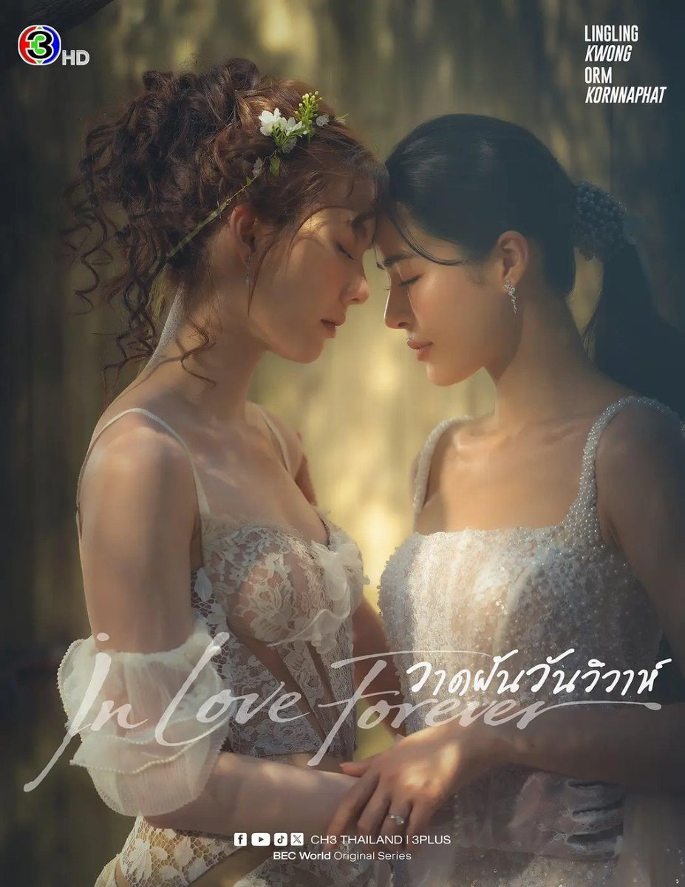

ต้นปีนี้
ฉันบังเอิญได้ค้นพบแวดวงภาพยนตร์และซีรีส์ที่ค่อนข้างเฉพาะกลุ่มอย่างซีรีส์ Girls’ Love (GL) ของไทย (ต่อไปนี้จะเรียกว่า “GL ไทย”) เมื่อเฝ้าสังเกตอยู่ระยะหนึ่ง
ฉันเห็นว่าแวดวงนี้มีเสน่ห์และน่าศึกษา จึงตัดสินใจเขียนบันทึกประวัติศาสตร์ซีรีส์
GL ไทยขึ้นมา

Girls’ Love (GL) หมายถึงเรื่องราวที่ศูนย์กลางอยู่ที่ความรักระหว่างผู้หญิง
ส่วนซีรีส์ GL ไทยนั้น
นับเป็นหนึ่งในประเภทที่เติบโตเร็วที่สุดในอุตสาหกรรมภาพยนตร์และซีรีส์ของเอเชียในช่วงไม่กี่ปีที่ผ่านมา

ในฐานะอุตสาหกรรม
ประวัติศาสตร์ของซีรีส์ GL ไทยนั้นสั้นมาก ทุกวันนี้
เรื่องเล่ากระแสหลักของอุตสาหกรรมมักถือว่า “ทฤษฎีสีชมพู” (GAP The Series) ซึ่งออกอากาศตอนแรกเมื่อเดือนพฤศจิกายน
2022 เป็นจุดเริ่มต้นของอุตสาหกรรมซีรีส์ GL ไทยยุคใหม่ ก่อนหน้านั้น
ไทยมีภาพยนตร์ GL นิยาย GL และคู่จิ้นหญิง (CP ย่อมาจาก couple หมายถึงคู่จิ้น)
อยู่แล้ว แต่ยังไม่เคยเติบโตเป็นห่วงโซ่อุตสาหกรรมที่มั่นคงอย่างทุกวันนี้: “ซีรีส์—คู่จิ้นประจำ—การบริหารนักแสดง—การเป็นพรีเซนเตอร์แบรนด์—งานแฟนมีตติ้ง—ซีรีส์เรื่องต่อไป”

ตรงนี้ต้องแยกคำถามสองข้อ:
อะไรคือ “ซีรีส์ GL
เรื่องแรก” และอะไรคือ “จุดเริ่มต้นของอุตสาหกรรม” หากถามข้อแรก ในปี 2022 ยังมี “Rak Kaew” รวมถึงความพยายามสร้างซีรีส์ GL เรื่องอื่น ๆ ที่มาก่อน
หากนับภาพยนตร์ด้วย “Yes or No” เมื่อปี
2010 ก็ยิ่งมาก่อน สถานะทางประวัติศาสตร์ของ “ทฤษฎีสีชมพู” ส่วนใหญ่มาจากการที่ผลงานนี้เป็นเรื่องแรกที่ผลักดัน GL
ให้กลายเป็นสินค้าเชิงพาณิชย์กระแสหลัก มากกว่าจะเป็น “เรื่องแรกในประวัติศาสตร์”

หากจะเข้าใจประวัติศาสตร์ช่วงนี้
ต้องเริ่มจากปี 2010

### **2010: จุดกำเนิด****—“Yes or No” กับเรื่องเล่าแบบทอมบอย**

เส้นทางของภาพยนตร์และซีรีส์
GL ไทยสามารถสืบย้อนไปได้อย่างน้อยถึงภาพยนตร์ปี 2010 เรื่อง “อยากรัก ก็รักเลย” (Yes or No)

“Yes or No” เล่าเรื่องของ Pie นักศึกษาหญิงมหาวิทยาลัยกับ Kim เพื่อนร่วมห้อง
โดยความสัมพันธ์เริ่มจากความขัดแย้ง การเข้าใกล้กัน ไปจนถึงความรัก Kim
เป็นทอมแบบฉบับในบริบทไทยดั้งเดิม: การแต่งกาย ทรงผม
และกิริยาท่าทางค่อนไปทางผู้ชาย ซึ่งเมื่อประกอบกับความเป็นหญิงของ Pie ก็กลายเป็นการจับคู่แบบทอม–ดี สิ่งนี้ใกล้เคียงกับโครงสร้างการแสดงออกทางเพศภาวะ (gender expression)
ที่พบได้บ่อยในภาพยนตร์และซีรีส์ GL ไทยยุคแรกและในชุมชนจริง
ส่วนคู่จิ้นเชิงพาณิชย์อย่าง FreenBecky, LingOrm, MilkLove และ NamtanFilm
ในปัจจุบัน ส่วนใหญ่ใช้รูปแบบ “นางเอกสองคน” ที่นักแสดงทั้งสองมีภาพลักษณ์แบบผู้หญิง ทั้งสองรูปแบบมีอยู่จริง
สิ่งที่เปลี่ยนไปคือทางเลือกของอุตสาหกรรม ไม่ใช่ว่าแบบไหน “จริงกว่า”

ความหมายทางประวัติศาสตร์ของ “Yes or No” อยู่ที่ว่า
ภาพยนตร์เรื่องนี้เป็นผลงานเรื่องแรกที่พิสูจน์ผ่านภาพยนตร์เชิงพาณิชย์ว่า
ความรักระหว่างผู้หญิงสองคนสามารถเป็นแกนหลักของภาพยนตร์รักสำหรับผู้ชมทั่วไปได้ด้วยตัวเอง
ภาพยนตร์ออกฉายในประเทศไทยเมื่อวันที่ 16 ธันวาคม 2010 จากนั้นมีภาคต่อ “Yes or No 2” (2012) และ “Yes
or No 2.5” (2015) แต่ก็ยังเป็นเพียงภาพยนตร์เรื่องหนึ่ง
ยังไม่สามารถรองรับอุตสาหกรรมซีรีส์ที่ผลิตและบริหารคู่จิ้นได้อย่างต่อเนื่อง

ดังนั้น
หากพูดถึงประวัติศาสตร์ภาพยนตร์และซีรีส์ GL ไทย “Yes or No” คือจุดเริ่มต้นที่เลี่ยงไม่ได้
แต่หากพูดถึงประวัติศาสตร์อุตสาหกรรมไอดอล GL ไทยยุคใหม่
จุดเริ่มต้นที่แท้จริงต้องรออีกสิบสองปี ในปี 2022 FreenBecky กับ “ทฤษฎีสีชมพู” จึงทำให้ “GL” กลายเป็นธุรกิจที่ดำเนินต่อไปได้อย่างต่อเนื่อง

### **2022:** **“ทฤษฎีสีชมพู” ผลงานบุกเบิกของ GL ไทยยุคใหม่**

เส้นแบ่งยุคที่แท้จริงของซีรีส์
GL ไทยยุคใหม่คือ “ทฤษฎีสีชมพู” (GAP The Series)

นำแสดงโดย Freen Sarocha (Sarocha Chankimha) และ Becky Armstrong (Rebecca Patricia Armstrong) ทั้งคู่เป็นที่รู้จักในนามคู่จิ้น FreenBecky

เรื่องราวไม่ซับซ้อน: Mon
นับถือ Sam เป็นแบบอย่างมาตั้งแต่เด็ก หลังเรียนจบเธอเข้าทำงานที่บริษัทของ Sam
จึงพบว่าหัวหน้าที่เข้มแข็งและเย็นชาคนนี้มาจากตระกูลสูงศักดิ์
(ในต้นฉบับกำหนดให้เป็นทายาทราชวงศ์) ระหว่างทั้งสองมีทั้งอายุที่ห่างกันแปดปี
ชนชั้น อำนาจในที่ทำงาน และแรงกดดันจากครอบครัว แต่สุดท้ายทั้งสองก็ลงเอยด้วยกัน

แต่ความหมายของ “ทฤษฎีสีชมพู” ไม่เคยอยู่แค่ในเนื้อเรื่อง
เป็นผลงานเรื่องแรกที่พิสูจน์ได้อย่างสมบูรณ์ว่า
นักแสดงนำหญิงสองคนสามารถเป็นแกนหลักให้ซีรีส์รักเชิงพาณิชย์เรื่องยาวดำเนินไปได้ด้วยตัวเอง
และคู่จิ้นหญิงหญิงก็สามารถรวมแฟนคลับนานาชาติที่มีขนาดมหาศาลได้

มูลนิธิไทย (Thailand Foundation) ในบทความปี 2025 ระบุชัดเจนว่า “ทฤษฎีสีชมพู” คือ “ซีรีส์ GL
กระแสหลักเรื่องแรกของไทย” (Thailand’s first mainstream GL series); หลังจากนั้น
การรายงานและการศึกษาทางอุตสาหกรรมส่วนใหญ่ก็มองว่าปี 2022
เป็นจุดเริ่มต้นของการเติบโตของอุตสาหกรรม GL ไทยยุคใหม่

“ทฤษฎีสีชมพู” ออกอากาศตอนแรกเมื่อวันที่ 19 พฤศจิกายน 2022 และจบเมื่อวันที่ 11
กุมภาพันธ์ 2023 รวม 12 ตอน ออกอากาศพร้อมกันทางช่อง 3 และทางช่อง YouTube ของ
IdolFactory ผู้ชมต่างประเทศหลั่งไหลเข้ามาอย่างรวดเร็ว Freen กับ Becky
ก็เปลี่ยนจากนักแสดงซีรีส์เป็นคู่ดาราที่สร้างแบรนด์ของตัวเองได้โดยไม่ต้องอิงบทบาทในเรื่อง
ก้าวนี้สำคัญมาก: บริษัทไทยจึงตระหนักว่าซีรีส์ไม่ใช่สินค้าเพียงอย่างเดียว
คู่จิ้นก็เป็นสินค้าได้เช่นกัน
และอาจเป็นสินค้าที่ความนิยมคงทนกว่าและทำรายได้ได้มากกว่าซีรีส์ด้วย

หากต้องเลือกคู่จิ้น GL
ไทยที่มีความหมายทางประวัติศาสตร์ที่สุด คำตอบร่วมของคนส่วนใหญ่ก็คงเป็น
FreenBecky—สองคนนี้:

FreenBecky มักถูกเรียกกันว่า “ผู้บุกเบิกรุ่นแรกของ GL ไทยยุคใหม่” ผลงานสำคัญที่สุดของพวกเธอคือการทำให้คู่จิ้นหญิงหญิงของไทยกลายเป็นสินค้าดาวเด่นที่บริหารได้อย่างต่อเนื่องเป็นครั้งแรก

หลังจาก “ทฤษฎีสีชมพู” ทั้งสองไม่ได้ “แยกทางเมื่อจบซีรีส์” แต่ยังปรากฏตัวด้วยกันในกิจกรรมแบรนด์
พรมแดง งานแฟนมีตติ้ง ทัวร์ต่างประเทศ การถ่ายนิตยสาร คอนเสิร์ต
และผลงานเรื่องต่อไป จุดศูนย์กลางของคู่จิ้นจึงค่อย ๆ
เลื่อนจากคู่ตัวละครในซีรีส์มาสู่ FreenBecky ในโลกจริง

ผลงานที่แสดงให้เห็นการถ่ายโอนจุดศูนย์กลางจากตัวละครในซีรีส์มาสู่คู่จิ้นในโลกจริงได้ชัดที่สุดคือ “ปิ่นภักดิ์” (The Loyal Pin) จากปี 2024 ซีรีส์เรื่องนี้พา FreenBecky
จากความรักในที่ทำงานยุคใหม่เข้าสู่ครอบครัวชนชั้นสูงในทศวรรษ 1950: Freen
รับบทคุณหนู Pin และ Becky รับบทเจ้าหญิง Anin
การที่ผู้ชมยอมติดตามคู่จิ้นคู่นี้ไปดูตัวละคร ยุคสมัย
และเรื่องราวที่แตกต่างออกไปทั้งหมด แสดงให้เห็นว่า
อย่างน้อยสำหรับผู้ชมจำนวนไม่น้อย แรงดึงดูดไม่ได้มาจากตัวละครเพียงอย่างเดียว
แต่มาจาก “การที่สองคนนี้แสดงร่วมกัน” IP ของตัวละครจึงเปลี่ยนเป็น IP ของคู่นักแสดง—นี่คือก้าวสำคัญที่ทำให้อุตสาหกรรมคู่จิ้น
GL ไทยเคลื่อนจาก “ผลพลอยได้ของซีรีส์” ไปสู่ “สินทรัพย์ที่ใช้ซ้ำได้”

### **2023: ความบังเอิญ หรือตลาดใหม่ที่ยังไม่มีใครครอบครอง?**

หากเปรียบการพัฒนาซีรีส์ GL
ไทยกับการก่อตั้งบริษัทสักแห่ง ปี 2022
คือการที่ผลิตภัณฑ์ถูกสร้างขึ้นเป็นครั้งแรก ส่วนปี 2023
คือการพิสูจน์ว่าผลิตภัณฑ์นี้สามารถสร้างรายได้อย่างต่อเนื่อง และปี 2024
จึงเป็นการขยายกำลังการผลิตครั้งใหญ่ด้วยเงินทุน

ดังนั้น
ตำแหน่งทางประวัติศาสตร์ที่แม่นยำที่สุดของปี 2023 ไม่ใช่ “การเติบโตแบบก้าวกระโดด” แต่เป็น “ปีแห่งการพิสูจน์ตลาด” และ “ปีแห่งการเตรียมพร้อมของอุตสาหกรรม” สิ่งที่เกิดขึ้นจริงในปีนี้ไม่ใช่แค่การมีซีรีส์ออกอากาศเพิ่มขึ้นหลายเรื่อง
แต่เป็นครั้งแรกที่อุตสาหกรรมบันเทิงไทยตั้งคำถามสี่ข้ออย่างเป็นระบบ:

(1) ความสำเร็จของ “ทฤษฎีสีชมพู” (GAP) สามารถลอกเลียนแบบได้หรือไม่?

(2) นอกเหนือจาก FreenBecky
จะสร้างคู่จิ้น GL ใหม่ได้หรือไม่?

(3) ซีรีส์ GL
จะใช้โทรทัศน์ YouTube การสมัครสมาชิกแบบเสียเงิน และสตรีมมิ่งระหว่างประเทศ
เพื่อสร้างรูปแบบธุรกิจที่แตกต่างกันได้หรือไม่?

(4) หากคำตอบของคำถามข้างต้นคือ “ได้” บริษัทบันเทิงขนาดใหญ่สมควรลงทุนครั้งใหญ่ตั้งแต่ปี
2024 เป็นต้นไปหรือไม่?

ถึงสิ้นปี 2023
สามคำถามแรกได้รับคำตอบในเชิงบวกเป็นหลัก
ส่วนคำถามที่สี่ต้องรอคำตอบจากการลงทุนในปี 2024

หลังจาก “ทฤษฎีสีชมพู” ประสบความสำเร็จ
อุตสาหกรรมเผชิญคำถามที่จับต้องได้จริงข้อหนึ่ง: บางทีผู้ชมอาจแค่ชอบ FreenBecky
และไม่ได้ต้องการซีรีส์ GL หรือคู่จิ้น GL เพิ่มขึ้นจริง ๆ หากคู่จิ้น GL คู่อื่น
ๆ ล้มเหลวทั้งหมด “ทฤษฎีสีชมพู” ก็จะถูกมองเป็นเพียงความบังเอิญครั้งหนึ่ง

ผลงานเรื่องหนึ่งที่รับหน้าที่ “พิสูจน์” ในปี
2023 คือ “แค่อยากบอกรัก” (Show Me
Love) คู่จิ้นของเรื่องนี้คือ EngLot (Engfa Waraha × Charlotte Austin) ออกอากาศตอนแรกเมื่อวันที่ 28 กุมภาพันธ์ 2023 และจบเมื่อวันที่
28 เมษายน รวม 9 ตอน ต่อจาก “ทฤษฎีสีชมพู” ทันที

ความหมายทางประวัติศาสตร์ของ “แค่อยากบอกรัก” ไม่ได้อยู่ที่ว่าเนื้อเรื่องจะแปลกใหม่เพียงใด
สิ่งที่เปลี่ยนอุตสาหกรรมจริง ๆ คือ ลำดับการปั้นดาราของมันตรงข้ามกับ “ทฤษฎีสีชมพู” โดยสิ้นเชิง: “ทฤษฎีสีชมพู” มีซีรีส์ก่อน แล้วจึงปั้น FreenBecky ให้ดัง; “แค่อยากบอกรัก” มีคู่จิ้น EngLot ก่อน
แล้วจึงสร้างซีรีส์ให้คู่จิ้นคู่นี้

ทำไม EngLot จึงพิเศษ?

Engfa Waraha เป็นผู้ชนะ
Miss Grand Thailand 2022 ส่วน Charlotte Austin ก็เข้าร่วมการประกวด Miss Grand
Thailand เวทีเดียวกัน
ทั้งสองสะสมแฟนคลับคู่จิ้นจำนวนมากระหว่างการประกวดและกิจกรรมที่เกี่ยวข้อง
กล่าวอีกนัยหนึ่ง ก่อนที่ “แค่อยากบอกรัก” จะเริ่มถ่ายทำ ตลาดมี “คู่จิ้นโลกจริง” อย่าง EngLot อยู่ก่อนแล้ว

ผู้ผลิตจึงทำสิ่งที่มีนัยสำคัญเชิงธุรกิจ:
เปลี่ยนความนิยมของคู่จิ้นโลกจริงที่มีอยู่แล้วให้เป็น IP ของซีรีส์ เรื่องราวของ
Meena กับ Cherine ถูกวางไว้ในบรรยากาศการประกวดนางงาม อุตสาหกรรมบันเทิง
และการแข่งขันของความฝัน พร้อมทั้งใช้ฉากหลังจริงของนักแสดง และทำให้ “การประกวดนางงาม” กลายเป็นธีมที่หาได้ยากในซีรีส์
GL ขณะนั้น

จากจุดนี้ ซีรีส์ GL
ไทยจึงเกิดเส้นทางการปั้นดาราที่แตกต่างกันสองเส้นทาง:

รูปแบบ “ทฤษฎีสีชมพู”: ซีรีส์ → คู่จิ้น

รูปแบบ “แค่อยากบอกรัก”: คู่จิ้น → ซีรีส์

เส้นทางทั้งสองดำรงอยู่คู่กันต่อเนื่องมา:
บางโครงการมีซีรีส์ก่อนแล้วจึงปั้นคู่จิ้น
บางโครงการมีคู่จิ้นก่อนแล้วจึงสร้างซีรีส์เฉพาะให้คู่จิ้นนั้น

ยังมีอีกเส้นทางหนึ่งที่ตอนนั้นไม่โดดเด่นนักแต่ต่อมาสำคัญมาก: “Blank” ที่ออกอากาศในปี
2023 ดัดแปลงจากนิยายภาคแยกจากต้นฉบับ “ทฤษฎีสีชมพู” ผลิตโดย NineStarStudios แต่เปลี่ยนนักแสดงนำทั้งชุด
สิ่งที่งานนี้ทดสอบคือคำถามอีกข้อ: IP ของ GL
จะดำรงอยู่ต่อไปได้หรือไม่หากแยกจากคู่จิ้นเดิม เส้นทาง “การสืบทอด
IP” นี้ต่อมาไม่ได้กลายเป็นกระแสหลัก
แต่คำถามที่งานนี้ตั้งไว้—แบรนด์ GL
จะแยกจากคู่จิ้นเดิมได้หรือไม่—ได้รับการตอบอีกครั้งในรูปแบบอื่นผ่าน “4 Elements” และ “กฎหลัก…ห้ามรักเธอ” ในปี 2026

“แค่อยากบอกรัก” ยังพิสูจน์อีกเรื่องหนึ่ง: คู่จิ้น GL
สามารถมาจากอุตสาหกรรมบันเทิงอื่นได้ FreenBecky มาจากระบบนักแสดงซีรีส์เป็นหลัก
ส่วน EngLot มาจากอุตสาหกรรมการประกวดนางงาม
เรื่องนี้ดูเรียบง่ายแต่นัยสำคัญลึกซึ้ง: หมายความว่าเมื่อไทยสร้างดารา GL
ไม่จำเป็นต้องหาคนใหม่จากโรงเรียนการแสดงแบบดั้งเดิมเท่านั้น
แต่ยังสามารถค้นหาผู้หญิงสองคนที่มีเคมีจากระบบที่แตกต่างกัน—การประกวดนางงาม ไอดอล นางแบบ อินฟลูเอนเซอร์ ศิลปินเพลง—แล้วนำมาบริหารเป็นคู่จิ้นได้ จากมุมมองประวัติศาสตร์อุตสาหกรรม “แค่อยากบอกรัก” เชื่อม “เศรษฐกิจการประกวดนางงาม” เข้ากับ “เศรษฐกิจ GL” และเส้นทางนี้ยังคงอยู่จนถึงทุกวันนี้

### **2024: การเติบโตแบบก้าวกระโดดครั้งแรกอย่างแท้จริง**

หลังการทดลองตลาดในปี 2022–2023 ถึงปี 2024
อุตสาหกรรมเริ่มเชื่อว่าซีรีส์ GL ทำเงินได้ GMMTV, ช่อง 3
และผู้เล่นหลักรายอื่นในอุตสาหกรรมโทรทัศน์แบบดั้งเดิมเข้าสู่สนามอย่างเป็นทางการ
ซีรีส์ GL ไทยจึงเกิดการเติบโตแบบก้าวกระโดดครั้งแรกอย่างแท้จริง
และมีผลงานจำนวนมากปรากฏต่อผู้ชมในปี 2024

แต่พูดอย่างเคร่งครัด GMMTV
ไม่ได้เริ่มจากศูนย์ ในปี 2021 เส้นเรื่องย่อย InkPa ใน “Bad Buddy” ทำให้บริษัทเห็นศักยภาพของคู่จิ้นหญิงหญิงแล้ว; “23.5 องศาที่โลกเอียง” ในปี 2024
ต่างหากคือซีรีส์ GL เรื่องแรกที่สมบูรณ์ของบริษัท

(1) “23.5 องศาที่โลกเอียง”:
GMMTV เข้าสู่แวดวงซีรีส์ GL อย่างเป็นทางการ

“23.5 องศาที่โลกเอียง” (23.5) นำแสดงโดย MilkLove (Milk Pansa × Love
Pattranite) ออกอากาศระหว่างวันที่ 8 มีนาคมถึง 24 พฤษภาคม 2024 ทาง GMM25,
YouTube และ Netflix รวม 12 ตอน
เรื่องราวเป็นเรื่องรักในโรงเรียนมัธยมปลายแบบคลาสสิก: Ongsa ผู้ขี้อายแอบชอบ Sun
แต่เข้าใกล้เธอโดยใช้ชื่อในโลกออนไลน์ว่า “Earth”; Sun เคยเข้าใจว่า Earth เป็นผู้ชาย ตัวตนจริง ความสัมพันธ์ออนไลน์
และความรักที่เก็บงำในวัยรุ่นจึงพันกัน

ความหมายเชิงอุตสาหกรรมของ “23.5 องศาที่โลกเอียง” มีมากกว่าความหมายเชิงเนื้อเรื่อง: มันเป็นซีรีส์ GL
เรื่องแรกที่สมบูรณ์ของ GMMTV (ก่อนหน้านี้มีเพียงเส้นเรื่องย่อยหญิงหญิงใน “Bad Buddy” เป็นต้น) GMMTV
มีระบบนักแสดงและระบบการผลิต Y-series ที่พัฒนาเต็มที่ที่สุดแห่งหนึ่งของไทย
การที่บริษัทเข้าสู่สนามจึงไม่ใช่แค่ “ถ่ายซีรีส์ GL
เพิ่มอีกเรื่อง” แต่หมายความว่าบริษัทที่เชี่ยวชาญวิธีผลิต
BL แบบอุตสาหกรรมแล้ว เริ่มสร้างไลน์ผลิตภัณฑ์ GL ของตัวเอง

(2) “ใจซ่อนรัก”: อุตสาหกรรมโทรทัศน์แบบดั้งเดิมเข้าสู่สนามอย่างเป็นทางการ

ผลงานอีกเรื่องที่มีความหมายทางประวัติศาสตร์สูงคือ “ใจซ่อนรัก” (The Secret of Us) นำแสดงโดย LingOrm (Lingling Kwong × Orm
Kornnaphat) หลิงหลิงเป็นลูกครึ่งไทย–ฮ่องกง เกิดเมื่อปี
1995 ที่ฮ่องกง ย้ายมาอยู่ไทยตอนอายุ 17 พูดได้ทั้งภาษากวางตุ้ง จีนกลาง ไทย
และอังกฤษ; เธอเป็นนักแสดงในสังกัดช่อง 3 ของไทย และราวปี 2022
เคยเป็นพิธีกรรายการท่องเที่ยว เช่น “ชงโหยวไทยแลนด์” ทางช่อง J2 ของ TVB ฮ่องกงด้วย

สถานะของช่อง 3 ในอุตสาหกรรมโทรทัศน์ดั้งเดิมของไทยเป็นตัวกำหนดความหมายเชิงสัญลักษณ์ของผลงานเรื่องนี้ “ใจซ่อนรัก” ไม่ใช่เรื่องรักของเด็กสาวมัธยมอีกต่อไป
แต่เป็นเรื่องของผู้หญิงวัยทำงาน แพทย์ แฟนเก่า บาดแผลจากการเลิกรา
และการพบกันอีกครั้ง หลิงหลิงรับบท Fahlada แพทย์ผิวหนัง ส่วน Orm รับบท Earn
แฟนเก่าของเธอ; ทั้งสองเคยรักกัน แต่ Earn จากไปอย่างกะทันหัน เหตุผลที่แท้จริงเกี่ยวข้องกับการคัดค้านของแม่
Fahlada หลายปีต่อมา ทั้งสองกลับเข้าสู่ชีวิตของกันและกันอีกครั้ง ซีรีส์มี 8 ตอน
ออกอากาศระหว่างวันที่ 24 มิถุนายนถึง 12 สิงหาคม 2024

เว็บไซต์ทางการของช่อง 3
ระบุชัดเจนว่า “ใจซ่อนรัก” เป็นโครงการซีรีส์ GL ที่ทางช่องผลักดัน และยังเป็นซีรีส์ GL
เรื่องแรกที่ช่อง 3 ผลิตเอง หาก “ทฤษฎีสีชมพู” พิสูจน์ว่าบริษัทสตาร์ทอัพสามารถสร้างซีรีส์ GL ที่เป็นกระแสได้ “ใจซ่อนรัก” ก็พิสูจน์ว่า
ยักษ์ใหญ่โทรทัศน์แบบดั้งเดิมเห็นว่าซีรีส์ GL
ควรค่าแก่การเป็นผลิตภัณฑ์กระแสหลักแล้ว

ต่อมา LingOrm ยังนำแสดงใน “เพียงเธอ” (Only You) และ “วาดฝันวันวิวาห์” ซึ่งออกอากาศในปี
2026; “เพียงเธอ” ออกอากาศตอนแรกวันที่
18 กรกฎาคม 2025 รวม 14 ตอน; “วาดฝันวันวิวาห์” ออกอากาศตอนแรกวันที่ 19 มิถุนายน 2026 รวม 12 ตอน ช่อง 3
เริ่มสร้างแบรนด์คู่จิ้น GL ระยะยาวโดยมี LingOrm เป็นแกนอย่างจริงจัง

เส้นทางของ LingOrm
น่าศึกษาเป็นพิเศษ เพราะแสดงให้เห็นการเติบโตอย่างรวดเร็วของเรื่องเล่า GL ซีรีส์
GL ยุคแรกใช้เวลาส่วนใหญ่เพื่อตอบคำถาม “ผู้หญิงสองคนจะอยู่ด้วยกันได้หรือไม่” ครอบครัว
สังคม และอัตลักษณ์ของตัวเองเป็นอุปสรรคหลัก; ถึงปี 2026 “วาดฝันวันวิวาห์” ของ LingOrm สามารถเข้าสู่การแต่งงาน ความสัมพันธ์แบบสามีภรรยา
ครอบครัว การหย่า และการกลับมาคืนดีได้โดยตรง
ฐานคิดของการเล่าเรื่องเปลี่ยนไปอย่างเงียบ ๆ:
คำถามหลักในอดีตคือผู้หญิงสองคนจะอยู่ด้วยกันได้หรือไม่
วันนี้คำถามหลักของผลงานที่มากขึ้นเรื่อย ๆ กลายเป็น “ผู้หญิงสองคนที่รักกันแล้วจะบริหารความสัมพันธ์นี้อย่างไร” นี่คือสัญญาณสำคัญของความเติบโตเต็มวัยของประเภท—เรื่องราวไม่จำเป็นต้องใช้ “GL” เองเป็นความขัดแย้งทางละครที่ใหญ่ที่สุดอีกต่อไป

(3) “ปิ่นภักดิ์”: ซีรีส์
GL ไม่ใช่แค่ “ธีม” อีกต่อไป

ความสำคัญของ “ปิ่นภักดิ์” มักถูกประเมินต่ำเกินไป
ความก้าวกระโดดที่แท้จริงของมันคือ “GL + ละครย้อนยุค”: FreenBecky เปลี่ยนชุด ตัวตน และฉากหลังทางประวัติศาสตร์ไปโดยสิ้นเชิง
ความรักถูกวางไว้ในสังคมชนชั้นสูงของไทยในทศวรรษ 1950
ท่ามกลางความรับผิดชอบต่อครอบครัว สถาบันการแต่งงานแบบดั้งเดิม
และบรรทัดฐานของยุคสมัย ซีรีส์ออกอากาศระหว่างวันที่ 4 สิงหาคมถึง 17 พฤศจิกายน
2024 ทาง Workpoint TV และช่อง YouTube ของ IdolFactory รวม 16 ตอน
ได้รับการกล่าวขานว่าเป็นซีรีส์ GL ย้อนยุคเรื่องแรกของไทย

ส่วนความหมายที่มีต่อแบรนด์คู่จิ้นนั้นได้กล่าวมาแล้ว;
ในแง่ประวัติศาสตร์ของประเภท การเปลี่ยนแปลงที่สำคัญกว่าคือ ช่วงแรกเป็น “ฉันจะสร้างซีรีส์ GL
จึงหาผู้หญิงสองคนมาแสดงความรัก” ต่อมาค่อย ๆ กลายเป็น “ฉันจะสร้างละครย้อนยุค และตัวเอกทั้งสองบังเอิญเป็นผู้หญิงและรักกัน” ความต่างนี้มาก: แบบแรกบอกว่า GL เป็นธีม แบบหลังบอกว่า GL
เริ่มกลายเป็นโครงสร้างความสัมพันธ์ระหว่างตัวละครที่ยอมรับได้

(4) “นิทาน ดวงดาว ความรัก”:
เนื้อเรื่องเริ่มสำคัญกว่า “ฉากหวาน”

คู่จิ้นหลักอีกคู่ที่ GMMTV
สร้างขึ้นต่อมาคือ NamtanFilm (Namtan Tipnaree × Film Rachanun) “นิทาน
ดวงดาว ความรัก” (Pluto) ออกอากาศตอนแรกวันที่ 19 ตุลาคม
2024 จบวันที่ 4 มกราคม 2025 รวม 12 ตอน

“นิทาน
ดวงดาว ความรัก” นำเสนอฝาแฝด การสวมรอย ความลับ อุบัติเหตุ
ตาบอด และโครงสร้างระทึกขวัญ: ก่อนเกิดอุบัติเหตุในวันแต่งงาน Oaboom
หนึ่งในฝาแฝดได้ฝากให้ Ai-oon อีกคนไปบอกเลิกกับ May แทนเธอ; เมื่อ Ai-oon พบ May
กลับพบว่าเธอตาบอด จึงปล่อยเลยตามเลยสวมรอยต่อไป ดังนั้นเรื่องนี้จึงไม่พึ่ง “เคมีระหว่างผู้หญิงสองคน” ในการดึงผู้ชมดูตอนต่อไปเพียงอย่างเดียว
ผู้ชมยังถามอีกว่า “ความจริงคืออะไร?” นี่แสดงว่าซีรีส์
GL เริ่มเข้าสู่ระยะที่เนื้อเรื่องเป็นตัวขับเคลื่อน

“นิทาน
ดวงดาว ความรัก” มักถูกผู้ชมมองว่าเป็นหนึ่งในผลงานระดับแนวหน้าด้านเนื้อเรื่องของ
GL ไทย การวางโครงเรื่องของการสวมรอยฝาแฝดยังถือว่าใหม่ในบรรดาซีรีส์ GL ไทยปี
2024 และสร้างจุดพลิกผันสำคัญกลางเรื่อง;
แม้ละครไทยมักถูกวิจารณ์ว่าโครงเรื่องไม่รัดกุมนัก เรื่องนี้ก็ไม่ได้สมบูรณ์แบบ
แต่โดยรวมยังจัดว่าดี

### **2025: จาก** **“กระแส GL” สู่ “GL ที่กลายเป็นปกติ”**

หากปี 2022 “ทฤษฎีสีชมพู” เปิดตลาด
และปี 2024 ซีรีส์ GL ไทยเติบโตแบบก้าวกระโดดครั้งแรกแล้ว ปี 2025 ซีรีส์ GL
ไทยก็เข้าสู่ “การผลิตจำนวนมาก” อย่างแท้จริง

สิ่งที่สำคัญที่สุดของปี
2025 ไม่ใช่การมีผลงานบุกเบิกสักเรื่องเหมือน “ทฤษฎีสีชมพู” แต่คือการมีซีรีส์
GL ไทยออกอากาศเกือบตลอดทั้งปีโดยไม่มีช่วงขาดตอน ตามรายชื่อซีรีส์ GL ไทยปี 2025
ของ MyDramaList ทั้งปีมี 26 เรื่อง (รวมซีรีส์สั้น 3–4 ตอน);
หากนับเฉพาะซีรีส์ปกติที่มี 8 ตอนขึ้นไป ประมาณ 21 เรื่อง นี่หมายความว่าซีรีส์ GL
เริ่มกลายเป็นหมวดหมู่ปกติในอุตสาหกรรมละครโทรทัศน์ไทย

(1) “เพียงเธอ”: LingOrm จากคู่จิ้นที่ประสบความสำเร็จแบบถล่มทลายกลายเป็นสินทรัพย์ระยะยาวของช่อง 3 หนึ่งในโครงการสำคัญที่สุดของปี
2025 คือ “เพียงเธอ” อย่างไม่ต้องสงสัย หลัง “ใจซ่อนรัก” ประสบความสำเร็จในปี 2024 ช่อง 3 ไม่เปลี่ยนนักแสดงนำ แต่เร่งให้ LingOrm
กลับมาจับคู่กันอีกครั้งใน “เพียงเธอ” และเปลี่ยนแนวอย่างสิ้นเชิง:
หลิงหลิงรับบทบอดี้การ์ดหญิง Tawan ส่วน Orm รับบทซูเปอร์สตาร์ Ayla
ซีรีส์ออกอากาศระหว่างวันที่ 18 กรกฎาคมถึง 17 ตุลาคม 2025 รวม 14 ตอน
ออกอากาศตอนแรกทางช่อง 3 และเผยแพร่บน Netflix นี่แสดงว่า ช่อง 3
ตระหนักว่าคุณค่าเชิงพาณิชย์ของ LingOrm ไม่ได้ผูกติดกับตัวละคร Fahlada กับ Earn;
สิ่งที่สถานีมีอยู่จริงคือแบรนด์คู่จิ้น LingOrm ในปี 2025 ช่อง 3 ยังจัดงาน HER & HERS LINGORM 1st FANCON ให้ทั้งสองด้วย

ดังนั้น หาก “ใจซ่อนรัก” สะท้อนว่าสถานีโทรทัศน์แบบดั้งเดิมหันมาทำซีรีส์
GL อย่างจริงจังเป็นครั้งแรก “เพียงเธอ” ก็สะท้อนว่าสถานีโทรทัศน์แบบดั้งเดิมหันมาบริหารคู่จิ้น GL
ระดับแนวหน้าระยะยาวอย่างจริงจังเป็นครั้งแรก
ความหมายเชิงอุตสาหกรรมของทั้งสองเรื่องแตกต่างกัน

(2) การเปลี่ยนแปลงสำคัญอีกอย่างของปี
2025: ซีรีส์ GL เริ่ม “ออกอากาศตลอดทั้งปีโดยไม่ขาดตอน”

ลองเรียงผลงานสำคัญตามเวลาออกอากาศตอนแรก จะเห็นได้ชัดมาก:

| **เดือน** | **ผลงานตัวแทน**       | **ความหมายเชิงอุตสาหกรรม**                                |
| --------- | --------------------- | --------------------------------------------------------- |
| ม.ค.      | **Us**                | EmiBonnie ตั้งตัวสำเร็จ และ GMMTV  ขยายกลุ่มคู่จิ้น GL |
| ก.พ.      | **Reverse With Me**   | แฟนตาซี ข้ามเวลา จักรวาล IP ของ GL                        |
| พ.ค.      | **Denied Love**       | สตรีมมิ่ง + รูปแบบการแต่งงานตามสัญญา                      |
| มิ.ย.     | **Whale Store xoxo**  | MilkLove จับคู่ครั้งที่สอง ความยั่งยืนของคู่จิ้น          |
| ก.ค.      | **Only You**          | LingOrm จับคู่ครั้งที่สอง ช่อง 3 ลงทุนเพิ่ม               |
| ก.ค.      | **Harmony Secret**    | LMSY จับคู่ครั้งที่สอง (ต่อจาก Affair)                    |
| ส.ค.      | **Somewhere Somehow** | IdolFactory ปั้น FayMay                                   |
| ต.ค.      | **Love Design**       | นักแสดงหญิงกระแสหลักเข้าสู่ GL                            |
| ต.ค.      | **Unlimited Love**    | EngLot + ระบบนิเวศ Miss Grand                             |
| พ.ย.      | **ClaireBell**        | เรือนจำ/อาชญากรรมเข้าสู่ธีม  GL                        |

หมายเหตุ: “การออกอากาศตอนแรก” ในตารางนับตามเดือนที่ออกอากาศตอนแรกทางสถานีโทรทัศน์หรือแพลตฟอร์มของไทย; “เพียงเธอ” ออกอากาศตอนแรกในเดือนกรกฎาคมและจบในเดือนตุลาคม
ส่วน “Us” เริ่มในเดือนมกราคมและจบในเดือนเมษายน
ทั้งสองเรื่องออกอากาศข้ามเดือน

นอกจากนี้ยังมี “I’m Your Moon”, “Queendom”, “Roller Coaster”, “My Safe
Zone”, “Poisonous Love”, “Player”, “Dangerous Queen” และผลงานอีกหลายเรื่อง
ตามรายชื่อซีรีส์ GL ไทยปี 2025 ของ MyDramaList ทั้งปีมี 26 เรื่อง
(รวมซีรีส์สั้น 3–4 ตอน); หากนับเฉพาะซีรีส์ปกติที่มี 8
ตอนขึ้นไป ประมาณ 21 เรื่อง ไม่ว่าจะใช้เกณฑ์ใด ก็ไม่ใช่ระดับเดียวกันกับปี 2022
ที่มีเพียงไม่กี่โครงการทดลอง

ดังนั้นปี 2025
จึงเป็นครั้งแรกที่ทำให้รู้สึกว่า GL ไทยไม่มี “ฤดูกาล GL” อีกต่อไป—ทุกเดือนของปีมีโอกาสได้เห็นโครงการใหม่

(3) ปี 2025
เกิดอะไรขึ้นจริง ๆ?

หากจะสรุปเป็นคำสำคัญสักสองสามคำ
ฉันคิดว่าเป็นดังนี้

ประการแรก
การขยายขนาดเชิงปริมาณ

ซีรีส์ GL
ไทยเปลี่ยนจากการเติบโตแบบก้าวกระโดดในปี 2024 เป็นการผลิตต่อเนื่องในปี 2025:
ตามรายชื่อของ MyDramaList มี 26 เรื่อง (รวมซีรีส์สั้น) ตามเกณฑ์ “ซีรีส์ปกติ 8 ตอนขึ้นไป” ประมาณ 21 เรื่อง การนับจำนวนขึ้นอยู่กับว่าจะรวมซีรีส์สั้น ซีรีส์จบในตอน
และโครงการร่วมผลิตหรือไม่ แต่ขนาดของตลาดชัดเจนแล้ว

ประการที่สอง
การกลับมาจับคู่กันอีกครั้งกลายเป็นเรื่องปกติ

MilkLove, LingOrm, LMSY,
EngLot และอื่น ๆ ต่างกลับมาจับคู่กันอีกครั้ง

ประการที่สาม
คู่จิ้นใหม่เกิดขึ้นเป็นกลุ่ม

EmiBonnie, FayMay,
EnjoyJune, KaoJane, LenaMiu และอื่น ๆ เข้าสู่ตลาดอย่างต่อเนื่อง

ประการที่สี่
บริษัทใหญ่ไม่ได้ทุ่มกับคู่จิ้นเพียงคู่เดียวอีกต่อไป

GMMTV, ช่อง 3, IdolFactory
และอื่น ๆ เริ่มสร้างกลุ่มนักแสดง GL ของตัวเอง

ประการที่ห้า
ประเภทขยายตัวอย่างรวดเร็ว

จากโรงเรียนและออฟฟิศ
ขยายไปสู่แฟนตาซี การแพทย์ แอ็กชัน การแข่งขันทางธุรกิจ การแต่งงานตามสัญญา
เรือนจำ และอาชญากรรม

ประการที่หก
ระบบการเผยแพร่พัฒนาเต็มที่

GMM25, ช่อง 3, One31, ช่อง
7, Workpoint กับ YouTube, Netflix, iQIYI, WeTV และแพลตฟอร์มอื่น ๆ
ดำรงอยู่พร้อมกัน อุตสาหกรรม GL ไทยจึงผลิตตามตรรกะ “ออกอากาศในไทย + สตรีมมิ่งระหว่างประเทศ” มากขึ้นเรื่อย ๆ อย่างเป็นธรรมชาติ

หากสรุปปี 2025
ด้วยประโยคเดียว: ปี 2024 ทำให้บริษัทบันเทิงไทยค้นพบว่า “GL สร้างได้ทุกที่”; ปี
2025 ทำให้ทั้งอุตสาหกรรมเรียนรู้ว่า “GL สร้างได้ตลอดเวลา”

**2026: ซูเปอร์โปรเจกต์
ซีรีส์กลุ่มตัวละคร และการสร้าง IP**

การเปลี่ยนแปลงที่เป็นตัวแทนที่สุดของปีนี้ไม่ใช่แค่ “มีซีรีส์ GL เพิ่มขึ้นกี่เรื่อง” อีกต่อไป แต่เป็นโครงสร้างอุตสาหกรรมที่ได้รับการยกระดับ:

“4 Elements” ทำให้ซีรีส์ GL สี่เรื่องกลายเป็นจักรวาลร่วมที่ยาว 32 ตอน; “กฎหลัก…ห้ามรักเธอ” เป็นครั้งแรกที่นำคู่จิ้น
GMMTV ที่เติบโตเต็มที่แล้วสองคู่ และคู่จิ้นใหม่หนึ่งคู่
มารวมไว้ในซีรีส์กลุ่มตัวละครเรื่องเดียวกัน; “เงาใต้พระจันทร์” พา EmiBonnie จากความรักวัยรุ่นใน “Us” ไปสู่ความสัมพันธ์แบบวันไนท์สแตนด์ ความสัมพันธ์แบบเลี้ยงดู
คนรักเก่า และความปรารถนาแบบผู้ใหญ่; ส่วน “วาดฝันวันวิวาห์” ของ LingOrm เริ่มพูดถึงการแต่งงาน การหย่า
และการซ่อมความสัมพันธ์ในชีวิตคู่โดยตรง

กล่าวอีกนัยหนึ่ง ปี 2026
GL ไทยเริ่มจาก “การผลิต GL
จำนวนมาก” เข้าสู่การสร้าง IP ของ GL การสร้างโครงข่ายดารา
GL และการพัฒนาอุตสาหกรรมเฉพาะประเภท

(1) “4 Elements”: โครงการ
GL ที่มีความหมายทางประวัติศาสตร์อุตสาหกรรมที่สุดของปี 2026

หากต้องเลือกโครงการเดียวเป็นตัวแทนการยกระดับอุตสาหกรรมของ
GL ไทยปี 2026 ฉันจะเลือก “4 Elements”

โครงการนี้ไม่ใช่ซีรีส์เรื่องเดียว
แต่เป็นโครงการต่อเนื่องที่ประกอบด้วยซีรีส์ GL สี่เรื่อง:

“4 Elements:
The Earth”: วิกฤตอสังหาริมทรัพย์ของครอบครัว
เพื่อนสมัยเด็กร่วมมือกัน
ความร่วมมือที่เริ่มจากการแสร้งทำแล้วกลายเป็นความรักจริง

“4 Elements:
The Water” (นทีร้อยเล่ห์): การแข่งขันทางธุรกิจ +
ความขัดแย้งระหว่างตระกูล + สายลับ

“4 Elements:
The Air” (เสน่หาวาโย): ราชวงศ์ + บอดี้การ์ด + การลอบสังหาร

+ ปริศนาตัวตน

“4 Elements:
The Fire”: ศัตรูที่กลายเป็นคนรัก + คู่กัดที่ลงเอยด้วยรัก

แต่ละเรื่องมี 8 ตอน รวม 32
ตอน ทั้งสี่เรื่องผลิตโดย North Star Entertainment ดัดแปลงจากชุดนิยาย “The Wathinwanits” ของนักเขียนไทย
Salmon; “ดิน” ออกอากาศเป็นเรื่องแรก
ส่วน “น้ำ” ออกอากาศตอนแรกวันที่ 21
มีนาคม 2026 ทางช่อง 7 และสตรีมต่อทาง iQIYI ส่วน “ลม” เริ่มวันที่ 16 พฤษภาคม และ “ไฟ” เริ่มวันที่ 11 กรกฎาคม นี่แตกต่างจากยุค “ทฤษฎีสีชมพู” โดยสิ้นเชิง วิธีคิดของปี 2022 ยังเป็นแบบนี้ คือ “เราลงทุนสร้างซีรีส์ GL สักเรื่องอย่างเสี่ยง ดูว่าจะสำเร็จหรือไม่”

ถึงปี 2026
สิ่งที่ผู้ผลิตกล้าทำคือลงทุนสี่เรื่อง 32 ตอนในครั้งเดียว
ออกอากาศตั้งแต่ต้นปีถึงสิงหาคม
และออกอากาศตอนแรกทางสถานีโทรทัศน์ภาคพื้นดินอย่างช่อง 7 ก่อนสตรีมต่อทาง iQIYI
นี่คือการเปลี่ยนแปลงครั้งใหญ่ในความเชื่อมั่นของอุตสาหกรรม

นวัตกรรมที่แท้จริงของ “4 Elements” คือการทำให้ซีรีส์
GL กลายเป็น “จักรวาลร่วม” เป็นครั้งแรก
เรื่องราวทั้งสี่หมุนรอบตระกูล Wathinwanit เดียวกัน
ลูกพี่ลูกน้องหญิงสี่คนในตระกูลเดียวกัน โดยแต่ละคนแทนธาตุดิน น้ำ ลม ไฟ ตามลำดับ
แต่ละคนมีความรักของตัวเอง แต่ลูกพี่ลูกน้องคนอื่น ๆ
จะไปปรากฏตัวในซีรีส์ของกันและกัน—ใน “ลม” Engfa กับ Charlotte ปรากฏตัวในฐานะ Apo และ Lada ทำให้ FreenBecky กับ
EngLot อยู่บนจอเดียวกันเป็นครั้งแรก
ดังนั้นซีรีส์ทั้งสี่จึงเป็นซีรีส์ที่ดูแยกกันได้และใช้โลกร่วมกันของตระกูล
สิ่งนี้แตกต่างจากรูปแบบ GL ไทยเดิมมาก

ในอดีตเป็นแบบนี้ คือ
นิยายหนึ่งเล่ม → ซีรีส์หนึ่งเรื่อง → คู่จิ้นหนึ่งคู่

“4 Elements” กลับกลายเป็นแบบนี้ คือ ชุดนิยาย → โลกของตระกูล → ซีรีส์สี่เรื่อง → คู่จิ้นสี่คู่ → ตัวละครข้ามเรื่อง → แบรนด์เดียว

สิ่งนี้ใกล้เคียงกับ IP
แบบแฟรนไชส์ในอุตสาหกรรมบันเทิงเชิงพาณิชย์แบบดั้งเดิมมาก
ดังนั้นฉันจึงคิดว่าความหมายทางประวัติศาสตร์ของ “4 Elements” ย่อมมีมากกว่าความสำเร็จหรือล้มเหลวของซีรีส์เรื่องใดเรื่องหนึ่ง:
มันพิสูจน์ว่า GL ไทยเริ่มมีความสามารถในการ “สร้างโลก”

(2) “กฎหลัก…ห้ามรักเธอ”: จาก “หนึ่งเรื่องหนึ่งคู่จิ้น” สู่ “จักรวาล GL แบบกลุ่มตัวละคร”

หาก “4 Elements” เป็นตัวแทนของความพยายามสร้างซีรีส์ข้ามค่ายและข้ามคู่จิ้น “กฎหลัก…ห้ามรักเธอ” (Girl Rules) ของ GMMTV ก็เป็นตัวแทนของการสร้างโครงข่ายดารา GL
ภายในบริษัท

“กฎหลัก…ห้ามรักเธอ” ออกอากาศระหว่างวันที่ 9 มีนาคมถึง 1
มิถุนายน 2026 ทาง GMM25 รวม 12 ตอน iQIYI เผยแพร่ฉบับ UNCUT
นักแสดงหลักประกอบด้วย:

Namtan × Film (NamtanFilm)

Milk × Love (MilkLove)

View × Mim (ViewMim)

คือสามคู่จิ้นและนักแสดงนำหญิงหกคน

ก่อนหน้านี้
หน่วยทางธุรกิจพื้นฐานของ GL ไทยโดยทั่วไปคือ “หนึ่งเรื่อง = หนึ่งคู่จิ้น”

“กฎหลัก…ห้ามรักเธอ” เป็นครั้งแรกที่นำคู่จิ้น GL
หลายคู่ซึ่งมีฐานแฟนคลับของตัวเองอยู่แล้วมาไว้ในเรื่องหลักเดียวกันอย่างชัดเจน
GMMTV ประกาศในงานเปิดตัวผลงานประจำปี (upfront) เดือนพฤศจิกายน 2024
ว่าเป็นโครงการสำคัญของปี 2025 (ต่อมาเลื่อนเป็นมีนาคม 2026
เนื่องจากปัญหาในการผลิต) เรื่องราวดำเนินไปในอุตสาหกรรมแฟชั่นและงานผลิตภาพยนตร์
รวมถึงชีวิตการงานและความสัมพันธ์ส่วนตัวของผู้หญิงหกคนที่ตัดกันไปมา

โดยพื้นฐานแล้ว นี่แสดงว่า
GMMTV ไม่จำเป็นต้อง “โปรโมตคู่จิ้น
GL ทีละคู่” อีกต่อไป บริษัทเริ่มสร้าง “จักรวาล GL ของ GMMTV” ได้

(3) “เงาใต้พระจันทร์”: หนึ่งในผลงานที่เป็นตัวแทน “ความเป็นผู้ใหญ่” ของ GL ไทยปี 2026

จากนั้นในเดือนสิงหาคม
GMMTV เปิดตัวผลงานที่มีสไตล์แตกต่างชัดเจนอีกเรื่อง: “เงาใต้พระจันทร์” (Moonshadow) ซีรีส์ออกอากาศระหว่างวันที่ 12 สิงหาคมถึง 14 ตุลาคม 2026 ทาง GMM25
รวม 10 ตอน เผยแพร่เฉพาะบน oneD นำแสดงโดยคู่จิ้น EmiBonnie (Emi Thasorn × Bonnie Pattraphus) พร้อมด้วย Film Rachanun
ในบทนางเอกคนที่สามที่สำคัญมาก (รับบทแฟนเก่าของนางเอก)

เมื่อเทียบกับ “Us” “เงาใต้พระจันทร์” เกือบเป็นการ “เข้าสู่วัยผู้ใหญ่” ใน “Us” ปี 2025 แกนหลักของ
EmiBonnie ยังเป็นเรื่องของหญิงสาว ความรักที่เก็บงำ ความสัมพันธ์ในครอบครัว
และการเติบโต

แต่ “เงาใต้พระจันทร์” เปิดเรื่องด้วยวันไนท์สแตนด์
โดย Chan ซึ่งรับบทโดย Emi เป็นผู้หญิงที่ประสบความสำเร็จในธุรกิจ
ควบคุมสถานการณ์ได้ดี และมีความเป็นผู้ใหญ่; ส่วน Key ที่ Bonnie รับบท
หลังมีความสัมพันธ์กับ Chan เธอไม่ได้จากไป แต่กลับเสนอเงื่อนไขที่ยั่วยุ: ให้
Chan “เลี้ยงดู” เธอ
ทั้งสองจึงเข้าสู่ความสัมพันธ์ที่คลุมเครือในลักษณะซูการ์เบบี้ (sugar baby)

เมื่อ Chan กับ Key
เริ่มมีใจต่อกัน Jay ที่ Film รับบท—รักแรกของ
Chan—ก็กลับมาอีกครั้ง
เรื่องราวจึงกลายเป็นรักสามเส้าแบบผู้ใหญ่ระหว่าง Chan × Key × Jay

“เงาใต้พระจันทร์” ยังมีการทดลองทางอุตสาหกรรมที่น่าสนใจและมักถูกมองข้าม: การให้ Film
แทรกเข้าไปในสามเส้าของ EmiBonnie

Film เป็นสมาชิกคนหนึ่งของ
NamtanFilm อยู่แล้ว ภายใต้ตรรกะคู่จิ้นแบบเดิมที่แข็งทื่อ
ในทางทฤษฎีควรหลีกเลี่ยงการให้เธอกลายเป็นมือที่สามที่มีบทบาททรงอิทธิพลในเรื่องรักของคู่จิ้นยอดนิยมอีกคู่
แต่ GMMTV ยังให้ Film เข้าสู่สามเส้าหลักของ EmiBonnie โดยตรง; ในซีรีส์เดียวกัน
Namtan ก็ปรากฏตัวในฐานะ Elle ด้วย นี่เท่ากับนำสมาชิกจากคู่จิ้นหลักสองคู่ของ
GMMTV เข้ามาในซีรีส์ใหม่เรื่องเดียวกัน แสดงว่าบริษัทเริ่มทดสอบสิ่งสำคัญ:
นักแสดง GL จะค่อย ๆ หลุดจากข้อจำกัด “แสดงความรักได้เฉพาะกับคู่จิ้นประจำ” ได้หรือไม่?

หากคำตอบในอนาคตคือ “ได้” พื้นที่การพัฒนาของนักแสดง
GL ไทยจะกว้างขึ้นมาก เพราะรูปแบบคู่จิ้นประจำถึงจะทำเงินได้ดี
แต่มีภัยแฝงระยะยาว: นักแสดงอาจถูกตรึงไว้กับคู่จิ้นของตัวเอง

ปี 2026
เริ่มมีสัญญาณแบบนี้มากขึ้น: โดยรักษาแบรนด์คู่จิ้นหลักไว้
แต่อนุญาตให้นักแสดงสร้างความสัมพันธ์ระหว่างตัวละครข้ามผลงานและข้ามคู่

(4) “วาดฝันวันวิวาห์” ของ
LingOrm: จากความรักสู่การแต่งงาน

ผลงานอีกเรื่องที่ต้องใส่ไว้ในบริบททางประวัติศาสตร์ของปี
2026 คือ “วาดฝันวันวิวาห์” (In Love Forever) นี่เป็นผลงานหลักเรื่องที่สามติดต่อกันของ LingOrm:

2024: “ใจซ่อนรัก”

2025: “เพียงเธอ”

2026: “วาดฝันวันวิวาห์”

และซีรีส์สามเรื่องเรียงต่อกันเป็นเส้นทางสู่ความเติบโตเต็มวัยที่ชัดเจนมาก

เมื่อเรื่องเริ่มต้น
นางเอกทั้งสองแต่งงานกันแล้วและกำลังจะหย่า หลิงหลิงรับบท Ran
ทนายความที่ประสบความสำเร็จ ส่วน Orm รับบท Neen ทายาทตระกูลเศรษฐีรุ่น Gen Z
เนื่องจากการคัดค้านของแม่ Ran และความขัดแย้งที่สะสมมานาน
การแต่งงานของทั้งสองจึงพังทลาย; แต่เพราะผลประโยชน์ทางธุรกิจและเหตุผลอื่น ๆ
พวกเธอจึงต้องแสร้งทำเป็นคู่รักที่มีความสุขต่อหน้าคนนอก
หลังเหตุการณ์ที่เกือบคร่าชีวิต Neen แล้ว Ran ก็ตัดขาดจากแม่
สองปีต่อมาทั้งสองพบกันอีกครั้ง ความรู้สึกเดิม ๆ ก็ผุดขึ้นมาใหม่
ซีรีส์ออกอากาศระหว่างวันที่ 19 มิถุนายนถึง 4 กันยายน 2026 ทางช่อง 3 รวม 12 ตอน

เมื่อนำมาเทียบกับ “ทฤษฎีสีชมพู” จะเห็นว่าสี่ปีที่ผ่านมาเปลี่ยนแปลงไปมากเพียงใด

2022 “ทฤษฎีสีชมพู”: “ผู้หญิงสองคนจะเอาชนะแรงกดดันจากครอบครัวและอยู่ด้วยกันได้หรือไม่?”

2026 “วาดฝันวันวิวาห์”: “ผู้หญิงสองคนที่แต่งงานกันแล้วเหตุใดจึงหย่า?
การแต่งงานนี้ยังมีโอกาสซ่อมแซมหรือไม่?”

นี่คือระยะของการเล่าเรื่องที่แตกต่างกันโดยสิ้นเชิง
และเป็นสิ่งที่ฉันคิดว่าเป็นการเปลี่ยนแปลงที่ลึกที่สุดของปี 2026

อุปสรรคใหญ่ที่สุดของ GL
ยุคแรกมักเป็น “พวกเธอเป็นผู้หญิงทั้งคู่
พ่อแม่ไม่เห็นด้วย”

ถึงปี 2026
ความขัดแย้งที่แท้จริงในผลงานที่มากขึ้นเรื่อย ๆ กลายเป็น “เธอไม่เชื่อใจฉัน” “แฟนเก่าของเธอกลับมา”
“การแต่งงานของเรามีปัญหา” “เธอโกหกฉัน”
“เธอควบคุมฉันมากเกินไป” “เรานิยามความสัมพันธ์ไม่เหมือนกัน”

กล่าวคือ ความขัดแย้งมาจาก “คน” มากขึ้น ไม่ใช่จาก “GL” นี่คือสัญญาณว่าประเภทนี้เติบโตเต็มวัยแล้ว

นำ “4 Elements”, “กฎหลัก…ห้ามรักเธอ”, “เงาใต้พระจันทร์”, “วาดฝันวันวิวาห์” มาไว้ด้วยกัน จะเห็นการยกระดับอุตสาหกรรมสี่ครั้งที่ปี 2026
ทำสำเร็จ:

| **ผลงาน**             | **นวัตกรรมเนื้อเรื่องเบื้องหน้า**           | **ความหมายเชิงอุตสาหกรรมที่ลึกกว่า**                           |
| --------------------- | ------------------------------------------- | -------------------------------------------------------------- |
| **4 Elements**        | ลูกพี่ลูกน้องหญิงสี่คน ความรักสี่ธาตุ       | **GL แบบซีรีส์ต่อเนื่อง / จักรวาลร่วม**                        |
| **กฎหลัก…ห้ามรักเธอ** | ผู้หญิงหกคน ความสัมพันธ์สามคู่ที่ตัดกัน     | **GL แบบกลุ่มตัวละครหลายคู่ / โครงข่ายดาราในบริษัท**           |
| **เงาใต้พระจันทร์**   | วันไนท์สแตนด์ การเลี้ยงดู คนรักเก่า สามเส้า | **GL สำหรับผู้ใหญ่ / ข้อจำกัดคู่จิ้นประจำเริ่มคลาย**           |
| **วาดฝันวันวิวาห์**   | แต่งงาน หย่า  ซ่อมความสัมพันธ์           | **ความสัมพันธ์ GL  เข้าสู่ครอบครัวและการแต่งงานแบบผู้ใหญ่** |

อย่างไรก็ตาม ปี 2025–2026 เป็นช่วงที่ความเสี่ยง “GL ไทยล้นตลาด” ปรากฏชัดเป็นครั้งแรก ปี 2025 มี 26
เรื่อง (รวมซีรีส์สั้น) ปี 2026 ยังเพิ่มโครงการต่อเนื่องสี่เรื่องอย่าง “4 Elements” เข้ามาอีก; ผลงานมากขึ้น คู่จิ้นมากขึ้น
แต่เวลาของผู้ชมไม่ได้เพิ่มขึ้นตามไปด้วย อุตสาหกรรมเริ่มมีข้อถกเถียงว่า “GL ไทยเติบโตเร็วกว่าผู้ชมและระบบรองรับของอุตสาหกรรมหรือไม่”

ไม่กี่ปีก่อนตลาดมีคู่จิ้นหลักเพียงไม่กี่คู่
วันนี้ขยายเป็นหลายสิบคู่ บริษัทผู้ผลิตหลายแห่ง และประเภทที่หลากหลายมาก
การแข่งขันจะรุนแรงขึ้นเรื่อย ๆ การพึ่งพาแค่ “ผู้หญิงสวยสองคนมารักกัน” ไม่เพียงพออีกต่อไป; บท ผู้กำกับ งานภาพ ขนาดการผลิต การแสดง
นวัตกรรมทางประเภท เคมีคู่จิ้น การเผยแพร่ต่างประเทศ
และความสามารถของบริษัทในการบริหารนักแสดงระยะยาว
คือสิ่งที่กำหนดว่าซีรีส์จะโดดเด่นได้หรือไม่

สรุป:

ปี 2022 “ทฤษฎีสีชมพู” พิสูจน์ว่า “ซีรีส์ GL สามารถเป็นผลิตภัณฑ์กระแสหลักได้”

ปี 2023
อุตสาหกรรมพิสูจน์ว่า “คู่จิ้น GL
สามารถทำซ้ำได้ และยังสามารถสร้างซีรีส์โดยเริ่มจากคู่จิ้นได้”

ปี 2024 ทุนพิสูจน์ว่า “ซีรีส์ GL สามารถขยายขนาดได้”

ปี 2025 ตลาดพิสูจน์ว่า “ซีรีส์ GL สามารถผลิตได้ตลอดทั้งปี”

ปี 2026 ไทยเริ่มพิสูจน์ว่า
ซีรีส์ GL สามารถมีจักรวาลร่วม, โครงข่ายดารา, IP ขนาดใหญ่, ระบบประเภท
และระบบนิเวศเชิงพาณิชย์ระดับโลกของตัวเองได้

### **อีกด้านของซีรีส์ GL ไทย:** **“ยูโทเปียทางจิตใจ” ที่ถูกสร้างขึ้นอย่างประณีต**

เหตุผลสำคัญที่ซีรีส์ GL
ไทยดึงดูดผู้ชมจำนวนมากคือ มันไม่ได้มีเป้าหมายหลักในการบันทึกความจริง ซีรีส์ GL
หลายเรื่องใกล้เคียงกับความฝันรักที่ถูกกลั่นกรองอย่างสูง:
ผู้หญิงสองคนที่รูปร่างหน้าตาดี มีฐานะทางเศรษฐกิจดี มีอาชีพมั่นคง
และดึงดูดกันอย่างรุนแรง ต้องผ่านความเข้าใจผิด อุปสรรคจากครอบครัว
หรือมือที่สามเพียงเล็กน้อย ในที่สุดก็ยืนยันความรักต่อกัน กลับมารักกันใหม่
และได้ตอนจบที่ค่อนข้างสมบูรณ์ คฤหาสน์ ชายทะเล คาเฟ่ มหาวิทยาลัย บริษัทแฟชั่น
แพทย์ ดารา ทายาทธุรกิจ และเสื้อผ้าสวย ๆ ร่วมกันสร้างพื้นที่ทางสุนทรียะที่แทบจะกรองแรงเสียดทานของชีวิตจริงออกไป
ไม่ว่าจะเป็นโลกของตระกูลสูงศักดิ์และบริษัทใน “ทฤษฎีสีชมพู” โลกของโรงเรียนใน “23.5 องศาที่โลกเอียง” โรงพยาบาลและธุรกิจครอบครัวใน “ใจซ่อนรัก” หรือราชสำนักใน “ปิ่นภักดิ์” ล้วนเป็นรูปแบบที่แตกต่างกันของพื้นที่นี้
ผู้ชมไม่ได้บริโภคแค่ “ผู้หญิงสองคนรักกัน” แต่บริโภคยูโทเปียทางจิตใจที่ความรักสามารถเอาชนะความจริงได้
และทั้งสองจะเลือกกันอย่างมั่นคงในที่สุด

อย่างไรก็ตาม
ความสัมพันธ์คู่รักหญิงหญิงในความเป็นจริงย่อมไม่ง่ายเช่นนี้
พวกเธอเช่นเดียวกับคู่รักระยะยาวทุกคู่ ต้องเผชิญกับนิสัยที่เข้ากันไม่ได้
วิธีสื่อสารที่แตกต่างกัน ทัศนคติต่อเงิน การเลือกอาชีพ การแบ่งงานบ้าน
ความต้องการใกล้ชิดที่ต่างกัน ความหึงหวง ขอบเขต
การแทรกแซงของครอบครัวต้นกำเนิดของแต่ละฝ่าย และความสัมพันธ์ที่ค่อย ๆ จืดจาง
บางความสัมพันธ์ยังต้องผ่านการนอกใจ ความต้องการควบคุม การพึ่งพาทางอารมณ์
การเลิกราแล้วกลับมาคืนดี
หรือแม้แต่ความขัดแย้งเรื่องค่านิยมที่แก้ไม่ได้เป็นเวลานาน ความสัมพันธ์ระหว่างผู้หญิงไม่ได้มีความเข้าอกเข้าใจที่แข็งแกร่งกว่าโดยธรรมชาติเพียงเพราะทั้งสองเป็นผู้หญิง
ในทางกลับกัน มันอาจเผชิญความยากลำบากเฉพาะ: สูตรสำเร็จในความสัมพันธ์ต่างเพศ—“ผู้ชายหาเงิน ผู้หญิงดูแลบ้าน” “แบบนี้เรียกผู้ชายได้ยังไง”—ใช้ไม่ได้ที่นี่
คู่รักต้องเจรจาแบ่งงาน ขอบเขต และความรับผิดชอบกันเอง ไม่มีแม่แบบให้ลอกตาม
สิ่งนี้อาจลดแรงเสียดทานบางอย่าง
และยังหมายความว่ามีอีกหลายส่วนที่ต้องสำรวจด้วยตัวเอง

ดังนั้น
สิ่งที่น่าสังเกตที่สุดของซีรีส์ GL ไทยคือระยะห่างระหว่างมันกับความจริง
ความรักบนจอ มักย่อความจริงที่ยาวนาน ละเอียดหยุมหยิม
และเหนื่อยล้าให้เหลือความขัดแย้งทางละครไม่กี่ข้อที่แก้ได้;
ความสัมพันธ์จริงไม่มีนักเขียนบทคอยให้ความเข้าใจผิดคลี่คลายในตอนที่สิบเอ็ด
และไม่มีตอนจบที่รับประกันว่าทั้งสองจะกอดกันในที่สุด

ไม่ได้หมายความว่าการทำให้ความรักดูเป็นอุดมคติในซีรีส์
GL ไม่มีคุณค่า ตรงกันข้าม “ความไม่สมจริง” นี้เองคือหน้าที่สำคัญของมัน ผู้ชมจำนวนมากเข้าสู่โลกของซีรีส์ GL
ไทย ไม่ใช่เพื่อรับบทเรียนสังคมวิทยาเรื่องความยากลำบากของชีวิตคู่หญิงหญิง
แต่เพื่อเข้าสู่โลกที่สวยกว่า อ่อนโยนกว่า และความรักตอบสนองได้ง่ายกว่าชั่วคราว

ดังนั้นจึงมองซีรีส์ GL
ไทยเป็น “ยูโทเปียทางอารมณ์” ที่ตอบสนองความต้องการความสัมพันธ์ใกล้ชิดของผู้ชมได้
แต่เมื่อออกจากหน้าจอ สิ่งที่จำเป็นสำหรับการรักษาความสัมพันธ์ระยะยาวยังไม่ใช่ “เคมีคู่จิ้น” แต่เป็นการสื่อสาร ขอบเขต ความไว้วางใจ
ความรับผิดชอบ การประสานผลประโยชน์จริง และความสามารถในการจัดการความขัดแย้ง
ซีรีส์ GL ไทยไม่ได้สะท้อนชีวิตคู่หญิงหญิงในความเป็นจริง;
มันเหมือนความฝันเหนือความจริง และเพราะความรักในความเป็นจริงซับซ้อนกว่าละครมาก
ความฝันนี้จึงน่าดึงดูดใจเช่นนี้

**ความนิยมของซีรีส์ GL
ไทยโดยพื้นฐานไม่ใช่แค่ความนิยมของวัฒนธรรม GL
แต่ยังสะท้อนสภาวะความสัมพันธ์ใกล้ชิดของคนยุคใหม่ การกลายเป็นเมือง ปัจเจกนิยม
และการที่สังคมแตกออกเป็นหน่วยย่อย ทำให้คนมีอิสระมากขึ้น
แต่ไม่ได้มีคนที่อยู่เคียงข้างอย่างมั่นคงมากขึ้นเสมอไป ความรักจริงต้องแบกรับความเสี่ยงของการถูกปฏิเสธ
การปรับตัว ความรับผิดชอบ ความกดดันทางเศรษฐกิจ และการสูญเสีย
ขณะที่ผลงานภาพยนตร์และซีรีส์สามารถกรองความซับซ้อนเหล่านี้ออกไป
เหลือไว้เพียงใจเต้น การกอด ความผูกพัน และความรู้สึก** **“ถูกเลือกอย่างมั่นคง” ดังนั้นสำหรับผู้ชมบางส่วน
ซีรีส์ GL จึงเป็นกลไกชดเชยทางอารมณ์: พวกเขาดูตัวละครสมมติรักกัน
ชั่วคราวเติมเต็มความใกล้ชิด การอยู่เคียงข้าง
และความรู้สึกเป็นส่วนหนึ่งที่อาจไม่ได้ในชีวิตจริง ซีรีส์ GL
ไม่ได้สร้างสำเนาความสัมพันธ์จริง แต่สร้างยูโทเปียทางจิตใจที่พักอาศัยได้ชั่วคราว—เพราะโลกจริงไม่มีนักเขียนบทรับประกันตอนจบที่มีความสุข
คนเราจึงต้องการโลกสมมติที่ทำให้ความรักอย่างน้อยก็ที่นั่นเกิดขึ้นในแบบที่ตัวเองหวัง**

**นี่คือการเย้ยหยันมนุษย์ยุคใหม่ที่แตกตัวเป็นอะตอมหรือไม่?**
